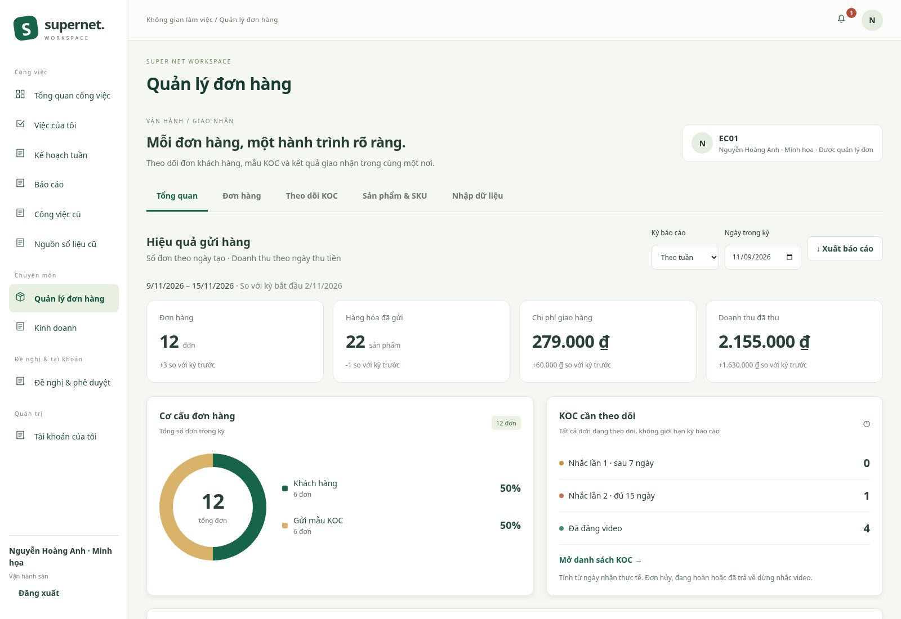
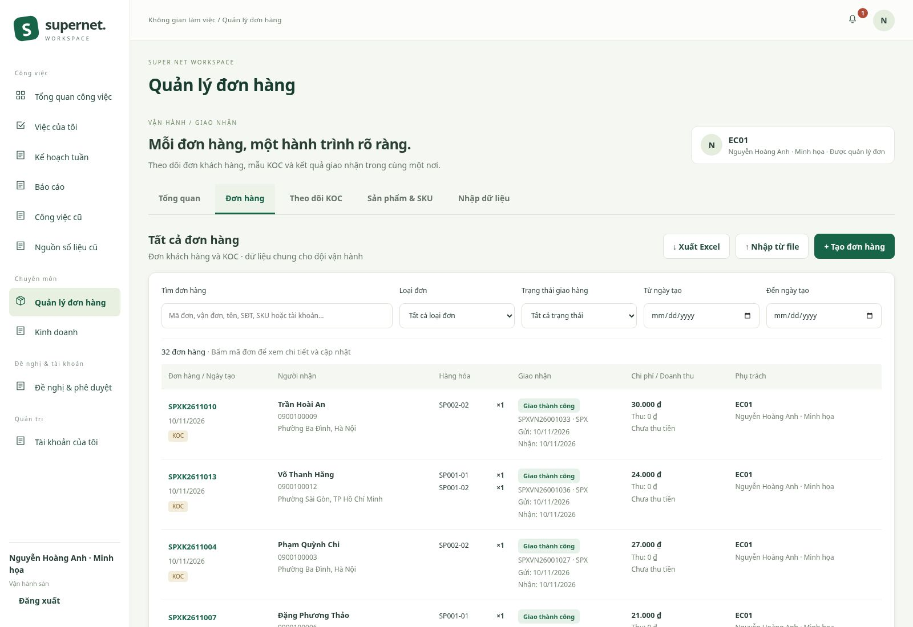
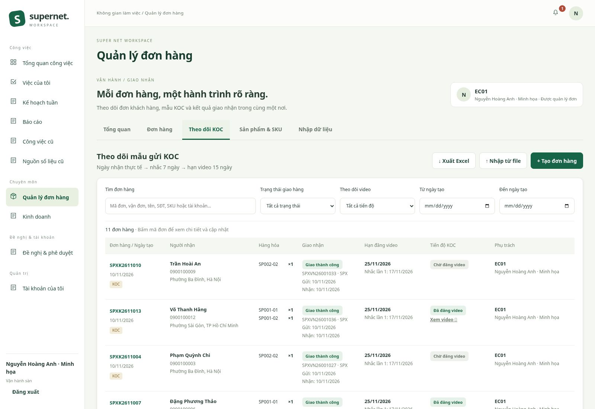
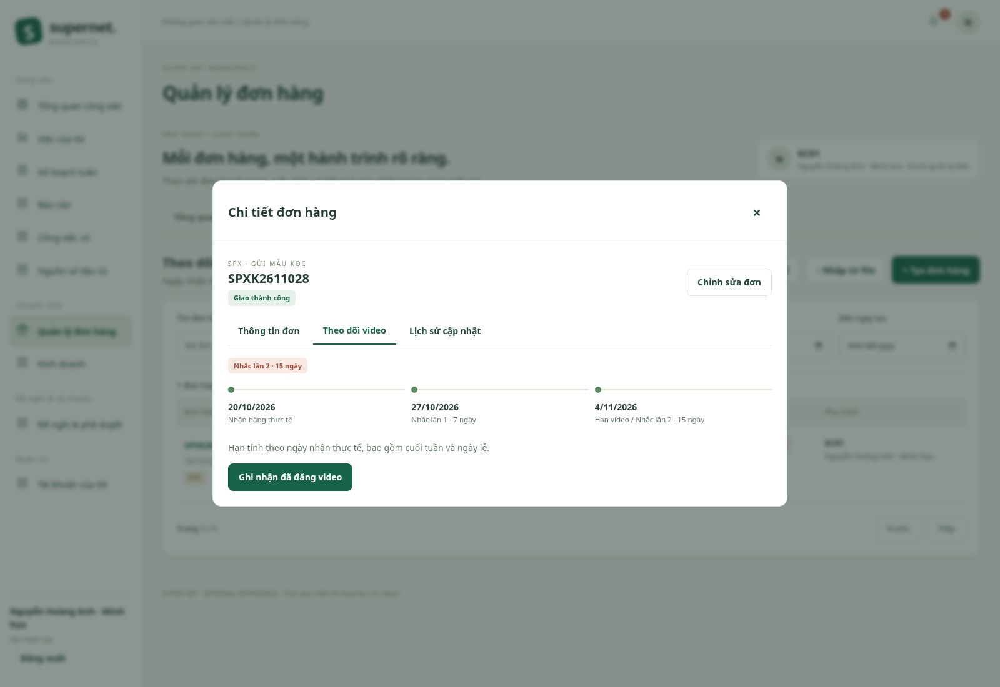
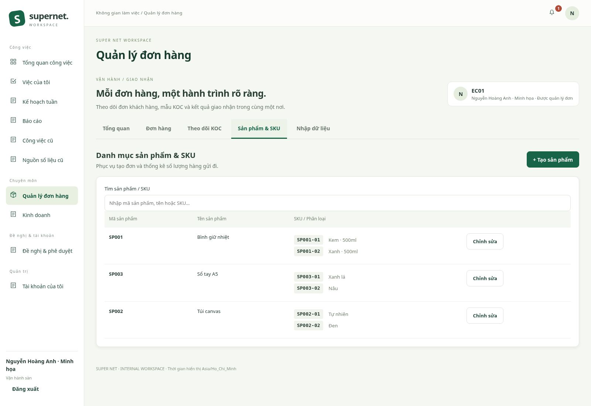
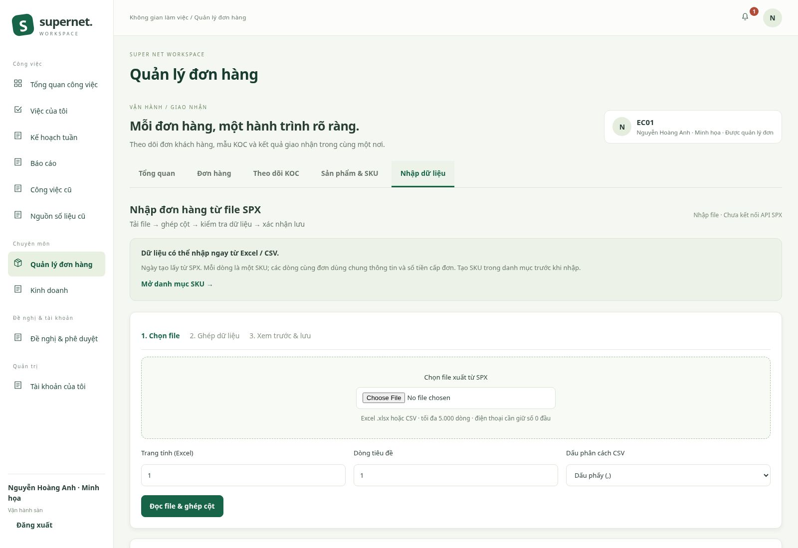
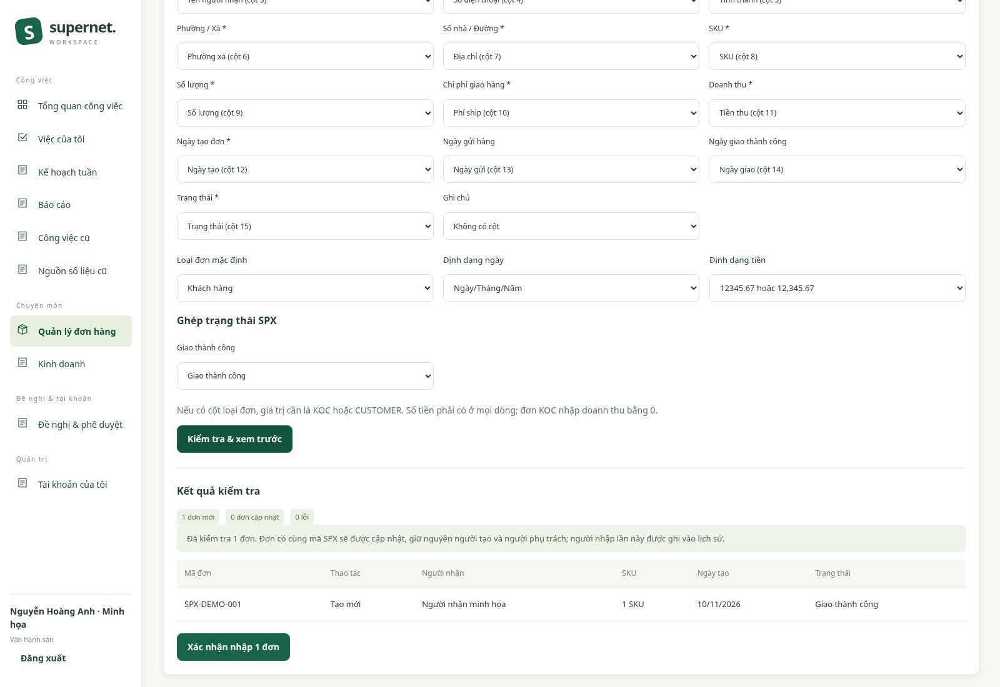
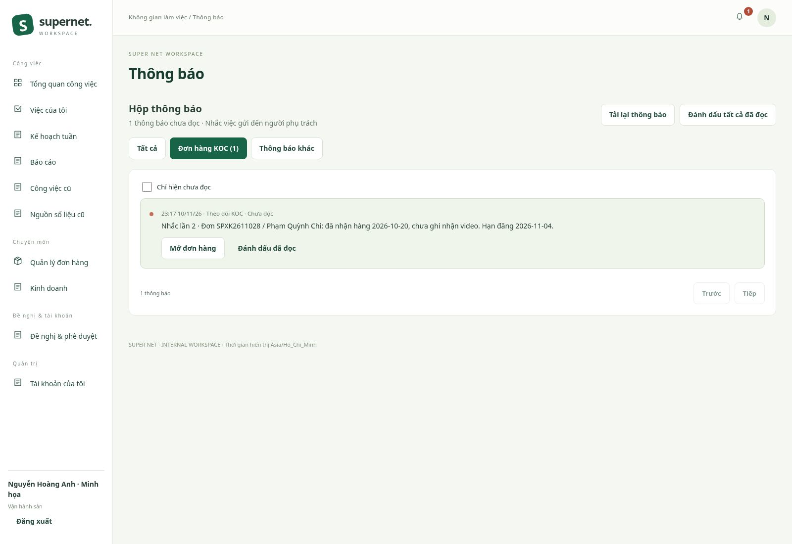
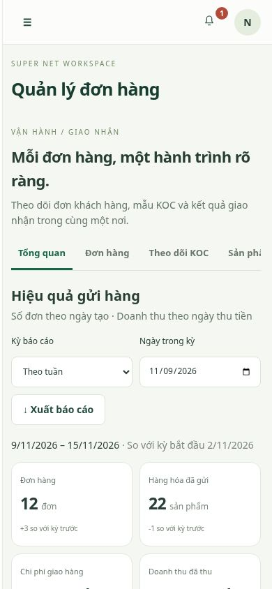

# Thiết kế Quản lý đơn hàng

Bản triển khai để duyệt giao diện và luồng thao tác. Các ảnh dưới dùng dữ liệu minh họa trong DB riêng, không phải dữ liệu SPX thật.

## Các tab

| Tab | Nội dung |
| --- | --- |
| Tổng quan | Kỳ tuần/tháng, so sánh kỳ trước, tổng đơn/chi phí/doanh thu, biểu đồ tỷ trọng khách hàng/KOC, số lượng theo SKU |
| Đơn hàng | Tìm theo mã đơn/vận đơn/tên/SĐT/SKU/tài khoản; lọc ngày tạo, loại đơn, trạng thái; tạo, sửa, xem lịch sử và xuất Excel |
| Theo dõi KOC | Ngày nhận thực tế, nhắc ngày 7, hạn/nhắc ngày 15, lọc tiến độ video, ghi nhận link và ngày đăng |
| Sản phẩm & SKU | Mã/tên sản phẩm, nhiều SKU và tên phân loại; không có tồn kho, giá vốn hoặc điều chỉnh kho |
| Nhập dữ liệu | Excel/CSV, chọn trang tính/dòng tiêu đề, ghép cột và trạng thái, xem lỗi theo dòng, xác nhận nhập, lịch sử người tải |

Hộp thông báo có các tab **Tất cả / Đơn hàng KOC / Thông báo khác**, bộ lọc chưa đọc, đánh dấu đã đọc/tất cả đã đọc và mở đúng đơn hàng. Chuông hiển thị số chưa đọc và cập nhật sau thao tác hoặc mỗi 30 giây.

## Quy tắc đã áp dụng

- MARKETPLACE quản lý tất cả đơn; ADMIN được quản lý toàn bộ; BOSS chỉ xem và xuất dữ liệu. CONTENT/HR không được truy cập nếu không có thêm quyền phù hợp. Kiểm tra quyền ở cả giao diện và API.
- Người phụ trách đơn mới là tài khoản đang đăng nhập, liên kết hồ sơ HR bằng user ID và hiển thị mã nhân sự. Người tạo, người nhập file và các lần cập nhật được lưu riêng; nhập lại không đổi người phụ trách/người tạo cũ.
- Một đơn có nhiều SKU, mỗi SKU có số lượng riêng. SKU phải có trong danh mục trước khi nhập đơn. SKU đã lưu được giữ để bảo toàn liên kết với đơn cũ.
- Ngày tạo đơn nhập từ SPX được dùng để đếm đơn theo kỳ. Ngày tải file được lưu riêng. Tuần từ thứ Hai đến hết Chủ nhật; tháng theo tháng dương lịch, giờ Việt Nam.
- Chi phí giao hàng là khoản người gửi trả. Doanh thu là khoản người nhận trả; chỉ đơn khách hàng giao thành công mới ghi doanh thu, theo ngày giao/thu tiền thực tế. Không cộng tiền đơn nhiều lần khi có nhiều SKU.
- Đơn KOC giao thành công bắt đầu theo dõi video; hoàn thành khi có link HTTP(S) và ngày đăng hợp lệ. Nhắc lần 1 sau 7 ngày, lần 2 sau tổng cộng 15 ngày, tính mọi ngày từ ngày nhận thực tế. Ví dụ nhận 01/11 thì mốc nhắc là 08/11 và 16/11, dù cập nhật trạng thái muộn.
- Đơn hủy, đang hoàn hoặc đã trả về dừng theo dõi; thông báo cũ được đánh dấu đã đọc, thông báo đang chờ được hủy. Không có nhắc giao hàng sau 5 ngày.
- Số lượng hàng đã gửi dựa trên đơn có ngày gửi hoặc trạng thái đã được lấy hàng trở đi, lọc theo ngày tạo và không gồm đơn hủy. Đơn hoàn/trả vẫn phản ánh số hàng đã gửi; không dùng con số này làm tồn kho.
- Các trạng thái chuẩn hóa hiện có: đã tạo, đã lấy hàng, đang vận chuyển, đang giao, giao thất bại, giao thành công, đang hoàn, đã trả về, đã hủy. File nguồn được ghép trạng thái một cách tường minh.

## Nhập file và SPX

**Chưa kết nối API SPX.** Đã có luồng nhập file tổng quát; cần đối chiếu file xuất và danh sách trạng thái thực tế từ tài khoản SPX của người dùng trước khi dùng với dữ liệu thật.

Một dòng biểu diễn một SKU. Các dòng cùng mã đơn phải có cùng thông tin người nhận, ngày, trạng thái và số tiền cấp đơn. Mã đơn + đơn vị vận chuyển xác định đơn cần cập nhật. File trùng không tạo thêm đơn trùng. Mã vận đơn không được thuộc nhiều đơn. Thiếu SKU, thiếu ngày giao khi giao thành công, trạng thái chưa ghép, số tiền/số lượng không hợp lệ đều chặn nhập.

Định dạng ngày: ngày/tháng/năm hoặc năm-tháng-ngày; ngày Excel được đọc từ ô ngày. Định dạng tiền được chọn riêng, hỗ trợ `12.345,67` hoặc `12,345.67`. Điện thoại cần giữ dạng text để bảo toàn số 0 đầu. Giới hạn 5.000 dòng và 80 cột mỗi file; một đơn tối đa 100 SKU. Bản nhập có lỗi không được lưu một phần. Đơn thay đổi sau khi xem trước sẽ yêu cầu kiểm tra lại; cập nhật có kiểm tra phiên bản.

Để đồng bộ tự động sau này, cần URL tài khoản và tài liệu/quyền API chính thức hoặc webhook từ SPX; cấu hình khóa ở môi trường riêng, không đưa vào chat hoặc Git.

## Chạy thử và nâng cấp

Thêm migration **012.sql**, không sửa migration cũ, không thay đổi dữ liệu hay role lịch sử. Sao lưu theo quy trình README trước khi nâng cấp hệ thống thật.

```sh
npm ci
npm run build
npm run migrate
npm start
# Terminal thứ hai, cùng cấu hình:
npm run worker
```

Worker tạo thông báo KOC; trình duyệt cập nhật số chưa đọc. Chỉ mở giao diện mà không chạy worker sẽ không tạo nhắc tự động. Bộ dữ liệu minh họa và mật khẩu chạy thử không nằm trong mã nguồn.

Kiểm chứng: build/typecheck; 99 kiểm thử API/DB; Playwright trên desktop và mobile, gồm tạo sản phẩm nhiều SKU, tạo đơn, xuất file, ghi nhận video, BOSS chỉ xem và mở đơn từ thông báo. Xem kết quả kiểm thử cụ thể trong mô tả PR.

## Ảnh giao diện

### Tổng quan



### Danh sách đơn hàng



### Theo dõi KOC



### Hạn và ghi nhận video



### Sản phẩm và SKU



### Nhập dữ liệu





### Hộp thông báo



### Điện thoại


