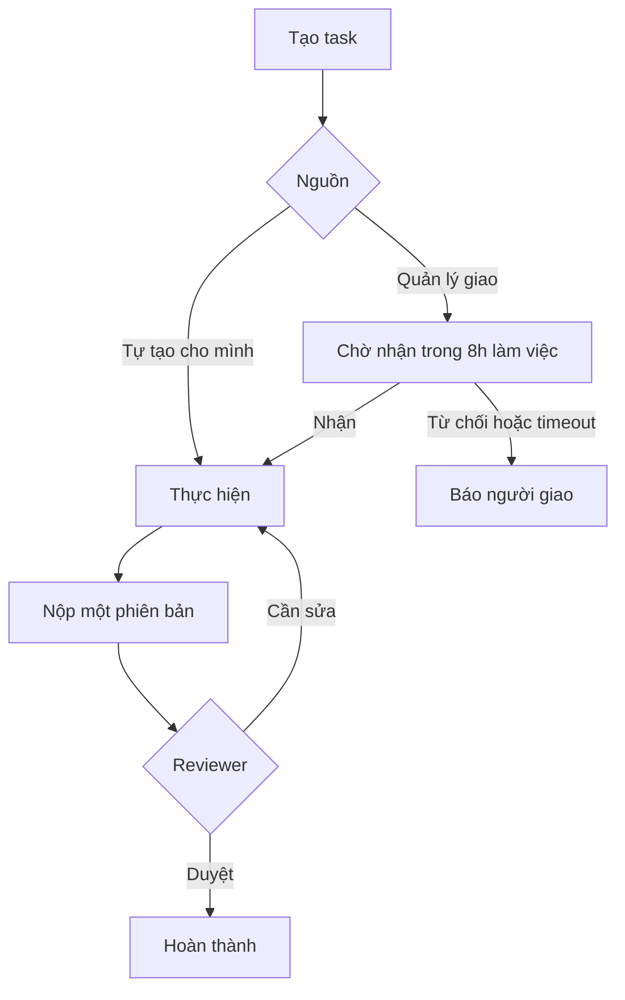
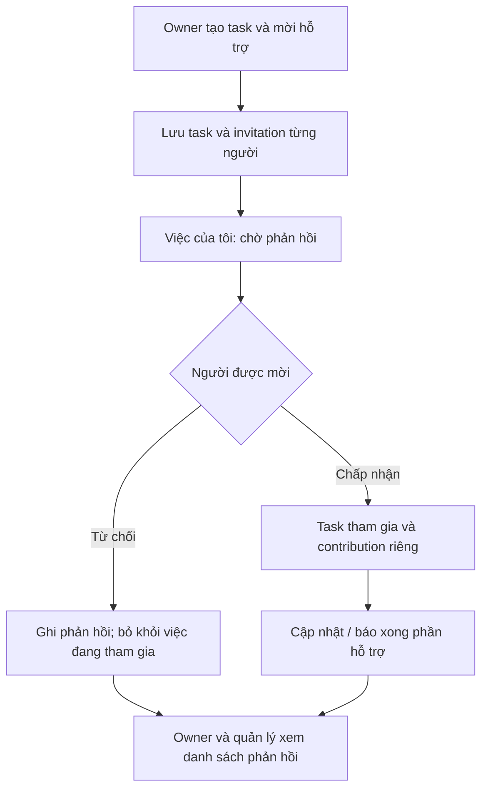
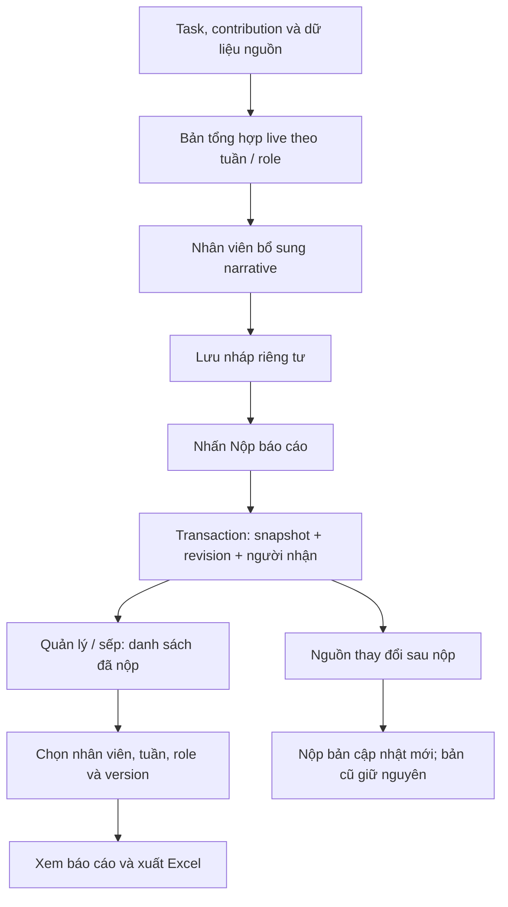
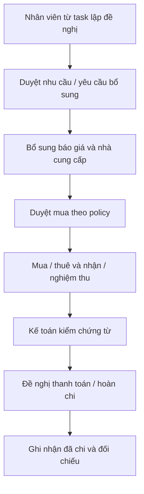
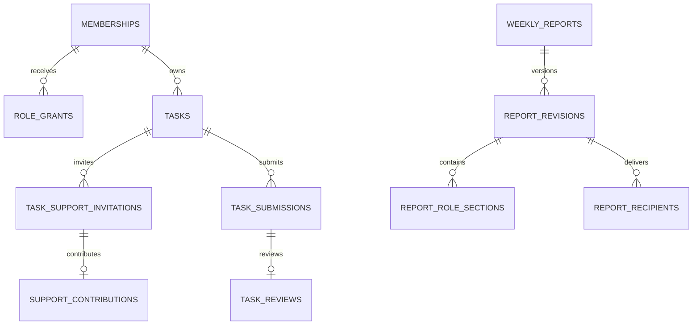
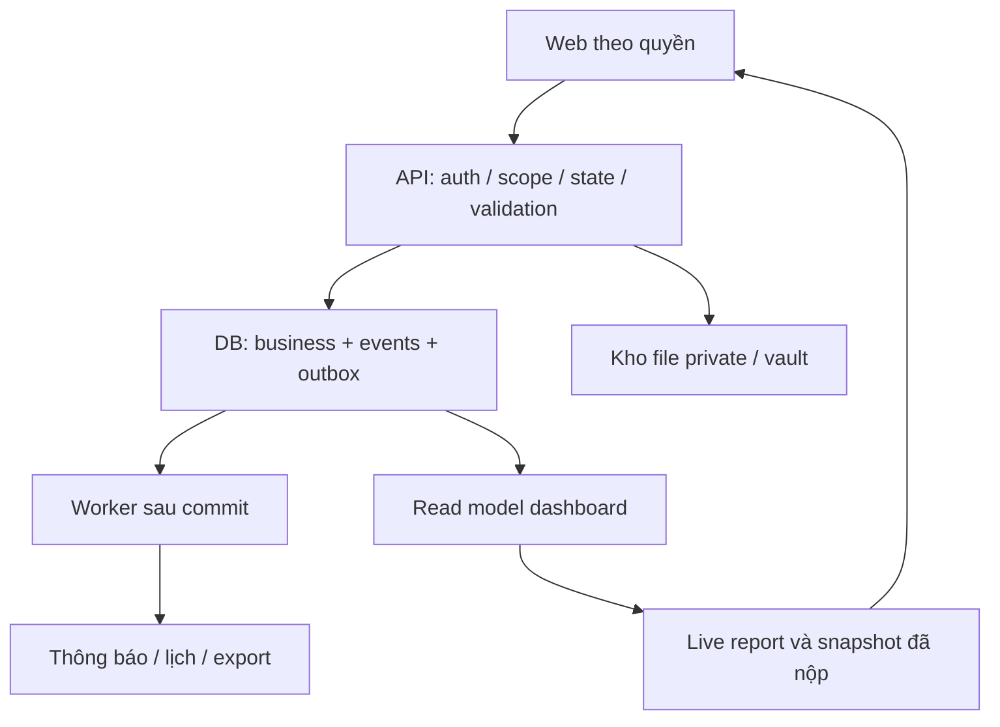

# 內部管理網站規格 — Đặc tả triển khai web nội bộ Super Net

Phiên bản 2.0 · 06/11/2026. Đọc cùng gói ZIP có SQL/catalog/từ điển database/config/test/source demo. Đây là đặc tả thiết kế, không phải backend đã chạy.

# Super Net — Bộ bàn giao triển khai web nội bộ
**Phiên bản 2.0 · 06/11/2026 · Ngôn ngữ nghiệp vụ: tiếng Việt**

Mục tiêu: Codex có đủ cơ sở để xây một hệ thống dùng chung có đăng nhập, phân quyền server, dữ liệu bền vững, luồng làm việc và báo cáo thật. Bộ này là **đặc tả + thiết kế database dự thảo + cấu hình mẫu + tiêu chí test + source frontend tham khảo**, không phải backend đã hoàn thành.

## Bắt đầu ở đâu
1. Đọc `docs/01_YEU_CAU_VA_QUYET_DINH.md` để biết đâu là yêu cầu đã chốt, đâu là đề xuất kỹ thuật.
2. Đọc `docs/02_ROLE_VA_QUYEN.md`, `03_LUONG_TASK_VA_NHOM.md`, `04_BAO_CAO_VA_DU_LIEU.md`.
3. Xem `docs/06_GIAO_DIEN_TUNG_TAB.md` và chạy source trong `demo/` để giữ phong cách giao diện.
4. Đọc `docs/07_DATABASE_VA_LUU_TRU.md`, `database/DICTIONARY.md`, `database/schema.sql` và `docs/08_API_VA_XU_LY_HE_THONG.md`.
5. Triển khai theo `docs/09_TRIEN_KHAI_VA_NGHIEM_THU.md`; đối chiếu `tests/acceptance.csv`.
6. Những chính sách chưa chốt nằm ở `docs/10_CAN_BO_SUNG.md`. Chỉ chặn phần phụ thuộc; vẫn triển khai lõi đã đủ thông tin.
7. Dùng `CODEX_START_HERE.md` làm lời giao việc cho Codex.

## Thứ tự ưu tiên khi có mâu thuẫn
Yêu cầu trực tiếp mới nhất của người dùng > quyết định đã xác nhận trong bộ này > đề xuất kỹ thuật có nhãn > source demo > tài liệu cũ. **Demo không phải chính sách chính thức**. Mốc ngày demo cố định, dữ liệu mẫu và localStorage tuyệt đối không đưa sang production như dữ liệu thật.

## Nội dung gói
| Thư mục | Công dụng |
|---|---|
| docs/ | Yêu cầu, quyền, task, reports, nghiệp vụ theo role, UI, database, API, triển khai, câu hỏi mở |
| database/ | DDL PostgreSQL dự thảo, catalog JSON có kiểu dữ liệu/FK/constraint, từ điển dữ liệu |
| config/ | Mẫu form động, lịch làm việc, ma trận quyền, danh mục task theo role; đều có nhãn seed/proposal |
| tests/ | Kịch bản nghiệm thu và fixture giả |
| demo/ | Bản HTML/CSS/JS của giao diện đã xem; không có backend, không có auth thật |
| reference/ | Cơ sở đối chiếu nguồn và danh sách phần demo còn mô phỏng |
| index.html | Trang hướng dẫn đọc gói, mở nhanh từng tài liệu và demo |
| MANIFEST_SHA256.json | Hash từng tệp để kiểm tra tính toàn vẹn |

## Chạy demo
Từ thư mục gốc gói chạy `python3 -m http.server 8080`, mở `http://localhost:8080/demo/`. Nếu máy dùng lệnh `python`, thay `python3` bằng `python`. Các thao tác chỉ tác động dữ liệu mẫu của trình duyệt đó. Chọn chế độ Nhân viên Content/Designer/Quản lý/Boss để thử task nhóm và báo cáo tuần. Không tải hồ sơ thật hoặc nhập mật khẩu thật vào demo. Font Google có fallback hệ thống khi không có mạng.

## Website hiện có
https://supernet-workspace-review.iron-foresttw.chatgpt.site
Bản hiện có là frontend riêng tư để duyệt trải nghiệm, không phải hệ thống đang vận hành cho nhân viên thật.

## Giới hạn của bộ bàn giao
- SQL là thiết kế ứng viên, chưa chạy trên PostgreSQL thật; không gọi là migration production đã kiểm thử.
- Chưa có file quảng cáo TikTok đầy đủ để chốt mapping; screenshot kết quả kinh doanh chỉ đủ xác định các cột nhìn thấy.
- Không có mật khẩu, CCCD, số dư hay hồ sơ lương thật trong fixture.
- Không có định mức, điểm số, ngân sách duyệt, quyền cấp role tạm hoặc quy tắc tự phát hành hóa đơn được tự đặt.

---

# Lệnh bàn giao cho Codex
Bạn triển khai web quản lý nội bộ Super Net theo bộ tài liệu này. Không thay bằng một dashboard minh họa. Không bỏ các ràng buộc server chỉ vì đã ẩn nút ở frontend.

1. Kiểm tra repo, AGENTS.md, stack, cách deploy và dữ liệu đang tồn tại. Lập danh sách phần đã có/phần thiếu trước khi sửa. Nếu dự án mới, dùng kiến trúc module trong một ứng dụng, frontend TypeScript, API, PostgreSQL, kho file và worker; chọn phiên bản tương thích thực tế khi triển khai.
2. Yêu cầu đã chốt có mã R. Đề xuất có mã P và chính sách thiếu có mã Q. Không biến P thành quyết định của chủ hệ thống; có thể thực hiện thiết kế kỹ thuật được nêu, nhưng mọi chính sách Q có tác động nghiệp vụ phải giữ trạng thái chưa cấu hình. Không dừng toàn dự án vì một module còn Q.
3. Giữ UI nền sáng, xanh Super Net, sidebar theo quyền, form task ngắn, detail theo loại/phase, report trên và task chi tiết dưới. Đọc `06_GIAO_DIEN_TUNG_TAB.md`, tái sử dụng ngôn ngữ trực quan của demo nhưng thay mock/localStorage bằng API thật.
4. Đầu tiên hoàn thành: đăng nhập → Admin gán role/phạm vi/hạn → quản lý giao task → người nhận phản hồi → cập nhật/nộp → quản lý duyệt → nhân viên bổ sung/nộp báo cáo tuần → sếp chọn nhân viên/tuần và xuất XLSX. Sau đó task hỗ trợ nhiều người và thu hồi role, rồi nghiệp vụ chuyên môn/import.
5. Task nhóm chỉ có một task ID; lời mời và contribution theo từng người. Không copy task cho mỗi người hỗ trợ. Chấp nhận/từ chối chỉ thay lời mời đó, không thay trạng thái task chung. Hết role cắt quyền ở API/file/export.
6. Task_type và template_version quyết định trường chuyên môn; fields chưa cần lúc tạo không được required. Chỉ OTHER, tên, người và deadline đủ để giao. Mô tả/tài liệu là tùy chọn; người tự tạo được tự điền chủ việc.
7. Báo cáo là dữ liệu tự tổng hợp + narrative bổ sung; nộp tạo snapshot/version nguyên tử, giữ người nhận và nguồn. Sếp xem bản đã nộp, không nhìn draft của nhân viên. Đúng hạn theo lần nộp được duyệt và deadline cuối áp dụng; không lấy giờ duyệt làm giờ nộp.
8. Dùng DDL/catalog như đầu vào thiết kế migration, không chạy mù. Bổ sung kiểm tra same-workspace, state machine, quyền và ràng buộc chéo bảng; viết migration, seed giả và tests. Không có chính sách tự duyệt, auto-complete hay gia hạn tự động nào mặc định.
9. Mọi mutation kiểm tra auth + role còn hiệu lực + scope + state + expected_version + idempotency. Transaction ghi business data/event/outbox rồi mới gửi notification. Dữ liệu report/export/file phải cùng scope.
10. Xác nhận từng Q theo module; ghi vào decision log có người chốt và ngày chốt. Nếu chưa có mẫu file nguồn, làm upload/preview/mapping/manual input trước; tuyệt đối không tạo số doanh thu/ads giả rồi ghi là thật.
11. Cung cấp README chạy, env.example không có secrets, migrations, seed/test, build/deploy instructions, runbook backup/restore và danh sách tích hợp chưa hoàn tất. Tắt account không xóa lịch sử. Không ghi secret plaintext trong DB/log/export.
12. Báo cáo tiến độ bằng chức năng chạy được + test + phần còn thiếu. Đối chiếu tests/acceptance.csv, không chỉ chụp màn hình đẹp rồi báo đã xong.

# 01 — Phạm vi và các quyết định có hiệu lực
## 1. Nhãn bắt buộc
- **R / Đã xác nhận:** người dùng nêu rõ. Phải triển khai; không đổi theo suy đoán của Codex.
- **P / Đề xuất thiết kế:** phương án để thực hiện yêu cầu, không phải phát biểu của người dùng. Được dùng làm thiết kế kỹ thuật; chính sách nghiệp vụ chưa chốt phải cấu hình hoặc hỏi.
- **Q / Cần bổ sung:** thiếu thông tin có ảnh hưởng. Không tự đặt giá trị, không chặn phần độc lập đã đủ dữ liệu.
- **DEMO:** minh họa UX, không phải dữ liệu hoặc quyền thật.

## 2. Sổ yêu cầu hợp nhất
| ID | Yêu cầu đã xác nhận | Hành vi bắt buộc |
|---|---|---|
| R01 | Web nội bộ quản lý công việc và kết quả nhân viên | Một người có nhiều task, xem tiến độ và drilldown từng task |
| R02 | Nhiều role cho một tài khoản | Admin cấp vai trò, phạm vi và thời hạn; không nhân bản user |
| R03 | Role hết hạn tắt hoàn toàn quyền vị trí đó | Nhân viên không đọc dữ liệu của role cũ; lịch sử còn cho quản lý có quyền |
| R04 | Nhân viên không xem dữ liệu của nhau | Ngoại lệ giới hạn task chung được mời theo R35–R39; không mở hồ sơ/role khác |
| R05 | Chỉ hiện chức năng có quyền xem | Menu, tab con, nút, API, URL trực tiếp, file và export đều theo quyền |
| R06 | Người quản lý giao việc nhanh | Tên nhiệm vụ, người làm, deadline; mô tả và tài liệu hỗ trợ; trường nâng cao thu gọn |
| R07 | Nhân viên thêm việc phát sinh ngoài việc chính | Tự điền người tạo/chủ việc/nguồn/ngày giờ; nhân viên nhập nhiệm vụ và hạn |
| R08 | Mỗi loại task có dữ liệu riêng | Nghiên cứu không bắt trường quay; dựng/video hoàn thiện có file/link; đo hiệu quả có số liệu nguồn |
| R09 | Không bắt quản lý nhập hết ngay khi tạo | Trường chuyên môn bổ sung ở thực hiện/nộp/đo; validation theo hành động |
| R10 | Người được giao phản hồi nhận hoặc từ chối | Lưu phản hồi và thông báo lại người giao |
| R11 | Hạn phản hồi 8 giờ làm việc từ khi giao | Thay hoàn toàn quy tắc 12h cũ; không đếm từ lúc mở thông báo |
| R12 | Làm T2–T7, 09–12 và 13–18 | Bỏ trưa, ngoài giờ và Chủ nhật. Ngày lễ/ngoại lệ cần Q01 |
| R13 | Hết hạn không phản hồi mặc định từ chối | Lưu TIMEOUT, báo người giao, không tự giao người khác |
| R14 | Nhân viên cập nhật tiến độ, khó khăn và hỗ trợ cần thiết | Có bước tiếp theo, người cần hỗ trợ, lịch sử |
| R15 | Nộp trước/đúng deadline được đánh giá theo giờ nộp | Tách submitted_at và approved_at; phút/giờ theo server |
| R16 | Quản lý duyệt hoặc yêu cầu chỉnh sửa | Duyệt đúng revision; giữ các lần nộp/sửa/đổi deadline |
| R17 | Deadline mới dùng để đánh giá cuối | Khi hoàn thành và hết sửa, dùng lần nộp được duyệt và hạn cuối áp dụng; giữ hạn gốc |
| R18 | Báo cáo tuần tự tổng hợp | Không bắt nhân viên viết lại task hoặc cộng số bằng tay |
| R19 | Đếm task phát sinh trong tuần | Hiện tổng, đã làm, hoàn thành, đúng hạn, trễ hạn, chưa xong; hủy/từ chối riêng |
| R20 | Báo cáo riêng theo nhân viên và role | Một người đa role có các khối báo cáo chuyên môn; task hỗ trợ tách riêng |
| R21 | Báo cáo ở trên, việc cụ thể ở dưới | Có Đã xong/Chưa xong; bấm truy vết nguồn/task |
| R22 | Nhân viên bổ sung nội dung rồi nhấn nộp | Draft riêng tư; nộp cho quản lý và sếp xem |
| R23 | Sếp chọn báo cáo tuần của từng nhân viên | Chọn tuần/người/role/phiên bản; danh sách Đã nộp/Chưa nộp |
| R24 | Xuất file Excel | Theo quyền và bộ lọc, có tổng hợp/narrative/chi tiết |
| R25 | So sánh tuần/tháng trước | Ghi rõ khoảng ngày, nguồn và tính đầy đủ; kỳ tương đương xem P06/Q06 |
| R26 | Dữ liệu nhập tay hoặc file xuất nền tảng | TikTok/Shopee có định dạng khác nhau; có mapping/version/preview |
| R27 | GMV và chi phí quảng cáo lấy từ file | Không dùng task count suy ra doanh thu, không tự đo analytics chỉ bằng URL |
| R28 | Bồi hoàn tính từ nhân viên nhập | Ghi người nhập/ngày/ID đơn/SKU/số tiền; nhân viên chịu trách nhiệm dữ liệu |
| R29 | BigSeller là nguồn tồn kho | Web không xây sổ tồn song song làm nguồn cạnh tranh trong phạm vi hiện tại |
| R30 | HR hồ sơ ứng viên → nhân viên và lịch sử | Người tuyển, thử việc/chính thức, ngày hợp đồng/sinh nhật; lương/CCCD có quyền riêng |
| R31 | Bắt đầu thử việc tạo thông báo thưởng tuyển dụng | Chỉ thông báo HR; số thưởng do HR nhập vào bảng lương |
| R32 | Sinh nhật báo HR trước 5 ngày làm việc | Nhân viên đang thử việc/chính thức; không tự áp dụng ứng viên chưa nhận việc |
| R33 | Nhân viên tự đổi mật khẩu nền tảng, web lưu bản cập nhật | Không tự đổi ở TikTok/Shopee; giữ hiện tại và lịch sử người sửa/thời gian/giá trị trước sau, Admin xem lịch sử |
| R34 | Đề xuất mua dụng cụ, mua hàng, hóa đơn, quản lý/sếp phê duyệt | Phân biệt đề nghị mua, duyệt nhu cầu, mua thật, chứng từ và yêu cầu xuất hóa đơn; policy chi tiết cần Q |
| R35 | Một task có nhiều người hỗ trợ | Một task ID, một người phụ trách chính, nhiều invitation/contribution |
| R36 | Một nhân viên tạo task, task xuất hiện cho người hỗ trợ | Không buộc mỗi người tạo lại task; vào Việc của tôi với lời mời |
| R37 | Người hỗ trợ chấp nhận hoặc từ chối | Phản hồi độc lập từng người; từ chối không làm task chung từ chối |
| R38 | Theo dõi trạng thái tham gia của từng thành viên | Chờ phản hồi/đã nhận/từ chối; phản hồi và thời điểm lưu lại |
| R39 | Người hỗ trợ cập nhật phần hỗ trợ riêng (thiết kế đã có ở demo) | Không thay owner, deadline hoặc tự duyệt kết quả chung |
| R40 | Giao diện dễ dùng, đẹp như demo | Nền sáng/xanh đậm, form ngắn, sidebar theo role, list/board, responsive |
| R41 | Đóng gói rõ để Codex không đoán | Database, luồng, quyền, API, UI, test, các Q và giới hạn demo được bàn giao |

**Lưu ý R39:** mã này truy vết tính năng bổ trợ đã làm trong demo (P13), không phải một quyết định nghiệp vụ được người dùng xác nhận riêng. Chỉ yêu cầu chấp nhận/từ chối hỗ trợ là phát biểu trực tiếp mới nhất.

## 3. Đề xuất thực hiện có nhãn
| ID | Đề xuất kỹ thuật / chính sách chưa phải quyết định người dùng |
|---|---|
| P01 | Kiến trúc module trong một app, PostgreSQL quan hệ, kho file, worker/outbox; không microservices sớm |
| P02 | Task có một role chính để tính báo cáo, các role liên quan qua link; hỗ trợ có role riêng |
| P03 | Tự tạo task cho mình thì tự nhận (không chờ tự đồng ý); lưu sự kiện SELF_CREATED |
| P04 | Bản báo cáo đã nộp immutable; chỉnh sau nộp thành revision, người nhận giữ snapshot |
| P05 | Tuần báo cáo T2 00:00 tới T2 kế tiếp 00:00 theo Asia/Ho_Chi_Minh; cần chốt Q05 |
| P06 | So kỳ đang chạy với cùng số ngày đã đủ dữ liệu của kỳ trước; cho chọn cả kỳ nếu gắn nhãn |
| P07 | Phản hồi hỗ trợ chưa mặc định timeout 8h cho tới khi chốt Q10; hạn assignment chính vẫn 8h |
| P08 | Từ chối hỗ trợ bắt buộc chọn phản hồi nhưng ghi chú là tùy chọn như demo; Q11 nếu cần bắt lý do |
| P09 | Reviewer mặc định quản lý trực tiếp; thiếu cấu hình thì lưu nháp/báo thiếu, không tự duyệt |
| P10 | Tách kết quả công việc, hiệu quả kinh doanh, đánh giá thái độ; chưa có thang điểm thì không chấm |
| P11 | Chưa tự đánh giá thái độ bằng số lần online, gõ phím hoặc thời gian đăng nhập |
| P13 | Contribution riêng của từng supporter và báo xong phần hỗ trợ; đã mô phỏng, cần xác nhận điều kiện nghiệm thu nếu muốn bắt buộc |
| P12 | Multi-company có company_id cho tài chính/shop/tài khoản; không gộp pháp nhân, cần Q22 xác nhận phạm vi |

## 4. Những nội dung cũ đã bị thay thế
- 12h → 8 giờ làm việc. Ví dụ thứ Bảy 17h → thứ Hai 12h không còn đúng; với lịch đã chốt là thứ Hai 17h.
- Sau hết role vẫn cho nhân viên xem → không còn được xem role đó; quản lý có quyền giữ lịch sử.
- Thưởng khi lên chính thức → chỉ thông báo HR từ lúc bắt đầu thử việc; tiền do HR quyết định trong bảng lương.
- Nộp/duyệt cùng mốc → tách giờ nộp và giờ duyệt.
- Báo cáo chỉ là bảng live → thêm draft bổ sung, nộp, snapshot và người nhận.
- Nhân viên A tuyệt đối không có task B → ngoại lệ task được mời hỗ trợ, chỉ scope task chung.
- “Hai file TikTok không có dữ liệu” không được dùng như kết luận về hệ thống xuất TikTok: người dùng đã cung cấp screenshot bảng kinh doanh có số liệu; mapping chi tiết dựa screenshot/bytes file cần phân biệt.

## 5. Giới hạn phạm vi
Không tự làm ERP/sổ kế toán đầy đủ, sổ tồn thay BigSeller, phát hành hóa đơn điện tử thật, thanh toán ngân hàng, gửi email bên ngoài, đồng bộ mật khẩu nền tảng hoặc chấm điểm nhân viên khi chưa có chính sách/tích hợp được chốt. Các extension vẫn được thiết kế điểm nối; không giả vờ đã kết nối.

---

# 02 — Vai trò, phạm vi và quyền
## 1. Mô hình
User là tài khoản đăng nhập; membership là tư cách thành viên tổ chức; job_role là chuyên môn; access_role là tập quyền. Một người có nhiều role đồng thời, mỗi grant có valid_from, valid_to (nullable nếu được phép không hạn), revoked_at, granted_by, reason và scope.

Quyền hiệu lực = tài khoản đang hoạt động + membership hoạt động + ít nhất một grant cho đúng hành động/đối tượng/phạm vi còn hiệu lực + mọi ràng buộc nghiệp vụ đều đạt. Không lấy chữ “Admin” từ dữ liệu client để tin. Server trả `capabilities` để frontend dựng menu/nút.

Thời hạn theo khoảng nửa mở `[valid_from, valid_to)`: đúng thời điểm valid_to là hết quyền. Đây là quy ước kỹ thuật P; UI hiển thị rõ “Hết hiệu lực lúc…”. Không biến ngày hết hạn thành 00:00 vô ý; nếu admin chọn hết ngày thì server chuyển sang 00:00 ngày kế tiếp ở múi giờ VN.

## 2. Ma trận chức năng tối thiểu
Ký hiệu: Tự = chỉ mình; Nhóm = danh sách được quản lý; Được cấp = grant cụ thể; Toàn = trong workspace được cấp. Đây là thiết kế quyền nền để thực hiện R; các quyền tài chính nhạy cảm còn Q.

| Chức năng | Nhân viên / TTS | Quản lý | Boss | Admin |
|---|---|---|---|---|
| Tổng quan | Tự và task chung | Nhóm | Toàn theo scope | Toàn |
| Việc của tôi | Tự + lời mời/hỗ trợ có role hiệu lực | Tự + hỗ trợ | Tự + hỗ trợ | Tự + hỗ trợ |
| Giao task cho người khác | Không; được mời hỗ trợ | Nhóm | Trong scope | Toàn |
| Tạo phát sinh | Tự | Tự/nhóm | Trong scope | Toàn |
| Công việc nhóm | Không hiện trang quản trị nhóm | Nhóm | Trong scope | Toàn |
| Sửa tiến độ task chính | Owner | Không giả làm owner | Không giả làm owner | Override có audit nếu được bật |
| Nhận/từ chối hỗ trợ | Chính người được mời | Như nhân viên | Như nhân viên | Không nhận thay người khác |
| Cập nhật contribution | Chính người đã nhận | Xem nhóm | Xem scope | Xem; sửa quản trị có audit |
| Duyệt task | Không tự duyệt | Reviewer trong nhóm | Reviewer được cấp | Quyền cao nhất; quyết định gắn actor |
| Nháp báo cáo bổ sung | Chính nhân viên | Không xem nháp của cấp dưới | Không xem nháp của nhân viên | Truy cập hỗ trợ đặc biệt cần policy; không hiện mặc định |
| Bản báo cáo đã nộp | Của mình, lọc role còn hiệu lực | Nhóm/người nhận | Nhân viên trong scope/người nhận | Toàn theo quyền |
| Xuất Excel | Dữ liệu của mình trong quyền | Báo cáo đã nộp thuộc nhóm | Báo cáo đã nộp thuộc scope | Theo quyền |
| Hồ sơ HR | Chỉ thông tin cá nhân được phép | Không mặc định lương/CCCD | Quyền HR/nhạy cảm được cấp | Toàn có audit |
| Cấp role | Không | Chỉ quyền được ủy quyền, không vượt scope | Không tự mặc định từ Boss | Tạo/thu hồi/cấu hình |
| Tài khoản nền tảng | Tài khoản và role được cấp | Không tự được xem toàn bộ | Không tự được xem mọi mật khẩu | Toàn trong scope quản trị |
| Lịch sử mật khẩu nền tảng | Không | Không | Không | Có, thao tác reveal có audit |
| Phê duyệt mua/chi | Không tự duyệt | Theo policy | Theo policy | Không tự có policy duyệt chi nếu chưa cấu hình |
| Thiết lập hệ thống | Không | Chỉ phần được ủy quyền | Không mặc định quản trị | Có |

Admin có quyền quản trị cao nhất R; hạn chế tự duyệt chi và tiếp cận nháp HR là thiết kế kiểm soát P cần thống nhất Q, không được âm thầm biến thành ngoại lệ cho người khác. Override phải rõ người/lý do và không xóa audit.

## 3. Menu chuyên môn theo role
| Role / quyền | Menu/tab con có thể hiện |
|---|---|
| Content | Nội dung & sản xuất, lịch quay/lịch đăng, tài nguyên được cấp |
| Designer | Task thiết kế/brief và tài nguyên liên quan; không tự có dashboard GMV |
| Vận hành sàn | Doanh thu, KOC/video, hoàn/hủy, khiếu nại/bồi hoàn, import kinh doanh |
| ADS | Quảng cáo, hiệu quả video/campaign được cấp, import quảng cáo |
| Vận hành + ADS | Hợp các tab trên; cùng file không được ghi hai lần |
| HR | Ứng viên, phỏng vấn, nhân viên, sự kiện thử việc/sinh nhật |
| Kế toán | Chứng từ, yêu cầu hóa đơn, mua hàng/thanh toán được giao; không tự có toàn bộ hồ sơ HR |
| Kho | Yêu cầu xuất/trả mẫu, thiết bị, báo cáo xuất kho theo BigSeller |
| TTS chuyên môn | Chỉ mẫu/đầu việc được cấp và mentor; không kế thừa mọi quyền của chuyên viên |
| Booking KOC độc lập | Chỉ tạo role riêng nếu admin bật; hiện tại KOC thuộc vận hành theo tài liệu gốc |
| Tester (đề xuất từ trao đổi trước) | Issue, tái hiện lỗi, môi trường, bằng chứng, mức độ, kết quả kiểm lại; module tùy chọn |

Mua hàng/Đề nghị của tôi là quyền dùng chung theo scope, không phải mọi Content nhìn thấy quản trị mua hàng. Nhóm menu không còn mục con thì ẩn cả nhóm. Empty state chỉ dùng khi có quyền nhưng chưa có dữ liệu; không dùng trang Admin rỗng cho người không có quyền.

## 4. Task chung là ngoại lệ hẹp
- Owner/reviewer/manager có quyền đọc trong scope; supporter chỉ được task đã mời cho role còn hạn.
- PENDING: chỉ brief công việc, chủ việc, hạn, tài liệu đánh dấu được chia sẻ cho người được mời; không lộ toàn bộ file nhạy cảm trước chấp nhận.
- ACCEPTED: phần yêu cầu, tài liệu làm việc được chia sẻ, trao đổi chung và contribution; không lộ lương, đánh giá cá nhân, phí KOC/chứng từ tài chính chỉ vì task có link.
- DECLINED: bỏ khỏi danh sách task đang tham gia; giữ phản hồi ở owner/manager. Lịch sử tối thiểu lời mời của chính người đó có thể xem nếu role còn hạn (P).
- REVOKED/role expired/account disabled: không mở task bằng link cũ, tải file, xem export hay push payload cũ. Các bản đã tải xuống không thể thu hồi từ máy người dùng; web chỉ chặn truy cập tiếp theo.
- Không gửi notification chứa brief/secret nhạy cảm tới role vừa bị thu hồi; notification chỉ chứa mã/thông báo chung khi quyền thay đổi.

## 5. Hết role và dữ liệu đa role
Nếu A có Content + HR, hết HR: ẩn HR, chặn API/CCCD/ứng viên/file HR kể cả tự tạo; Content vẫn dùng bình thường. Một task HR có A tham gia không tự tái cấp HR sau khi hết hạn.

Báo cáo đã nộp cho quản lý vẫn giữ bản gốc trong quyền quản lý. Nhân viên xem lịch sử của mình chỉ nhận những khối role còn hiệu lực. Nếu narrative chung chứa nhiều role và không tách được an toàn: ẩn cả narrative đó với nhân viên khi một role trong scope narrative đã hết (giống logic demo); quản lý còn scope có thể xem. Production nên lưu narrative theo role + một phần chung có scope rõ, không trả full snapshot rồi che bằng CSS.

Thu hồi grant phải tăng permission_version, vô hiệu cache; request mới kiểm tra DB/time. WebSocket/polling không được mở đường đọc bypass. Session/identity còn hiệu lực không đồng nghĩa role còn hiệu lực.

## 6. Phân quyền dữ liệu nhạy cảm
Tách quyền HR cơ bản, HR compensation, identity document; tài chính read/verify/approve; credential current reveal/update và history reveal. File ACL kế thừa hồ sơ gốc + chia sẻ task tường minh. Upload lưu private object key, download qua API được kiểm tra và URL ký có TTL ngắn (đề xuất), không dùng public bucket.

Mật khẩu đăng nhập website: chỉ password hash/provider identity, không lưu AAA→BBB có thể đọc lại. Lịch sử yêu cầu giá trị trước/sau chỉ áp dụng **mật khẩu nền tảng dùng chung**, mã hóa từng version; cập nhật web không có nghĩa đã đổi ở nền tảng. Cần Q18 xác nhận cách đổi mật khẩu đăng nhập web, MFA và auth provider.

---

# 03 — Luồng task, checkpoint và task nhiều người
## 1. Tạo nhanh
| Trường | Lúc giao/tạo việc phát sinh | Tự điền / quy tắc |
|---|---|---|
| Tên nhiệm vụ | Bắt buộc | Text 1–255 ký tự sau trim (P kỹ thuật) |
| Người phụ trách chính | Bắt buộc | Tự điền chính nhân viên; quản lý chọn trong scope |
| Deadline | Bắt buộc | Ngày giờ VN; server lưu UTC; không dùng thời lượng dự kiến thay deadline |
| Mô tả | Tùy chọn | Yêu cầu/kết quả mong muốn/lưu ý; Enter xuống dòng |
| Tài liệu/link | Tùy chọn | Nhiều file/link, upload xong mới gắn |
| Người hỗ trợ | Tùy chọn, thu gọn | Chọn nhiều người và role hỗ trợ; không được trùng owner hoặc trùng user trong task |
| Role chính | Tự điền nếu một role | Nếu nhiều role: chọn chip, không đoán từ title |
| Loại task | OTHER mặc định | Chọn mẫu khi cần, không bắt điền kênh/series/pillar |
| Ưu tiên | NORMAL mặc định (P) | URGENT khi người tạo chọn; không phải trạng thái |
| Reviewer | Tự giải theo cấu hình | Không tự chọn người không có quyền; thiếu người duyệt hiển thị cần cấu hình |
| Campaign/content/giờ dự kiến | Nâng cao | Không bắt buộc, không gây thêm page form |

Nháp cho phép thiếu người/hạn; hành động “Giao việc” mới validate các trường bắt buộc. Task tự tạo đề xuất bắt đầu IN_PROGRESS, không phải tự gửi lời mời nhận chính mình. Role cung cấp danh mục công việc; chỉ rule/plan đã bật mới sinh việc định kỳ. Không tự tạo 20 task mỗi ngày chỉ vì có role Content.

## 2. Tách 5 loại trạng thái
1. **Task:** DRAFT → ASSIGNED → ACCEPTED → IN_PROGRESS → SUBMITTED → CHANGES_REQUESTED → IN_PROGRESS → DONE. CANCELLED là kết thúc hủy có lý do. Task bị từ chối giao hiển thị DECLINED ở UI; assignment attempt lưu lý do từ chối/timeout.
2. **Assignment attempt:** PENDING / ACCEPTED / DECLINED / TIMED_OUT / SUPERSEDED. Hết 8h là TIMED_OUT, không phải nhân viên nộp trễ.
3. **Support invitation:** PENDING / ACCEPTED / DECLINED / REVOKED. Từ chối người này không ảnh hưởng người khác.
4. **Contribution:** NOT_STARTED / IN_PROGRESS / REPORTED_DONE; “đã báo xong” là người hỗ trợ tự cập nhật, không phải task chung đã được duyệt.
5. **Suy ra:** overdue/blocked/urgent. Không cho user tự đánh dấu “đúng hạn”; không lấy URGENT làm status.

## 3. Đếm 8 giờ làm việc
- Thời điểm bắt đầu `assigned_at` do server ghi khi giao thành công trong transaction, không dựa đồng hồ client hoặc mở thông báo.
- Dùng calendar timezone Asia/Ho_Chi_Minh, T2–T7 [09:00,12:00), [13:00,18:00); cộng 480 phút trong các khoảng làm việc.
- Nếu bắt đầu ngoài giờ, chuyển tới khoảng làm việc kế tiếp. Chỉ tính giao lồng trong các khoảng; không cộng giờ nghỉ, Chủ nhật.
- Ghi `response_due_at` và `calendar_version_id` vào attempt để kiểm toán. Việc ngày lễ thay đổi sau giao có tính lại không là Q01, không âm thầm đổi.
- Nếu nhận/từ chối và worker timeout cùng lúc: lock attempt PENDING, lấy server time sau lock; yêu cầu trả lời với `now < response_due_at` mới nhận, đúng hạn tại mốc bằng hạn được coi đã hết theo P kỹ thuật Q02. Một transition cuối cùng, một notification. Worker chậm không kéo dài quyền phản hồi.
- Khi timeout: task không tự sang DONE, không ghi kết quả nộp, không tự giao lại. Người giao quyết định giao lại/hủy; tạo attempt mới, giữ attempt cũ.

| Giao thành công | Hạn phản hồi không có ngày lễ |
|---|---|
| T2 09:00 | T2 18:00 |
| T2 11:00 | T3 11:00 |
| T2 12:30 | T3 12:00 |
| T7 17:00 | T2 17:00 |
| CN 10:00 | T2 18:00 |
| T2 18:00 | T3 18:00 |

## 4. Task nhóm
Một row task, một owner. `task_support_invitations` có unique task/user cho vòng mời hiện hành; `task_support_responses`/events giữ lịch sử vòng mời. Không tạo 3 task giống nhau cho 3 supporter.

Luồng cụ thể:
1. Người tạo chọn hỗ trợ ở form thu gọn. Server kiểm tra người/role hiệu lực và scope có thể mời; lưu danh tính người mời/người nhận/role/brief chia sẻ/thời điểm.
2. Sau commit tạo notification in-app từng người. Task xuất hiện ngay ở Việc của tôi, gắn “Hỗ trợ · Chờ phản hồi”. Không phải đã đồng ý thực hiện.
3. Pending chỉ có Chấp nhận/Từ chối + ghi chú tùy chọn (P08). Double click không tạo hai phản hồi.
4. Chấp nhận: tạo membership hoạt động + contribution NOT_STARTED; người đó xem task chung và sửa contribution riêng. Không sửa owner/deadline/chung checklist nếu không được giao quyền rõ.
5. Từ chối: giữ lý do/thời điểm, thông báo người mời/owner; không làm task DECLINED, không từ chối lời mời người khác. Owner vẫn thực hiện và có thể mời người khác theo policy Q12.
6. Contribution có summary, next_step, blocker, file/link, báo xong và timestamp; có lịch sử riêng. Không auto-complete task chính khi tất cả báo xong.
7. Owner nộp kết quả chung; reviewer quyết định task. Mặc định kỹ thuật không chặn nộp chỉ vì có supporter pending/declined, trừ template có checkpoint cứng được cấu hình (Q13).
8. Role hết hạn/nghỉ việc: không còn quyền task qua supporter; giữ contribution lịch sử cho owner/manager. Không tự xóa nội dung người đó đã làm.

Không tự áp timeout 8h, bắt buộc lý do từ chối, tự mời lại hoặc quyền rút lui sau nhận cho supporter khi chưa chốt Q10–Q13. Demo hiện chỉ nhận/từ chối ban đầu, không có mời lại hay rút lui.

## 5. Checkpoint
- Checklist nhỏ không có owner/deadline độc lập thì thuộc task, không tăng task count.
- Checkpoint có tên, thứ tự, owner (nếu cần), due, evidence, reviewer, trạng thái, required flag. Chỉ required ở phase tương ứng.
- Với task SCRIPT: nhận brief → nghiên cứu → viết bản nháp → nộp → review/sửa → duyệt.
- Với SHOOT_PREP: lịch/địa điểm → người quay/diễn nếu cần → đạo cụ/shotlist → kiểm tra sẵn sàng.
- Với EDIT: nhận footage → rough cut → âm thanh/phụ đề → bản xem trước → sửa → bản duyệt.
- Nếu có trọng số, progress=sum(weight checkpoint đã đạt)/sum(weight mốc áp dụng). Không tự chia % dựa trạng thái. Không có trọng số: hiện số mốc x/y + trạng thái, % tự khai chỉ khi policy bật.
- Child task chỉ khi khác đầu ra/người chịu trách nhiệm/hạn cần quản riêng. Parent is_rollup không cộng cùng leaf vào KPI. Task hỗ trợ không tự biến thành child task.

## 6. Nộp, duyệt, sửa, đổi hạn
`task_submissions`: revision_no, submitted_by/at, payload snapshot, result text, artifact refs, requirement_version, due_at_at_submit. Immutable sau nộp. Review trỏ submission_id + expected task version.

- Nộp: ít nhất kết quả văn bản hoặc file/link hợp lệ; template chuyên môn có thể yêu cầu thêm. Upload chưa hoàn tất không tính.
- Quản lý yêu cầu sửa: feedback rõ, giữ revision cũ, có thể đưa hạn đề nghị mới; chỉ khi người có quyền đổi hạn quyết định mới cập nhật current_due_at.
- Hạn gốc không đổi; `task_deadline_changes` lưu trước/sau, lý do, người đề nghị/duyệt và hiệu lực.
- Duyệt DONE: khóa submission được duyệt + deadline cuối áp dụng tại quyết định; `timing = accepted_submission.submitted_at <= final_due_at` (bằng hạn là đúng hạn). Giờ duyệt muộn không làm nhân viên bị trễ nộp.
- SUBMITTED chờ duyệt: hiện “Nộp đúng hạn/chờ duyệt” hoặc “Nộp trễ/chờ duyệt”, chưa cộng “đã hoàn thành được duyệt”.
- DONE không sửa trực tiếp. Mở lại cần quyền/lý do (P, Q14), giữ vòng trước; báo cáo đã nộp không tự thay.
- Không tự đặt số điểm/trừ điểm cho vòng sửa. Đánh giá thái độ chỉ nhận xét có dẫn chứng, chưa cấu hình thang điểm thì ghi chưa cấu hình.

## 7. Những lỗi phải tránh
Không đóng modal khi Enter trong textarea; Enter không kích hoạt nút nộp toàn form ngoài ý muốn. Đóng khi đang lưu lỗi có cảnh báo giữ nháp. Thay template không xóa field cũ. API không chấp nhận sửa status/owner/due bằng PATCH payload chung; đi qua action có quyền. Không tạo thông báo cho mỗi autosave.

---

# 04 — Báo cáo tuần, dashboard, nhập dữ liệu và Excel
## 1. Báo cáo tự tổng hợp
Nhân viên không tự nhập tổng số task, số đúng/trễ hoặc chép lại danh sách. Hệ thống lấy dữ liệu chuẩn, nhân viên chỉ rà soát và bổ sung narrative. Role nào có dữ liệu riêng thì render panel riêng, không dùng một mẫu GMV cho Content/HR/Designer.

Đơn vị báo cáo cá nhân đề xuất: một employee + một khoảng tuần + một revision; bên trong có nhiều role sections. Không tạo hai bản task vì một người có nhiều role.

## 2. Tập task và phép đếm
Quy tắc chính người dùng: task phát sinh trong tuần. Demo dùng created_at thuộc tuần. Thiết kế ứng viên P05: [T2 00:00, T2 kế tiếp 00:00) theo VN; xác nhận Q05 trước khi đóng chính sách production.

| Chỉ số | Định nghĩa có thể triển khai | Chú ý |
|---|---|---|
| Phát sinh | DISTINCT task.id, created_at trong tuần, principal scope được phép, không is_rollup | Task giao lại/có owner đổi cần Q07; không đổi created_at |
| Đã làm | Trong tập phát sinh, có started_at hoặc hành động thực hiện/nộp hợp lệ trước cutoff | Không dùng số lần đăng nhập; demo dùng status, production dùng events |
| Hoàn thành | DONE tại cutoff và có approved_submission | Đã nộp nhưng chờ duyệt tách riêng |
| Hoàn thành đúng hạn | DONE và accepted_submission.submitted_at <= final_due_at | Không lấy approved_at |
| Hoàn thành trễ hạn | DONE và accepted_submission.submitted_at > final_due_at | final_due_at lưu cố định tại vòng hoàn tất |
| Chưa xong | Task trong tập còn mở tại cutoff: assigned/accepted/in_progress/submitted/changes_requested | Từ chối/hủy tách riêng, không gọi hoàn thành |
| Chưa phản hồi | Attempt PENDING chưa hết hạn | Không gộp với mọi trạng thái task chưa xong |
| Đã từ chối / timeout | Theo attempt, hiển thị nguyên nhân và task liên quan | Đếm distinct task ở summary; số attempt riêng khi drilldown |
| Hủy | CANCELLED có lý do | Không xóa khỏi lịch sử/baseline |
| Hỗ trợ đã nhận | Invitation ACCEPTED, role còn hiệu lực với người đang xem, task thuộc cohort | Tách khỏi số task phụ trách chính |
| Phần hỗ trợ đã báo xong | Contribution REPORTED_DONE | Không gọi là task đã được quản lý duyệt |
| Việc chuyển tiếp | Task tạo trước tuần nhưng còn mở/được làm trong tuần | Panel riêng, không cộng vào phát sinh tuần |

Đối chiếu: tổng task cohort = done + open + declined/cancelled + draft nếu draft có tính (Q08). Đúng hạn + trễ hạn + hoàn thành thiếu dữ liệu = done. Draft cá nhân đề xuất không tính đã giao. Không ngầm loại task khó khỏi mẫu số.

Báo cáo role dùng principal_role_id; task liên quan nhiều role vẫn chỉ một task tổng. Hỗ trợ báo theo role invitation, không theo role chính của owner. Quy tắc cohort hỗ trợ hiện theo ngày tạo task như demo; nếu muốn theo ngày nhận hỗ trợ cần Q07.

## 3. Luồng nhân viên và sếp

Bổ sung gồm: kết quả khác chưa có trong task; khó khăn/nguyên nhân chưa xong; đề nghị hỗ trợ; kế hoạch tuần tới. Không bắt buộc nhập chữ nếu đã đủ dữ liệu. Production đề xuất narrative theo role + phần chung có scope, tránh rò dữ liệu role đã hết.

Submit phải:
1. Kiểm tra user/role/scope, employee chính là người gửi; không nhận employee_id giả từ client.
2. Tính lại authoritative data ở server bằng snapshot transaction nhất quán; ghi cutoff_at, timezone, policy/schema version.
3. Ghi report_revision, sections, task snapshots, support snapshots, metric/source manifest và narrative, recipient list xác định từ manager relation/Boss scope.
4. Commit rồi phát notification. Gửi trùng cùng idempotency-key trả cùng revision. Nội dung giống hệt có thể trả lại version cũ như demo (P); không sinh revision vô ích.
5. Nếu mất mạng/DB lỗi: chưa nộp; giữ draft, cho thử lại; không hiện thông báo thành công giả.

Quản lý/sếp chỉ thấy bản đã nộp. Danh sách theo tuần hiển thị nhân viên thuộc scope, trạng thái chưa nộp/đã nộp, version, giờ nộp, Xem/Xuất. Không bấm vào “Chưa nộp” rồi đọc live draft của nhân viên. Không mặc định cần sếp duyệt báo cáo mới coi là đã nộp; phản hồi/duyệt báo cáo là extension Q09.

## 4. Snapshot và số liệu quá khứ
Báo cáo live có thể thay; bản đã nộp không thay khi task được duyệt sau đó hoặc import sửa số. Giữ toàn bộ source IDs/revisions và giá trị tại cutoff. Xuất version 1 sau version 2 phải đúng số/nhận xét của version 1, không join ngược task current để thay nội dung. Tên nhân viên/role snapshot giữ lịch sử, quyền xem kiểm tra hiện tại.

Thay role/hết role không xóa snapshot. Server lọc snapshot trả nhân viên theo quyền còn hiệu lực; manager vẫn phải còn scope quản lý lịch sử (Q20 nếu chuyển nhóm). Không gửi cả snapshot nhạy cảm để frontend che.

## 5. Các khối dữ liệu theo chuyên môn
| Role | Hệ thống tự tổng hợp từ task | Dữ liệu nghiệp vụ riêng |
|---|---|---|
| Content | Nghiên cứu, kịch bản, chuẩn bị/quay/dựng/đăng; bản được duyệt; chưa xong và blocker | Content/video/publication/live, views/likes/comments/shares/clicks/GMV khi nguồn có |
| Designer | Brief, thiết kế đã nộp/duyệt/cần sửa | Số deliverable và revision, file/link theo brief; không dùng task count thay số ảnh |
| Vận hành | Listing/kiểm tra/promo/KOC/case | GMV, tổng doanh thu, đơn/khách, hoàn/hủy, bồi hoàn, KOC đã đăng |
| ADS | Công việc ads và kết quả được giao | Chi tiêu, impression/click/conversion/attributed GMV, video/ad/campaign ID, cửa sổ quy gán |
| HR | Tuyển dụng/lịch PV/hồ sơ | Hồ sơ nhận, PV, bắt đầu thử việc, thông báo tuyển/sinh nhật; không lộ lương vào report chung |
| Kho | Task xuất/trả mẫu/kiểm tra | Xuất theo BigSeller: đơn/kiện/sản phẩm tách đơn vị; thiết bị mượn/trả |
| Kế toán | Task đối chiếu/chứng từ/yêu cầu được giao | Phiếu xử lý, thiếu chứng từ, đề nghị thanh toán/hoàn chi; chưa làm sổ kế toán đầy đủ |
| TTS | Task chuyên môn được mentor giao, review | Phần đã học, sản phẩm thực hành, góp ý; không mặc định KPI của nhân viên chính thức |

## 6. TikTok: mapping dựa screenshot người dùng
**Nguồn nhận biết:** screenshot bảng “Kết quả kinh doanh”, không phải parser đã chạy file mới. Có phần tổng quan (hàng 3–5) và dữ liệu ngày (tiêu đề hàng 9, dữ liệu hàng 10–15 trong ảnh). Production phải dò marker/header, không hardcode mọi file luôn bắt đầu dòng 9.

| Header nhìn thấy | Key dự kiến | Kiểu | Cách tổng hợp |
|---|---|---|---|
| Ngày | business_date | date | Khóa ngày + shop + source profile |
| GMV | gmv | decimal tiền | SUM theo ngày cùng phạm vi |
| Đơn hàng | orders | integer | SUM theo ngày; không đồng nghĩa SKU orders |
| Khách hàng | customers | integer | Tổng kỳ dùng số nguồn; sum ngày có thể lặp khách |
| Số món bán ra | items_sold | integer | SUM khi định nghĩa nguồn phù hợp |
| Hoàn tiền | refunds_amount | decimal tiền | Giữ riêng; không tự suy là số đơn hoàn |
| Đơn hàng SKU | sku_orders | integer | Riêng orders, không gộp |
| Tổng doanh thu | total_revenue | decimal tiền | Riêng GMV; không tự suy là ngân hàng thực nhận |
| Lượt xem trang | page_views | integer | SUM theo ngày |
| Khách truy cập | visitors | integer | Unique kỳ không tự sum các ngày |
| Tỷ lệ chuyển đổi | conversion_rate | decimal ratio | Giữ định nghĩa nguồn; không tự trung bình cộng |
| Lượt hiển thị sản phẩm | product_impressions | integer | Theo nguồn |
| Lượt hiển thị sản phẩm độc nhất | unique_product_impressions | integer | Non-additive qua ngày; dùng tổng kỳ nguồn |
| Lượt nhấp vào sản phẩm | product_clicks | integer | Theo nguồn |
| Cột bên phải bị cắt | UNMAPPED | Chưa rõ | Không đoán tên/ý nghĩa |

Ví dụ đối chiếu **từ ảnh** kỳ 26–31/10/2026: GMV 47.137.964; đơn 628; khách 607; món bán 651; hoàn tiền 5.786.767; SKU orders 635; tổng doanh thu 49.653.977; page views 10.204; visitors 6.682; product impressions 463.397; unique product impressions 255.534; clicks 10.148. Không tự đưa các số này thành dữ liệu production. Đơn vị tiền/currency và định nghĩa gross/net cần Q16 xác minh file thật.

Ảnh có kỳ so sánh 20–25/10/2026 và phần trăm thay đổi. Không lấy dòng “Tổng giá trị” cộng vào dòng ngày lần nữa. Dòng “Phần trăm thay đổi” là ratio/delta, không phải dữ liệu ngày. CR trong ảnh là số thập phân ~0,09084; hiển thị khoảng 9,08% nếu profile xác nhận lưu dạng 0–1, không hiển thị 0,09% hoặc nhân 100 hai lần.

File quảng cáo TikTok/Shopee: chưa đủ header và dòng để chốt mapping. Phải có mẫu đầy đủ, tài khoản/shop, timezone/currency và định nghĩa attribution. Không suy CTR/ROAS chỉ từ tên file.

## 7. Luồng import thống nhất
Upload → lưu file gốc private/checksum → nhận diện profile/platform/report_type/version → preview sheet/header/period → map columns → normalize ngày/số → validate từng dòng → đối chiếu tổng → xác nhận import → commit nguyên tử → tạo batch/rows/source records/revisions → tổng hợp dashboard.

- Upload mới không tự ghi dữ liệu KPI trước preview/validation.
- Business key có shop/account + platform + report_type + grain + date/window + subject IDs + metric + attribution + currency khi liên quan. Không dùng filename làm khóa.
- Checksum bắt import cùng file; row natural key bắt file khác tên cùng dữ liệu. Giao kỳ chồng lấn không append cộng lần hai; xác định revision/replace scope có xác nhận.
- Không sửa định nghĩa metric giữa hai batch mà vẫn dùng cùng definition version.
- Dòng lỗi có sheet, row_no, field, raw_value, code, message; null khác 0. Nguồn string “—”/trống không đổi thành 0 mặc định.
- Ghi định dạng số theo profile, ví dụ 1.234,56 khác 1,234.56. Không parse theo locale máy chủ ngẫu nhiên.
- Unique số kỳ và số ngày là hai grain; không cộng chéo. Unique theo tháng/tuần phải dùng report scope đúng.
- Khi revise nguồn đã nằm trong report nộp: gắn “nguồn có bản mới”, không sửa snapshot.
- Manual input dùng cùng metric definitions, validation và provenance; xung đột với import cần chọn nguồn ưu tiên theo policy Q17, không cộng cả hai.

## 8. GMV/ads/video/KOC và tránh cộng trùng
- File video hoàn thiện ≠ bài đã đăng. Cùng content đăng 2 kênh tạo 2 publications, metrics riêng.
- Video thường ≠ livestream session; chưa rõ “live” trong lời người dùng thì phải chọn loại metric, không tự hiểu là likes.
- Organic/ads/affiliate GMV có thể cùng quy gán một đơn; không cộng thành shop GMV. Tổng shop dùng nguồn tổng shop.
- Snapshot lũy kế D3=1.000, D7=3.000: tổng D7 là 3.000, tăng là 2.000; không cộng 4.000.
- ROAS chỉ dùng attributed revenue/GMV phù hợp nguồn / ad spend cùng kỳ/currency/cửa sổ quy gán; mẫu số 0 → N/A.
- Tỷ lệ tổng dùng numerator/denominator đúng định nghĩa, không trung bình tỷ lệ ngày. Chưa biết mẫu số → giữ tỷ lệ nguồn/Chưa rõ định nghĩa.
- Claim một đơn nhiều SKU: tiền bồi hoàn cấp đơn không lặp lại trên từng SKU. Có allocation được khai thì tổng allocations không vượt tiền claim.
- Người nhập chịu trách nhiệm dữ liệu; chưa gọi “đã nhận tiền” nếu mới nhập “được duyệt bồi hoàn”. Tách claimed/approved/received nếu chưa chốt Q15; UI không bịa trạng thái.

## 9. Biểu đồ và so sánh
1. Cards task cohort + nguồn/cutoff. Click card mở đúng filter.
2. Cột chồng done/open/declined/cancelled theo người, chỉ manager/Boss có scope.
3. Cột tuần này/tuần trước về task hoặc KPI cùng đơn vị; line ngày cho GMV/ad spend đặt chart riêng hoặc trục có nhãn rõ.
4. Bảng video: tuổi bài, D7/D14, nguồn, spend, views/likes/clicks/orders/GMV khả dụng.
5. Bảng support: người, accepted/declined/pending, contribution; không xếp hạng thái độ bằng số từ chối.

Đề xuất P06: kỳ kết thúc so kỳ trước đầy đủ; kỳ đang chạy so số ngày hoàn tất tương đương, ghi dải ngày. Ngày chưa đủ dữ liệu gắn Tạm tính. previous>0: delta%=(current-previous)/previous; previous=0: hiện delta tuyệt đối và “Kỳ trước bằng 0”; missing: Chưa đủ dữ liệu. Tỷ lệ thay đổi thể hiện điểm phần trăm khi so tỷ lệ; tăng chi phí không mặc định xanh.

## 10. Xuất XLSX thật
Server giải scope giống màn hình, dùng report_revision_id + filters, không nhận mảng dữ liệu do browser tự khai. Đề xuất sheet: Thong_tin, Tong_hop, Theo_role, Task_chinh, Ho_tro, Bo_sung, Nguon_du_lieu. Có tuần, employee, role, revision, cutoff, xuất lúc, người xuất, metric definition version và bộ lọc. Task filtered detail không làm summary cohort đổi mà không nói rõ.

Số tiền/numeric là ô số, date là ô ngày, mã đơn/SKU là chuỗi giữ số 0 đầu. Không chứa secrets/CCCD/lương ngoài scope. Text bắt đầu =,+,-,@ phải ghi kiểu text an toàn, tránh Excel formula injection. Nhiều dữ liệu tạo export job, trả trạng thái/URL tải được kiểm quyền; file hết hạn theo policy lưu trữ Q24. Không xuất HTML đổi đuôi .xlsx.

---

# 05 — Danh mục công việc theo role và các module bổ sung
**Toàn bộ danh mục dưới đây là thư viện mẫu đề xuất**, không phải định mức mỗi nhân viên phải làm hết. Admin/manager bật mẫu và rule cho từng role/người. Required theo phase trong config, không dồn vào Tạo task. Người dùng đã yêu cầu phân tích/đề xuất các nhóm việc; chưa xác nhận tần suất/KPI/định mức.

## 1. Content Marketing và sản xuất
| Mẫu / code | Đầu vào khi thực hiện | Checkpoint / đầu ra khi nộp | Liên kết dữ liệu |
|---|---|---|---|
| PRODUCT_RESEARCH | SKU, tài liệu, thị trường | Công dụng có nguồn, khách hàng, USP, giới hạn thông tin, ý tưởng áp dụng | products, research payload, refs |
| AUDIENCE_RESEARCH | Bình luận/phản hồi hợp lệ | Nhu cầu, pain points, câu hỏi, bằng chứng, giả thuyết | research payload; không gom dữ liệu cá nhân thừa |
| COMPETITOR_RESEARCH | Đối thủ/tiêu chí, link | Giá/nội dung/ưu đãi, ngày quan sát, so sánh, đề xuất | nhiều dòng đối thủ |
| TREND_RESEARCH | Kênh/ngành hàng | Xu hướng, ví dụ, lý do phù hợp, đề xuất thử | refs + summary |
| CONTENT_PLAN | Mục tiêu, campaign, nguồn lực | Tuần/tháng, ý tưởng, kênh, lịch, phân công | week_plan, content_items |
| IDEA | Brief/nghiên cứu | Thông điệp, angle, cách thể hiện, CTA | content_item |
| SCRIPT | Brief/ý tưởng | Hook, scenes hình/lời thoại/thời lượng, CTA; file/text/link | template payload + submission revision |
| COPY | Kênh, sản phẩm, brief | Bài/caption/FAQ/tiêu đề/CTA được duyệt | content variation |
| DESIGN_BRIEF | Nội dung chữ, nhận diện | Kích thước, layout, refs, assets bàn giao Designer | task links; có thể mời Designer hỗ trợ |
| SHOOT_PREP | Kịch bản duyệt | Ngày/giờ/địa điểm, người quay, người diễn khi cần, shot list, đạo cụ sẵn sàng | shoot_session, participants, props |
| PROP_PREP | Danh sách sản phẩm/dụng cụ | Số lượng/tình trạng/người giữ, cái thiếu, request mua/mượn | request/asset loan |
| SHOOT | Kịch bản, lịch, shotlist | Footage/file location, cảnh đủ/thiếu, ghi chú | shoot assets và task submission |
| EDIT | Footage, kịch bản, brief dựng | Rough cut → sửa → bản video hoàn thiện/phụ đề/ảnh bìa theo brief | deliverable revisions |
| PUBLISH | Bản duyệt, caption, kênh | URL hoặc platform ID + published_at + sản phẩm gắn | publications |
| COMMUNITY | Bài đăng, hướng dẫn trả lời | Tương tác đã xử lý, FAQ, case cần chuyển | summary/case; không tự đọc inbox |
| MEASURE | Publication/live + kỳ/nguồn | Chỉ số nguồn có, thiếu có lý do, phân tích và hành động | metric observations |
| PERFORMANCE_AUDIT | Nội dung và số liệu lịch sử | Nội dung hiệu quả/chưa hiệu quả, nhận định có căn cứ | report/analysis |
| OPTIMIZE | Baseline/giả thuyết | Điều chỉnh, phạm vi test, kết quả, bài học | experiment payload |
| LOCALIZE | Ngôn ngữ/brief | Bản dịch/phụ đề Việt/Hoa và người kiểm tra | content variation + revision |
| BRAND_GUIDE | Thương hiệu/phiên bản cũ | Voice/tone, nhận diện, mẫu chuẩn có version | knowledge/assets |
| ASSET_ORGANIZE | Footage/ảnh/video | Nhãn/tên/phiên bản/vị trí/quyền dùng | assets, usage_rights |
| CONTENT_INCIDENT | Bài sai/link hỏng/gắn sai SKU | Mức độ, quyết định sửa/gỡ, bằng chứng xử lý | issue + task |
| LIVE_PREP | Lịch live/sản phẩm/ưu đãi đã duyệt | Rundown/FAQ/người dẫn/đạo cụ | live_session plan |
| LIVE_SESSION | Kế hoạch phiên | Thực tế giờ/người, link/ID live, kết quả nguồn | live session riêng video |
| KOC_BRIEF | Sản phẩm/hợp tác | Brief, feedback, nội dung KOC được kiểm | KOC collaboration |
| OTHER | Mô tả tự do | Văn bản hoặc file/link | Không ép schema Content |

Không bắt diễn viên nếu video chỉ quay sản phẩm. Một buổi quay có nhiều nội dung; một nghiên cứu dùng nhiều video; một bản dựng có thể đăng nhiều kênh. Không dùng content_item = task = publication.

## 2. Designer
Mẫu: ảnh sản phẩm, banner chiến dịch, cover/thumbnail, key visual, template, chỉnh theo review, bàn giao file nguồn. Brief có mục tiêu/kích thước/nội dung chữ/brand assets; output file preview, bản final và file nguồn khi brief yêu cầu. Revisions có link/file, feedback và trạng thái duyệt. Designer nhận lời mời từ Content qua cùng cơ chế task nhóm; công việc có deadline/đầu ra độc lập có thể là task riêng với relation, không copy task hỗ trợ thành hai task không liên kết.

## 3. Vận hành sàn TikTok/Shopee
| Mẫu | Dữ liệu đầu vào | Đầu ra / dữ liệu báo cáo |
|---|---|---|
| LISTING_CREATE / UPDATE | SKU/ảnh/mô tả/biến thể | Checklist listing, external product ID/link, phần đã sửa |
| LISTING_AUDIT | Sản phẩm/chiến dịch | Sai/thiếu ảnh/giá/biến thể/mô tả, evidence và follow-up |
| PRODUCT_SEO | Keyword/source | Tiêu đề/mô tả trước sau, ngày thay đổi, hiệu quả nếu có |
| PROMOTION_PREP | Chương trình được duyệt | Sản phẩm/giá/khung giờ, file/link kiểm tra |
| SHOP_DAILY_REVIEW | File ngày | Số nguồn, bất thường, task xử lý |
| SHOP_WEEKLY_REPORT | Kỳ/shop/import batch | Hệ thống tổng hợp; nhân viên bổ sung nguyên nhân/kế hoạch |
| ORDER_CASE | ID đơn, SKU, issue | Trạng thái case, evidence, hạn xử lý theo nguồn |
| RETURN_CANCEL_REVIEW | File hoàn/hủy | Số đơn/tiền theo đúng ngày trạng thái và definition |
| COMPENSATION_ENTRY | ID đơn, SKU, amount | Người nhập/giờ nhập, trạng thái bồi hoàn đã được chốt |
| KOC_BOOKING / FOLLOWUP | Tiêu chí, brief, hợp tác | KOC được liên hệ/nhận/đăng, lịch, link, kết quả |
| SAMPLE_SHIP_FOLLOWUP | KOC/mẫu/vận đơn | Đã gửi/nhận, evidence, liên kết yêu cầu xuất mẫu |

KOC có nhiều bài đăng và nhiều lần hợp tác. Cần tách contact, collaboration, deliverable và publication; không ghi một cột video_url duy nhất cho cả KOC. Phí KOC/mẫu/ads không tự trở thành chi phí kế toán đã ghi nhận.

## 4. ADS
Mẫu: kế hoạch chiến dịch, thiết lập ads (chỉ ghi nhận task nếu chưa có API), kiểm tra creative, theo dõi ngân sách/hiệu quả, điều chỉnh, import báo cáo, phân tích video/campaign, tổng kết tuần. Fields theo account/campaign/ad/creative/video, ngày hoặc window, spend/currency, impressions/clicks/orders/attributed GMV có nguồn và attribution window. Không mặc định vận hành và ADS cùng nhập lại một khoản chi; ownership nguồn cần Q17.

## 5. HR
- Tiếp nhận CV/portfolio, ghi người tuyển/giới thiệu, vị trí, nguồn, ngày nhận.
- Application riêng theo vị trí; một ứng viên có thể ứng tuyển nhiều lần; dedupe người theo thông tin được phép, không suy tên giống là một người.
- Lịch phỏng vấn: ngày giờ, interviewer, trạng thái; không gửi email/SMS thật nếu chưa cấu hình và được giao tác vụ gửi.
- Kết quả tuyển và quyết định nhận việc do người có thẩm quyền ghi; không cho hệ thống tự quyết định phù hợp dựa dữ liệu nhạy cảm.
- Tạo employee từ candidate khi nhận việc; record ngày thử việc/chính thức, hợp đồng, bằng cấp và dữ liệu nhạy cảm theo quyền.
- Bắt đầu thử việc → một notification HR về thưởng người tuyển; correction không gửi thưởng trùng. Không tự tính tiền vào payroll.
- Sinh nhật: đang làm/đang thử việc, báo HR trước 5 ngày làm việc; ngày lễ/29-02/nghỉ việc cần Q01/Q19.
- Bàn giao/nghỉ việc: trạng thái account và role thu hồi, transfer task theo người có quyền, giữ lịch sử. Không xóa task/CV/hợp đồng khi disable.

## 6. Kho / thiết bị
BigSeller là nguồn tồn. Web lưu external reference, import snapshot và báo cáo xuất, các yêu cầu xuất/trả mẫu, mượn/trả thiết bị. Không cho nhập số tồn tùy ý rồi overwrite tồn chuẩn. Phân biệt số đơn/kiện/món và đơn vị quy đổi có nguồn.
Thiết bị mượn có unit/serial hoặc asset tag, người giữ, lịch mượn/due back, tình trạng giao/nhận, evidence; cảnh báo trùng lịch là P cần Q21 mức chặn/cho override. Mẫu tặng KOC khác mẫu mượn quay phải trả. Không tự tăng/giảm tồn BigSeller nếu chưa có tích hợp được xác minh.

## 7. Kế toán, mua hàng, hóa đơn
Yêu cầu người dùng: có đề nghị mua dụng cụ và mục hóa đơn để quản lý/sếp phê duyệt. Phạm vi dưới đây là thiết kế mở rộng P; hạn mức/người duyệt/pháp nhân/các bước cần Q22–Q23.

Các loại request: PURCHASE, RENTAL, EQUIPMENT_LOAN, SAMPLE_ISSUE, ADVANCE, REIMBURSEMENT, SALES_INVOICE_REQUEST, DOCUMENT_COLLECTION.
- Fields lúc đề nghị: loại, mục đích, task/campaign liên quan tùy chọn, ngày cần, item/qty/unit, số tiền dự kiến/currency khi đã có, tài liệu/quote nếu có.
- Chưa có giá: duyệt nhu cầu/lấy báo giá, không được coi là duyệt mua ngân sách không giới hạn.
- Approval policy lưu version/steps/approvers snapshot. Thiếu policy không auto-approve; hiển thị Chưa cấu hình người duyệt.
- Đổi số tiền/NCC/pháp nhân/phạm vi sau duyệt phải vào reapproval theo policy, không lén sửa bản đã duyệt.
- Nhận hàng/dịch vụ một phần, chứng từ một phần, thanh toán một phần là trạng thái khác nhau. Task “mua mic” hoàn thành không tự biến invoice thành đầy đủ hoặc payment thành đã chi.
- Nhân viên đã chi: reimbursement cho nhân viên; không tự tạo thêm thanh toán NCC cùng khoản.
- Thu thập hóa đơn mua vào ≠ yêu cầu xuất hóa đơn bán ra. Web chưa tự phát hành hóa đơn điện tử; kế toán ghi external_invoice_id/status/file sau xử lý ở hệ thống được phép.
- Tạm ứng ghi được duyệt/đã giải ngân/chưa quyết toán/quyết toán; không đồng nghĩa chi phí mới.
- Dashboard chi phí không cộng PR + PO + invoice + payment bốn lần. Cost actual/commitment/cash là ba góc nhìn, ghi nguồn tính rõ.
- Kho/phần tài chính không được tự gắn kết chéo hai công ty chỉ vì cùng nhân viên; company_id phải nhất quán hoặc workflow liên công ty được duyệt riêng.

Không đưa các luật thuế, BHXH, hạch toán hay ký hóa đơn chưa được xác nhận vào logic tự động. Thiết kế này là quản lý hồ sơ/luồng, không tư vấn pháp lý hay phần mềm kế toán thay thế.

## 8. TTS, mentor và Tester
TTS: role chuyên môn + level INTERN + supervisor/mentor assignment có hiệu lực. Task học/thực hành có brief, đầu ra, review của mentor. Không tự xuất bản/quản ngân sách/phê duyệt nghiệp vụ nhạy cảm.
Tester là module đề xuất: issue title, module/page, build/environment, steps, expected/actual, severity, evidence, assigned dev, fixed_build, retest result. Nếu chưa bật role Tester thì không hiện menu.

## 9. Những bổ sung nên cân nhắc, chưa mặc định bật
Trung tâm tài nguyên/brand guide; quyền sử dụng ảnh/nhạc/KOC có ngày hết hạn; quản lý lịch thiết bị; checklist onboarding/offboarding; báo cáo chất lượng dữ liệu; audit truy cập bí mật; hỗ trợ tìm kiếm task/tài liệu theo scope; phản hồi của nhân viên với nhận xét quản lý; cảnh báo backlog. Không triển khai như yêu cầu đã chốt nếu chưa ưu tiên.

## 10. Kho tài khoản nền tảng và phần mềm
Danh mục người dùng đã nêu: TikTok, Shopee, Facebook, Zalo, email, Google, ChatGPT, NAS và tài khoản nội bộ khác. Mỗi account có nhãn/login, pháp nhân hoặc phạm vi sở hữu, grant cho người/role/hạn, người duyệt. Người được quyền xem hiện tại được cập nhật bản lưu theo yêu cầu. Nhân viên đổi thật trên nền tảng trước rồi xác nhận cập nhật web; web không tự đồng bộ. Admin mới xem lịch sử giá trị trước/sau qua encrypted versions. Các subscription/ghế phần mềm/gia hạn/phí là module đề xuất P, chưa có chu kỳ/phí/auto-renew được chốt; không tự mua/gia hạn hay tính vào chi phí chiến dịch.

---

# 06 — Thiết kế giao diện và tương tác từng tab
## 1. Phong cách và bố cục
Giữ phong cách demo Super Net: xanh đậm, nền trắng/ngà, thẻ nhẹ, bo góc vừa, icon nét đơn, nhiều khoảng thở, chữ tiếng Việt rõ. Đây là hướng thiết kế đã được người dùng yêu cầu giữ. Logo chính thức và việc dùng logo Jielien thay Super Net chưa được chốt; không tự đổi công ty/brand theo ảnh logo được gửi.

| Token đề xuất | Giá trị |
|---|---|
| Primary | #176448, hover #12543C |
| Text đậm | #183C30 / body #293E34 |
| Background | #F5F6F1; surface #FFFFFF |
| Border | #E5E9E2 |
| Success / warning / danger | xanh / #B27A22 / #BE6355, luôn có nhãn chữ |
| Font | Be Vietnam Pro, fallback system-ui/Arial; self-host nếu production cần |
| Body | 14–15px production, label 12–13px, không bắt chước chữ quá nhỏ của demo |
| Heading | 24–30px page, 18–20px panel |
| Spacing / radius | thang 4/8/12/16/24/32px; cards 12px; controls 8px |
| Sidebar | 232–248px desktop; drawer mobile |
| Nội dung | padding 24–32px desktop, 16px mobile; max width rộng đủ dashboard |
| Form | 1 cột cho create nhanh, 2 cột cho advanced khi màn hình đủ rộng |
| Modal | create 620px, detail 840–960px; header/footer giữ thấy, body scroll |

Đề xuất khả dụng: mục tiêu thao tác phổ biến dưới 3 click; không biến đây thành KPI thời gian bắt buộc. Các màn hình có loading skeleton, empty state có CTA, error có Retry, quyền thiếu không hiện menu/nút. Mobile click target >=44px; focus rõ; label input có for/id; trạng thái không chỉ màu; bàn phím dùng được. Enter textarea xuống dòng, Escape/đóng không làm mất nháp chưa lưu.

## 2. Cấu trúc chung
Sidebar nhóm: Công việc; Chuyên môn; Đề nghị & phê duyệt; Tài khoản & quản trị. Chỉ render mục được cấp. Topbar breadcrumb, notification, avatar; chọn role preview chỉ có trong DEMO, tuyệt đối không xuất hiện như cách đổi quyền ở production. Nhân viên đa role thấy hợp chức năng được cấp; có filter role trong task/report, không cần đăng nhập lại.

## 3. Chi tiết từng tab
### 3.1 Tổng quan
- Nhân viên: lời chào, việc cần phản hồi, cần sửa, đến hạn, blocker, pending hỗ trợ; cards task chính và support tách nhãn.
- Quản lý/Boss: bộ lọc kỳ/team/người/role/người giao, cards tiến độ, chart trạng thái theo người, bảng việc cần can thiệp và chờ duyệt.
- Mỗi card/chart click mở danh sách có cùng scope/filter. Gắn dữ liệu cập nhật lúc/cutoff; số mẫu có nhãn DEMO.
- Không hiện bảng tất cả nhân viên cho role Content thường. Không show HR/salary/secret ở cards chung.

### 3.2 Việc của tôi
Thứ tự: banner Lời mời hỗ trợ chờ phản hồi → quick chips Tất cả/Phụ trách chính/Hỗ trợ/Chờ nhận/Cần sửa/Quá hạn → tìm/lọc người giao/role/tuần → list hoặc board. Người dùng không phải lọc lại mọi lần: lưu preference theo user, không ghi quyền vào localStorage.

Bảng: mã+tên, vai trò của tôi (chính/hỗ trợ), owner, bước tiếp theo, deadline, trạng thái chung, trạng thái hỗ trợ riêng nếu có. Hover/click cả row mở detail. Support pending hiển thị CTA phản hồi; đã từ chối không nằm trong việc đang làm. Board nhóm trạng thái chung nhưng nhãn hỗ trợ rõ, tránh gọi task pending support là đã nhận.

Nút “Thêm việc phát sinh” mở create nhanh. Không hiện employee selector tất cả công ty cho nhân viên tự tạo. Có thể xem người trong danh bạ tối thiểu để mời hỗ trợ, không đồng nghĩa đọc hồ sơ/công việc họ.

### 3.3 Công việc nhóm
Chỉ manager/Boss/Admin hoặc quyền tương ứng. List/board của task trong scope; filter owner, giver, role, due, priority, status, blocker, source. Hỗ trợ tổng hợp số pending/accepted/declined và mở roster. Không nhân nhiều dòng cùng task cho mỗi supporter trừ bảng contribution được ghi rõ.

### 3.4 Tạo task
Header “Tạo nhiệm vụ” hoặc “Thêm việc phát sinh”. Hiện tên, người làm (tự điền với nhân viên), deadline, mô tả, tài liệu. Thu gọn “Người hỗ trợ” gồm search tên + check nhiều người + role hỗ trợ nếu cần. Thu gọn “Tùy chọn thêm” gồm loại task/role/campaign/ưu tiên. Không bắt kênh/pillar/angle/series/estimated hours/tiêu chí nghiệm thu/bước tiếp theo lúc tạo.

Footer: Lưu nháp / Giao nhiệm vụ hoặc Lưu công việc; loading chống double-submit. Validation sát field, focus lỗi đầu tiên, giữ nội dung. File list hiện upload progress/retry/remove trước khi nộp.

### 3.5 Detail task
Header cố định: mã/tên, owner, deadline, role/type, status, hành động hợp lệ. Tab: Yêu cầu; Thực hiện; Nộp kết quả; Trao đổi & lịch sử. Roster hỗ trợ là section dễ thấy, mỗi người có trạng thái/giờ phản hồi/ghi chú/contribution; không chôn dưới hàng dài checklist trên mobile.

Yêu cầu: brief, refs, requirement version. Thực hiện: form động/checkpoint/next step/blocker. Nộp kết quả: text/file/link, revision, nút nộp. Lịch sử: giao/nhận/đổi hạn/sửa/review/mời hỗ trợ, có actor/time; không show bí mật.

Support pending dùng dialog ngắn brief/owner/deadline/role + ghi chú + hai nút Chấp nhận/Từ chối. Accepted: common task chỉ đọc, section “Phần hỗ trợ của tôi” có progress/result/attachment/đã báo xong. Các control owner không hiện thay vì nhìn một loạt disabled vô nghĩa; demo disabled chỉ làm tham khảo quyền.

### 3.6 Kế hoạch tuần & lịch
Chọn tuần và role. Panel kế hoạch đã chốt/phát sinh/việc chuyển tiếp; task gắn plan bằng link, không copy. Lịch công việc, lịch quay và lịch đăng có loại/màu/nhãn riêng. Thay ngày trên lịch không đổi deadline nếu chưa có quyền/luồng đổi hạn. “Lấy kế hoạch tuần sau” chỉ lấy item đã lập cho tuần đó, không tự dời mọi task cũ.

### 3.7 Nội dung & sản xuất
Tabs Nội dung / Kịch bản / Lịch quay / Lịch đăng / Hiệu quả / Tài nguyên theo permission. Card theo stage có tên content, owner, task tiếp theo, deadline, thumbnail bản final nếu có. Một content mở drawer timeline nghiên cứu→script→shoot/edit→publication, mỗi bước trỏ task/revision thật.

Lịch quay: thời gian/địa điểm, người quay/diễn, shotlist, props, thiết bị, cảnh báo xung đột. Đã hoàn thiện: file/link bản final, người duyệt; Đã đăng: URL/platform ID, kênh, ngày đăng; không dùng một trường video_url cho cả hai. Hiệu quả: chọn bài/live + kỳ đo + source; các chỉ số phù hợp, N/A khi thiếu.

### 3.8 Kinh doanh & quảng cáo
Các tab con theo role: Doanh thu; Quảng cáo; KOC & video; Hoàn/hủy & bồi hoàn; Nguồn dữ liệu. ADS không có quyền sales không thấy tab sales. Filter platform/shop/account/date/comparison/source; toàn shop khác cá nhân phải ghi nhãn.

Import wizard có 5 bước Upload → Chọn nguồn/sheet → Map & preview → Kiểm tra → Xác nhận. Hiện row lỗi cạnh raw value, tổng đối chiếu, warnings non-additive metrics và duplicate. Không import được thì giữ file/error batch, không hiện dashboard 0 khiến người dùng tưởng không doanh thu.

KOC: contact list, hợp tác, mẫu/vận đơn, lịch đăng, links, số liệu; phí/địa chỉ có permission riêng. Bồi hoàn: form ID đơn/SKU/nhiều dòng, amount chung, người nhập tự điền; số liệu không bị nhân theo SKU.

### 3.9 Kho & mẫu hàng / thiết bị
Hiện nguồn BigSeller/cutoff/sync status. Task kho; yêu cầu mẫu; mượn-trả; báo hỏng; báo cáo xuất. Chưa tích hợp hiển thị “Chưa kết nối”, không ghi đồng bộ thành công. Không show nút sửa trực tiếp tồn chuẩn. Lịch thiết bị theo đơn vị tài sản; người giữ/tình trạng/hạn trả và evidence.

### 3.10 Nhân sự & tuyển dụng
Tabs ứng viên/PV/nhân viên/sự kiện theo quyền. Kanban ứng tuyển tùy chọn; bảng có tên, vị trí, người tuyển, stage, next action. Detail ứng viên phân CV/portfolio/PV/history; employee có employment terms timeline, hợp đồng, ngày sinh; lương/CCCD nằm vùng quyền riêng và không hiện trong danh sách chung.

Notification HR: bắt đầu thử việc—người tuyển—đã thông báo/đã đọc; sinh nhật—ngày sinh—ngày nhắc—người nhận. Không có nút “Tự tính thưởng” khi chưa cấu hình tiền.

### 3.11 Đề nghị của tôi
Dành cho mọi role có quyền: card Mua/thuê / Mượn / Xuất mẫu / Tạm ứng / Hoàn chi / Hóa đơn. Tạo form theo loại, tự gắn task khi đi từ task. Bảng cho thấy đang chờ ai, bước hiện tại, ngày cần, số tiền trong scope; nhấn mở tiến trình duyệt. Không bắt Content điền định khoản/thuế suất/bank data nếu không cần lúc đề nghị.

### 3.12 Mua hàng & chứng từ
Chỉ người xử lý có quyền. Tab đề nghị/báo giá/mua/nhận-nghiệm thu/chứng từ/yêu cầu thanh toán. Phân biệt dự toán/đã duyệt/đã nhận/đã trả bằng nhãn, không chỉ một tick hoàn thành. Chi tiết hóa đơn có pháp nhân, NCC/khách, số/series/ngày/currency/file/check status; yêu cầu hóa đơn bán ra ghi external status, không giả nút phát hành thật.

### 3.13 Chờ phê duyệt
Hàng chờ tổng hợp theo task/request/role request/credential access nếu policy bật. Mỗi row: người đề nghị, loại, ngày cần, chờ bao lâu, approver, đúng revision. Detail: nội dung xin duyệt, before/after nếu sửa, evidence; Duyệt / Yêu cầu bổ sung / Từ chối theo loại. Không duyệt revision đã bị thay. Không lộ mọi chứng từ cho manager chỉ có quyền duyệt task.

### 3.14 Báo cáo — Nhân viên
Trên: chọn tuần/role → nhãn live/chưa nộp/đã nộp vN → KPI và role panels/charts. Giữa: bảng task chính với tabs Đã xong/Chưa xong/Từ chối/Hủy, phần hỗ trợ riêng, chuyển tiếp riêng. Dưới: bốn mục narrative bổ sung + Lưu nháp / Nộp báo cáo tuần, người nhận rõ. Có cập nhật nháp gần nhất và trạng thái lưu. Không ép nhập lại KPI.

### 3.15 Báo cáo — Quản lý/Boss
Mở tab thấy chọn tuần + danh sách nhân viên scope: Đã nộp/Chưa nộp, phiên bản, lúc nộp, Xem/Xuất. Chọn một người mở báo cáo: báo cáo tổng hợp/role/narrative ở trên, task và contributions ở dưới. Filter role/version/status/search; nút Xuất Excel của đúng report revision. Chưa nộp: chờ nhân viên nộp, không mở draft. Bản cũ có nhãn cutoff/version rõ; khi có bản mới, cho chọn phiên bản, không ghi đè.

### 3.16 Tài khoản nền tảng
Danh sách chỉ account được cấp; platform/company/login/valid_until. Secret mặc định ẩn, reveal/copy có quyền và audit; không ghi secret trong URL/notification. Update form nhắc “Bạn đã đổi trên nền tảng; thao tác này chỉ cập nhật bản lưu”. Admin có lịch sử phiên bản và actor/time, reveal từng version được ghi log. Nhân viên/Boss không có quyền history thì ẩn cả tab history và API không trả payload đó.

### 3.17 Đội ngũ & phân quyền
Admin: user, status, job role/access role, scope, từ/đến, người cấp, permission effective. Tạo cấp quyền có preview người đó sẽ thấy menu gì; hết hạn rõ ngày giờ. Quản lý chỉ thấy control đã được ủy quyền. Không hardcode boolean is_content/is_hr mỗi người.

### 3.18 Thiết lập
Admin: calendar/timezone/holidays, templates/schema versions, recurring rules, approval policies, metric/import profiles, source ownership, retention/backup, notification channel. Policy chưa chốt hiển thị Chưa cấu hình và chặn đúng hành động phụ thuộc. Không ép người dùng thấy bảng cấu hình kỹ thuật trong flow làm việc thường ngày.

## 4. Màn hình lỗi và trạng thái toàn app
401: cần đăng nhập; 403: không có quyền (danh sách không render row bị cấm); 404 cho ID không được tiết lộ theo policy; 409: dữ liệu vừa thay đổi, giữ nháp và tải bản mới; 422: lỗi field; 429: thử lại; 5xx/offline: giữ draft, không hiện thành công. Nút submit loading và khóa double-click nhưng server vẫn cần idempotency.

## 5. Bảo toàn thiết kế
Tái sử dụng components: AppShell, PermissionGate, TaskQuickCreate, DynamicTaskForm, TaskDetail, SupportInvitation, SupportRoster, ApprovalInbox, RoleReportSection, ReportSubmission, ImportWizard, SourceBadge, FileUploader, EmptyState. Tách API/data hooks khỏi layout. CSS token dùng nhất quán; chart có nhãn/tooltip/đơn vị, bảng export không phụ thuộc UI đang cuộn tới đâu.

---

# 07 — Database, lưu trữ, tính toàn vẹn và tối ưu
## 1. Phạm vi của thiết kế
`database/schema.sql` là **DDL ứng viên PostgreSQL**, không phải migration production đã chạy. `catalog.json` và `DICTIONARY.md` cùng sinh từ một catalog nên tên/cột/kiểu/FK nhất quán. Catalog có 110 bảng scoped và 2 bảng root cho toàn bản thiết kế nhiều module; **không yêu cầu dựng cả 112 bảng trong MVP**. Các module mua hàng/tài chính/kho thiết bị/tri thức là extension, không bật nghiệp vụ chưa được chốt chỉ vì có bảng.

Bản DDL bảo đảm PK, unique, CHECK cơ bản, FK cùng workspace và bất biến một số lịch sử. Nó **chưa** có auth, RLS hoàn chỉnh, trigger tất cả invariants, mọi quan hệ N:N tài chính nâng cao, migrations thực tế, seed production hoặc worker. Codex phải chia migration theo phase, kiểm thử và bổ sung các invariant dưới đây; không chạy nguyên file vào dữ liệu đang dùng.

## 2. Nguyên tắc nền
- Workspace là ranh giới tổ chức; legal_entity/company là pháp nhân. Một web có thể nhiều pháp nhân nhưng không tự gộp số. Phạm vi cụ thể chờ Q22.
- Users toàn cục chỉ danh tính/auth_subject/status; memberships thuộc workspace. Không tạo một bảng mỗi người/role/tháng.
- Tasks dùng chung; principal role, type/template version, source độc lập. Supporters là quan hệ, không bảng ContentTasks/AccountantTasks riêng.
- UUID; FK dạng `(workspace_id, target_id)` tới `(workspace_id,id)` ngăn link chéo tenant. users là FK global duy nhất có chủ đích. API resolve ID phải luôn kèm workspace.
- UTC timestamptz lưu sự kiện, Asia/Ho_Chi_Minh hiển thị; business_date là date theo nguồn. Numeric tiền + currency, không float. Tỷ lệ cần precision cao hơn tiền; metric observations numeric(28,10), không ép 2 chữ số.
- File video/ảnh/hợp đồng nằm private object storage hoặc NAS có lớp quyền thực; DB chỉ metadata/private key. Không nhét video base64 vào JSON/DB.
- JSONB dùng cho brief mềm/form schema/narrative/snapshot immutable; fields filter/sort/FK/số tiền/số lượng giao dịch nằm cột/bảng chuẩn.
- Audit/event append-only. Không hard delete lịch sử task/report/chứng từ/secret version. Retention xử lý riêng theo policy, không tự purge dữ liệu thật.

## 3. Nhóm bảng và phase
| Nhóm | Bảng chính | Phase |
|---|---|---|
| Identity/permissions | users, workspaces, memberships, teams, job_roles, access_roles, permissions, role_grants, manager_relations | A nền bắt buộc |
| Calendar/task | calendar_versions, task_types/templates/rules, tasks, assignment_attempts, owner_history, payloads, updates, checkpoints, blockers, submissions/reviews/events/deadline_changes | A lõi; recurring sau core |
| Collaboration | task_support_invitations/responses, support_contributions/events | A trước nghiệm thu task nhóm |
| File/audit/jobs | assets/asset_permissions/task_assets, notifications, outbox_events, audit_events, idempotency_records | A |
| Plans/reports | week_plans/items, report_periods, weekly_reports/drafts/revisions/sections/recipients, export_jobs | A/B báo cáo thật |
| Content | products, campaigns, content_items, task_content_links, deliverables/versions, shoot_sessions/participants/props, channels/publications/live | B |
| Metrics/import/KOC | definitions/subjects/observations, import_profiles/batches/rows, koc_*, order_claims/claim_sku_lines | B/C sau mẫu nguồn |
| HR/secrets | candidates/applications/interviews/employee_profiles/terms/events; platform_accounts/grants/credential_versions | C, quyền nhạy cảm riêng |
| Requests/approval | requests/lines, approval_policy_versions/instances/steps | C lõi; policy Q trước bật |
| Procure/finance | partners, purchase_orders/lines, receipts/lines, bills/matches, advances/expense/payment/invoice_request | D extension, chưa sổ kế toán |
| Equipment/inventory/knowledge | equipment_units/loans, sample_fulfillments, inventory_source_records, knowledge/rights | D; BigSeller chuẩn tồn |

Không tạo trước kho dữ liệu tài chính giả để đủ bảng. Khi triển khai MVP chỉ lấy closure FK cần thiết; ví dụ products/campaigns nếu tasks có FK thì tạo bảng context tối thiểu hoặc tạm bỏ FK nullable trong migration đầu có kế hoạch bổ sung. Không sửa tên cột ad hoc lệch catalog mà không cập nhật docs/tests.

## 4. Quan hệ cốt lõi

Snapshot report không chỉ giữ FK; giữ cả dữ liệu lúc nộp. Snapshot reference phục vụ drilldown/source lineage, không lấy live record ghi đè quá khứ.

## 5. Invariants cần service/constraint trigger — DDL chưa đủ
| Invariant | Kiểm tra ở đâu / khi nào |
|---|---|
| Role còn hiệu lực, account active, scope đúng | Server mỗi read/write/export/download; không chỉ khi login |
| Grant không vượt quyền cấp và phạm vi người cấp | Grant service transaction, audit |
| Khoảng manager/role trùng không tạo quyền bất ngờ | Service lock member; exclusion constraint theo business key nếu policy cần |
| Supporter khác owner, không duplicate active vòng mời | Unique partial index + kiểm owner/role trong invite service; transfer owner phải xử lý supporter cũ |
| Contribution chỉ invitation ACCEPTED và chính invitee | Service/trigger; task closed thì chặn sửa trừ luồng mở lại |
| Một pending assignment hiện hành, timeout/accept nguyên tử | Partial unique + SELECT FOR UPDATE + server time check |
| Owner task/current assignment/history nhất quán | Transfer service một transaction; close old interval, new attempt/history |
| Submission actor là owner; không reviewer tự duyệt | Submit/review service; Admin override riêng có policy/audit |
| DONE có approved submission cùng task | Review service/deferrable constraint trigger; không PATCH status trực tiếp |
| Review đúng revision và expected_version | Transaction + task row lock; 409 nếu stale |
| current due và original due/history nhất quán | Deadline service; original immutable sau giao; không sửa DONE |
| Checklist/checkpoint/file cùng task và scope | Composite FK cùng workspace chưa đủ; service/trigger check task_id matching |
| Không cycle task parent/dependency | Recursive validation ở transaction; lock vùng graph cần thiết |
| Publication dùng bản duyệt của content tương ứng | Service check submission/review/content link, không chỉ version FK |
| Không cộng metric grain/ngồn/currency khác nhau | Aggregation service theo definition/profile version |
| Metric business key chuẩn hóa và revision nối đúng | Server sinh key, không tin key client; concurrent revision lock |
| Report snapshot/sections/recipient cùng transaction | Report submit service, immutable trigger sau ghi |
| COMMON narrative lộ role đã hết | Serialize/filter server theo scope IDs, không CSS hide |
| Claim allocations <= amount, không lặp tiền theo SKU | Claim transaction + sum lock |
| PO/receipt/bill/payment cùng company/currency | Service/trigger; FK workspace không tự chặn cross-company |
| Receipt accepted total không vượt qty trừ policy | Lock PO line trước ghi nhiều receipt |
| Payment allocations tổng <= payment amount và target outstanding | Lock payment/targets; không chỉ check từng dòng |
| Không hoàn nhân viên và trả NCC trùng chi phí | Nguồn expense/bill identity + allocations transaction |
| Xóa/retention file không làm mất evidence lịch sử | Referenced asset retention/legal policy; soft archive |
| Mật khẩu platform là ciphertext, key nằm ngoài DB | Vault service/KMS; logs chỉ version refs |

Schema tài chính trong catalog là **skeleton quản lý hồ sơ**, chưa đủ cho matching nhiều-nhiều PO ↔ nhiều request lines ↔ invoice lines ↔ receipts/service acceptances. Nếu mở phase D, phải bổ sung các bảng `purchase_request_allocations`, `vendor_bill_lines`, `bill_line_matches` cấp invoice line, `advance_settlements`, `payment_request_allocations`, `service_acceptances`, `cost_allocations` và constraint sum/company/currency; không gọi skeleton là sổ tài chính hoàn chỉnh. Kho MVP không có stock posting ledger để cạnh tranh BigSeller.

## 6. Hình dạng snapshot bắt buộc
`principal_task_snapshot[]`: task_id/code/title, owner_id/name snapshot, principal_role_id/name, type/template_version, source, created_at, status_at_cutoff, started_at, original_due_at, final_due_at, accepted_submission_id/submitted_at, approved_at, timing_result, next_step/result/blockers, artifact metadata đã lọc quyền, assignment history refs.
`support_task_snapshot[]`: task_id/title/owner snapshot, invitee_id, support_role_id, invitation_round/status/responded_at, contribution_state/summary/next_step/blocker/reported_done_at, evidence refs.
`carryover_snapshot[]`: task cũ, các field tương tự, exclusion_reason=CREATED_BEFORE_PERIOD.
`summary_snapshot`: cohort policy/version/ranges; principal counts; support counts; cancelled/declined/unknown; no point score unless configured.
`data_snapshot` role: KPIs [{code,definition_version,value,unit,aggregation,missing_reason,source_refs}], chart datasets, coverage và cutoff.
`narrative_snapshot`: results,difficulties,support,next_week; scope_key/role_scope_ids.
`source_manifest`: definition versions, source batch/row/observation IDs+revision/hash, calendar version, permission context metadata không có secrets.

## 7. File và secrets
Upload: initiate API → private object → finalize checksum/mime/size → asset READY → link vào task/record. Upload dở không dùng làm evidence. Giới hạn loại/size/retention cần Q24, cấu hình môi trường, không hardcode 10MB cho video. Quét an toàn file và URL allowlist là thiết kế bảo vệ P.

Platform secrets: AES-GCM hoặc vault authenticated encryption tương đương do triển khai chọn; key version/KMS ở ngoài DB; credential_versions có ciphertext/nonce/key_version/actor/time. Current = version hợp lệ mới nhất, update append version không overwrite cũ. Admin có thể reveal version trước/sau theo R33; audit reveal không chứa plaintext. Website password hash không decrypt, không log old/new. Backup secrets cần key lifecycle/restore tách quyền; không backup key cạnh ciphertext trong cùng ZIP public.

## 8. Hiệu năng và vận hành
- Index theo workspace/owner/status/due, invitations invitee/status, reviewer/status, report employee/period, metric subject/date, import business_key, notification unread, pending jobs. Phân trang cursor; tìm kiếm title/code với index phù hợp stack.
- Dashboard aggregate theo scope rồi cache với key chứa permission_version + filter + cutoff; role revoke không trả cache dữ liệu cũ. Không cache secret plaintext.
- Không partition/microservices/EAV ngay từ đầu. Đo query/EXPLAIN trên volume đại diện trước tối ưu sâu.
- updated_at và row_version do server cập nhật ở mọi mutation; SQL ứng viên chưa tự touch mọi bảng. History immutable được INSERT mới, không update timestamp.
- Backup tự động + restore rehearsal, mã hóa, quyền truy cập; RPO/RTO/lưu trữ phải chốt Q25. Không hứa thời gian khôi phục chưa test.
- Migrations expand→backfill→validate→switch→contract; không drop legacy dữ liệu trước đối chiếu/backup. Source demo không phải data migration nguồn thật.

## 9. Yêu cầu môi trường production
Dedicated runtime DB role ít quyền, không owner/BYPASSRLS. Application authorization là bắt buộc; bổ sung RLS tenant và file scope như defense in depth theo auth context tin cậy. Không cho frontend trực tiếp DB/vault. Không dùng bảng permission grant client tự thay. Data encryption/session/CSRF/CORS/rate limit theo runtime được chọn và test; không nhúng secrets vào bundle.

## 10. Bổ sung đối tượng HR/kho và import chung
`employee_documents` lưu bằng cấp/giấy tờ qua asset ID + sensitivity, không chỉ hai link CV/portfolio. `warehouse_outbound_records` giữ dòng xuất BigSeller theo external transaction/line ID, order/package/qty/unit để tính riêng số đơn/kiện/sản phẩm, không lấy snapshot tồn suy ra xuất. `import_batches` có company_id/source_system và channel_id nullable; nguồn TikTok/Shopee bắt buộc channel ở service, nguồn kho BigSeller gắn company và không bắt tạo shop giả.

---

# 08 — Hợp đồng API và luồng xử lý server
## 1. Quy ước
Đề xuất REST JSON, có thể server actions tương đương nhưng giữ semantics. Prefix `/api/v1`; identity/workspace từ session server, không tin role/client employee_id. Time ISO UTC, local date rõ timezone. List cursor pagination `{items,next_cursor,total_if_available,capabilities}`; detail `{data,row_version,capabilities}`.
Mutation có `Idempotency-Key` với create/action/import commit/report submit và `expected_version` với sửa; cùng key + body khác trả 409. Response errors `{code,message,field_errors,request_id,retryable}`; không stacktrace/secret. Timestamps/actor/state terminal do server ghi.

## 2. Endpoint contract
| Route | Payload chính | Quyền / kết quả |
|---|---|---|
| GET /me | — | identity, active roles/scopes, menu/actions, permission_version |
| GET /directory/invitees | query, task context | Chỉ ID/tên/role mời được; không lộ hồ sơ/công việc |
| GET /task-types | role/phase | Chỉ template enabled trong quyền |
| POST /tasks | title,owner_id,due_at,role_id,type_id?,description?,assets?,supporters[] | Tạo task và invitations cùng transaction; không yêu cầu field chuyên môn chưa tới phase |
| GET /tasks | mode=mine/team,role,status,owner,giver,from,to,participation,cursor | Scope server; mode mine gồm chính/hỗ trợ hợp lệ |
| GET /tasks/:id | — | Payload theo role/participation, pending invite chỉ brief an toàn |
| PATCH /tasks/:id | title/description/payload allowed,expected_version | Không cho status/owner/due bypass action |
| PATCH /tasks/:id/payload | values,expected_version | Validate draft schema; không bắt field SUBMIT |
| POST /tasks/:id/assignment-response | decision ACCEPT/DECLINE,note?,expected_version | Chỉ người nhận; check 8h theo server; một kết quả terminal |
| POST /tasks/:id/start | expected_version | Owner đã nhận |
| POST /tasks/:id/updates | summary,next_step,progress? | Owner; % chỉ khi policy |
| POST /tasks/:id/blockers | reason,help_owner_id?,expected_resolve_at? | Owner hoặc contribution-specific route |
| POST /tasks/:id/submissions | result_text,payload,artifact_refs,expected_version | Owner, phase validate, creates immutable revision |
| POST /submissions/:id/review | decision,feedback?,deadline_request?,expected_task_version | Reviewer; đúng revision, không tự duyệt |
| POST /tasks/:id/deadline-requests | new_due_at,reason | Không tự đổi final due nếu chưa có quyền quyết định |
| POST /deadline-requests/:id/decision | APPROVE/REJECT,expected_version | Scope manager/reviewer theo policy |
| POST /tasks/:id/transfer | new_owner,role,reason,expected_version | Manager, tạo attempt/history mới |
| POST /tasks/:id/cancel | reason,expected_version | Người có quyền; history giữ |
| POST /tasks/:id/reopen | reason,expected_version | Extension Q14 trước bật |
| POST /tasks/:id/support-invitations | invitees[{user_id,role_id}],expected_version | Mời thêm sau tạo là extension Q12; create ban đầu đã có |
| POST /support-invitations/:id/response | ACCEPT/DECLINE,note? | Chính invitee, role còn hạn; không đổi task.status |
| PATCH /support-invitations/:id/contribution | summary,next_step,blocker,artifact_refs,reported_done,expected_version | Chính invitee ACCEPTED, task chưa đóng |
| GET /reports/live | employee=self,period,role | Tự tổng hợp chính/hỗ trợ/chuyển tiếp; manager không đọc narrative draft người khác |
| PUT /reports/draft | period,scope_key,narrative,expected_version | Employee self; autosave riêng tư |
| POST /reports/submit | period,expected_draft_versions,expected_source_etag? | Server recompute, snapshot/version/recipients/outbox atomic |
| GET /reports/submitted | period,employee?,role? | Manager/Boss scope, latest status list |
| GET /reports/:id/revisions/:n | role? | Snapshot đã nộp, filter ACL hiện tại |
| POST /report-revisions/:id/exports | filters,format=XLSX | Theo revision, scope, file job |
| POST /imports | asset_id,profile_id?,channel_id | Batch chưa commit |
| POST /imports/:id/preview | sheet/header/mapping/profile version | Rows/errors/period/totals/duplicate decisions |
| POST /imports/:id/commit | preview_hash,conflict_resolution | Authorized source writer; atomically commit validated rows |
| POST /metrics | subject,definition,window,as_of,value/missing_reason,source | Manual đúng schema, provenance; không fake 0 |
| POST /claims | order,sku_lines,amount,currency,stage?,note | entered_by/at server; total đúng cấp đơn |
| POST /assets/initiate; POST /assets/:id/finalize | filename,size,mime,sha256/context | Upload private/verify trước link |
| GET /assets/:id/download | — | ACL hiện tại, audit khi nhạy cảm |
| GET /notifications; POST /notifications/:id/read | cursor/id | Recipient self |
| POST /role-grants; POST /role-grants/:id/revoke | role,scope,from/to,reason | Admin/delegated scope; invalidate cache |
| GET /platform-accounts | — | Chỉ granted account role active; masked mặc định |
| POST /platform-accounts/:id/reveal | reason? | Current reveal có audit |
| POST /platform-accounts/:id/versions | secret,external_changed_confirmed,note | Encrypted append; không log request body |
| GET /platform-accounts/:id/history; POST /credential-versions/:id/reveal | — | Admin only; trả metadata trước, reveal riêng |
| POST /employees/:id/probation-start | actual_start_date | HR; event notification dedupe |
| POST /requests; POST /requests/:id/submit | typed request + version | Policy required; không auto approve nếu thiếu |
| POST /approval-steps/:id/decision | decision,note,expected_version | Actor step hiện hành, không stale revision |

Request đầy đủ/response JSON minh họa trong `config/api_examples.json`; UUID giả chỉ fixture, không dùng làm user thật.

## 3. Transaction điển hình
### Giao task có hỗ trợ
Validate auth/scope/template/calendar/roles → reserve idempotency key → INSERT task + assignment attempt + invitations + shared file links + task event + outbox events → commit → trả task ID/capabilities → worker gửi in-app. Nếu invitation một người invalid: đề xuất không commit một phần âm thầm; trả field error để sửa danh sách (P).

### Phản hồi hỗ trợ
Load invitation FOR UPDATE → validate actor/role active/status PENDING → update status/responded_at → INSERT response event → ACCEPT tạo contribution nếu chưa có → outbox notify owner → commit. Retry cùng key trả kết quả cũ. DECLINE không sửa task/status/owner; không tạo bản task khác.

### Nộp task và duyệt
Lock task → check owner/version/state/schema/file READY → INSERT submission immutable → update task SUBMITTED,row_version → event/outbox → commit. Review lock task + submission → validate reviewer/correct revision → INSERT review → DONE và khóa timing hoặc CHANGES_REQUESTED → event/outbox → commit. Review v1 sau khi đã có v2 phải 409, không duyệt nhầm v2.

### Nộp báo cáo
Lock report container employee/period → đọc nhất quán nguồn tại cutoff trong transaction → đọc authorized draft → validate role sections → tăng revision_no theo unique/lock → INSERT revision/sections/recipients + outbox → commit. Lưu bản snapshot mà sếp sẽ xem; nguồn thay sau đó không đổi report. Nếu không giải được manager/Boss recipient: lưu draft + lỗi cấu hình cụ thể, không báo đã gửi cho người giả. Recipient nhận và quyền đọc là hai lớp; thêm người nhận không được vượt quyền (Q09/Q20).

## 4. Worker/jobs
| Job | Trigger / tần suất đề xuất | Dedup / điều kiện |
|---|---|---|
| Assignment timeout | Queue đúng response_due_at, sweeper fallback ~1 phút P | attempt_id + timeout; check PENDING và now >= due |
| Notification dispatch | Sau outbox commit | event/recipient/type; retry backoff; không secret payload |
| Role expiry maintenance | Tại thời điểm hết hạn và sweeper | Không dựa job để chặn quyền; API luôn check time |
| Recurring task generation | Chỉ rules enabled theo local calendar | rule_id+assignee+occurrence_key unique |
| Birthday reminders | Hằng ngày theo cấu hình | employee/year/notification type; active employment |
| Recruitment notice | Employment event PROBATION_STARTED | employee/term event; correction không gửi thưởng lặp |
| Export generator | Sau POST export | export job ID, permission check lúc tạo/tải |
| Import processing | Sau upload/commit | batch/business key/revision; fail hiển thị trạng thái |
| Source reaggregation | Batch committed / metric correction | revision-aware, không rewrite submitted reports |

Tần suất job/retention/backoff là cấu hình kỹ thuật P, không phải SLA người dùng đã chốt. Job lỗi có attempts/last_error/dead letter, admin thấy để xử lý. Không report thành công khi job chưa làm xong.

## 5. Đồng thời, lỗi mạng và bảo mật
Optimistic concurrency row_version, update chỉ khi expected match; trả 409 giữ nháp. Pending/approve/submit dùng pessimistic lock khi quyết định terminal. Idempotency store cùng transaction, key payload hash chống replay khác nội dung. Connection mất sau commit: retry cùng key lấy kết quả, không nộp thêm revision.

Sessions secure/httpOnly theo stack; CSRF cho cookie mutations; scope mỗi route; rate-limit login/reveal; logs redact secrets, identity docs, request bodies nhạy cảm. Không fetch server URL người dùng tùy ý để tạo thumbnail (SSRF); phase đầu chỉ lưu URL hợp lệ, preview theo allowlist nếu bổ sung.

## 6. Luồng hệ thống

---

# 09 — Kế hoạch triển khai và nghiệm thu
## 1. Thứ tự triển khai
### A — Lõi có dữ liệu thật
Auth/session; workspace/membership; Admin gán nhiều role/scope/hạn; API permissions; lịch 8h; core task và form ngắn; nhận/từ chối; tiến độ/blocker/submission/review/deadline history; task nhóm invitations/contributions; file private; notifications in-app; audit/outbox/idempotency.

**Demo end-to-end để nghiệm thu A:** quản lý giao task → nhân viên nhận → mời hỗ trợ/được mời → một người nhận, một người từ chối → ghi phần hỗ trợ → owner nộp → manager yêu cầu sửa/hạn mới → owner nộp lại → manager duyệt → số đúng/trễ phản ánh giờ nộp đúng revision. Role hết hạn chặn ngay API/file.

### B — Kế hoạch và báo cáo tuần
Week plans; live report tách role; support/carryover; narrative draft; nộp immutable revision; manager/Boss list employees/period; Excel thật; chart drilldown và so sánh theo policy đã được xác nhận.

**Nghiệm thu B:** employee submit v1 → Boss xem/excel → task nguồn sửa → v1 giữ nguyên → employee submit v2 → Boss chọn v1/v2 được. Không đọc draft người khác; no double-count support/multi-role.

### C — Chuyên môn và nhập nguồn
Content research/script/shoot/edit/publish/live; assets; KOC; manual metrics/import pipeline; business dashboard theo file thật; HR và sự kiện; platform account vault. Làm module nào phải có template/source mapping/permissions/test module đó. Dữ liệu ads chưa đủ không chặn core tasks/reports.

### D — Nghiệp vụ mở rộng theo ưu tiên
Requests/approvals/mua/thuê/mượn/mẫu/chứng từ/yêu cầu hóa đơn/tạm ứng/hoàn chi; chỉ bật khi approver/limits/company/fields đã chốt. Kho vẫn BigSeller. Tester/tri thức/quyền sử dụng/subscriptions/budget nâng cao là P, không bắt buộc build trước go-live lõi.

## 2. Definition of Done từng tính năng
- Có UI đúng scope, API/data persistence, validation server, trạng thái loading/error/empty, audit sự kiện cần thiết.
- Read/write/export/download kiểm tra quyền; test trực tiếp API, không chỉ hide menu.
- Có kịch bản happy path + sai quyền + sai state + retry/double-click/concurrency nếu thay đổi trạng thái terminal.
- Không số mock, không timer hardcode ngày demo, không localStorage làm source dùng chung. Có demo seed tách môi trường, nhãn rõ.
- Migration và seed repeatable, config/version được lưu, rollback/recovery documented; không overwrite dữ liệu thật.
- Cập nhật catalog/docs/tests khi thay đổi thiết kế. Các Q giải quyết có quyết định người chốt/ngày/ảnh hưởng.

## 3. Nghiệm thu theo vai trò
| Người kiểm thử | Luồng cần làm được |
|---|---|
| Admin | Tạo user, cấp đa role có hạn, xem effective permissions, thu hồi, xem audit/history secrets theo quyền |
| Nhân viên | Nhìn đúng menu, tạo phát sinh nhanh, nhận/từ chối, tiến độ/nộp, cập nhật support, draft/nộp report |
| Quản lý | Giao trong scope, xem roster, xử lý blocker/đổi hạn/review, xem report đã nộp của nhóm |
| Boss | Mở report chọn người/tuần/role/version, drilldown done/open/support, tải XLSX đúng bản |
| HR | Hồ sơ/quyền nhạy cảm riêng; đúng một thông báo thử việc và sinh nhật đúng lịch |
| Vận hành/ADS | Upload preview/import đúng loại nguồn, đối chiếu totals, không trùng, metric thiếu giữ N/A |
| Kế toán/Kho | Đúng hồ sơ theo phân công, approval không vượt policy, không sửa tồn chuẩn hoặc giả thanh toán |

## 4. Test dữ liệu và UX
`tests/acceptance.csv` là checklist chạy, không phải kết quả các test đã được thực thi. `tests/fixtures.json` hoàn toàn giả để test, không phải hồ sơ công ty thật. Phải có integration test Postgres/transaction và end-to-end trên môi trường gần production. DDL trong gói chỉ được static review, không tuyên bố đã chạy DB.

Ưu tiên test timezone + cutoff + boundary, role expiry giữa session, direct URL/file access, salary/secret serialization, assignment timeout race, simultaneous support response, stale review, report snapshot immutability, import dedupe, formula injection trong export và cấp claim cấp đơn.

## 5. Dữ liệu ban đầu cần nhập khi triển khai
Workspace/pháp nhân; danh sách nhân viên/account; role và phạm vi; manager/Boss/reviewer mapping; calendar/ngoại lệ; task types/templates enabled; recurring rules được duyệt; shops/channels/source owners; approver policy; nguồn file thật; retention/backup. Không lấy người nhận hardcode `vu` hoặc `boss-demo` từ demo làm cấu hình production.

## 6. Chuyển từ frontend demo sang production
- Giữ CSS tokens/layout/components; bỏ selector đổi role giả và nhãn mẫu ở môi trường thật.
- Thay seed arrays/localStorage bằng API hooks; không upload tự động dữ liệu cũ của trình duyệt thành dữ liệu nhân sự thật.
- Task/demo IDs string/number phải map UUID/code production; mọi timestamp fixed Nov 2026 thay server clock/local date.
- HTML export generator demo có thể tham khảo định dạng nhưng production export server theo report snapshot/quyền.
- HR/KOC/accounts/role grants forms trong demo nhiều thao tác chỉ toast; thay bằng endpoint thực, không giữ toast thành công giả.
- Business charts có nhãn dữ liệu mẫu: thay bằng nguồn thật hoặc empty state; không lấp bằng random.
- Giữ các kịch bản UX đã kiểm tra, bổ sung backend security tests trước go-live.

## 7. Checklist go-live
Môi trường staging, HTTPS/auth/session; DB least privilege/RLS reviewed; secrets out of bundle/log; backup+restore test; migration rehearsal; file ACL và retention; error monitoring không PII/secret; job queue retry; giới hạn upload/rate; permission/cache invalidation; import reconciliation; XLSX mở được; quyền người thật/manager/Boss đúng; chưa có policy thì feature off; người phụ trách xử lý sự cố rõ. Không gửi email/đổi mật khẩu/phát hành hóa đơn/thanh toán ngân hàng tự động chỉ vì có nút frontend.

---

# 10 — Thông tin còn thiếu; Codex không được tự quyết định
Các mục dưới đây không có nghĩa toàn bộ dự án phải dừng. Triển khai phần độc lập đã rõ; để cấu hình hoặc tắt đúng tính năng phụ thuộc.

| ID | Cần chủ hệ thống cung cấp / chốt | Phần bị ảnh hưởng | Cách xử lý khi chưa chốt |
|---|---|---|---|
| Q01 | Danh sách ngày lễ/nghỉ bổ sung; calendar theo cá nhân hay chung; thay lịch sau giao có tính lại hạn cũ không? | 8h và sinh nhật | Dùng lịch T2–T7/trưa đã xác nhận, hiển thị không có ngoại lệ; chưa tự thêm luật ngày lễ |
| Q02 | Phản hồi đúng tại mốc response_due_at có chấp nhận không? (P: < hạn; = hạn là timeout) | Race/boundary nhận việc | Lưu chính sách kỹ thuật công khai, xác nhận trước bật auto-timeout production |
| Q03 | Ai có quyền đổi deadline/approve deadline request? Có cho đổi lùi hạn không? | Deadline workflow | Owner đề nghị; người có quyền mới quyết định; không tự gia hạn |
| Q04 | Reviewer của từng người/task tự tạo; ai thay khi reviewer nghỉ? | Giao/nộp/review | Thiếu reviewer giữ nháp/báo cấu hình, không tự duyệt |
| Q05 | Tuần có chính thức T2–CN không; task “phát sinh” có dùng created_at như demo không? | Report cohort | P: theo created_at và tuần T2–CN; ghi rõ trong cấu hình, cần xác nhận trước chốt báo cáo thật |
| Q06 | So sánh tuần/tháng đang chạy muốn cùng số ngày hay cả kỳ? | Charts/comparison | Cho lựa chọn, nhãn date ranges; không tự so không tương đương |
| Q07 | Task chuyển owner/giao lại tính cho người nào; hỗ trợ tính theo tuần tạo hay tuần nhận? | Report cá nhân/hỗ trợ | Giữ owner history và cả hai ngày; chưa tự chốt attribution lịch sử |
| Q08 | Draft/hủy/từ chối có nằm tổng phát sinh không; task cũ muốn hiển thị chuyển tiếp mức nào? | Đối chiếu count | Hiện riêng, không âm thầm loại hoặc gọi là hoàn thành |
| Q09 | Quản lý/sếp nào là người nhận report; có cần phản hồi/duyệt/chốt hoặc deadline nộp báo cáo không? | Delivery/submission | Không hardcode người demo; chỉ nhân viên tự nhấn nộp theo yêu cầu hiện tại |
| Q10 | Hỗ trợ có timeout 8h như nhận task chính không? Mời hỗ trợ trong nhóm hay toàn công ty? | Invitation rules | Chưa auto-timeout supports; directory chỉ dữ liệu tối thiểu theo scope được cấu hình |
| Q11 | Từ chối hỗ trợ có bắt buộc lý do không; có được rút lui sau khi nhận không? | Response workflow | Giống demo: ghi chú tùy chọn, chưa có rút lui |
| Q12 | Ai được thêm/bỏ/mời lại supporter sau tạo? Có được mời task đã DONE không? | Điều phối nhóm | Create ban đầu đã có; thao tác sau đó giữ feature off tới khi chốt |
| Q13 | Hỗ trợ có phần việc/deadline riêng hay dùng deadline chung; phải xong hết mới nộp task chính không? | Checkpoint/blocking | Demo dùng hạn chung; không chặn chỉ vì người hỗ trợ chưa báo xong |
| Q14 | Ai được mở lại task DONE; báo cáo đã nộp có cần correction riêng không? | Reopen/revisions | Không sửa DONE trực tiếp; bản báo cáo cũ immutable |
| Q15 | Bồi hoàn nhập là yêu cầu/được duyệt/đã nhận; tính theo entered_at hay ngày phát sinh nghiệp vụ? | Claims/cash semantics | entered_at theo yêu cầu, giữ amount_stage UNSPECIFIED khi chưa rõ; không gọi đã nhận |
| Q16 | File TikTok/Shopee đầy đủ: header+rows+shop/account/currency/timezone, định nghĩa GMV/revenue/CR, kỳ nguồn? | Import mapping | Screenshot chỉ map cột nhìn được; cột bị cắt/ads không đoán |
| Q17 | Vận hành hay ADS nhập nguồn ads gốc; ưu tiên manual vs import; cách thay batch chồng kỳ? | Source ownership/dedupe | Chỉ một canonical record/revision; xung đột phải resolve, không sum |
| Q18 | Auth provider/login web, đổi/reset password, MFA; ai duyệt account grants? TTL/grant và key management? | Auth/vault | Không dùng password demo; web password không có readable history |
| Q19 | Sinh nhật 29/02/ngày nghỉ; HR nhận theo nhóm hay tất cả; bắt đầu thử việc nhập bù thì báo lúc nào? | HR jobs | Rule chưa đủ có cảnh báo; dedupe event tránh lặp |
| Q20 | Quản lý đổi nhóm còn được xem report lịch sử cũ không? Boss theo công ty/team nào? | Historical ACL | Current scope kiểm lại; giữ data, không cho truy cập mặc định vượt scope |
| Q21 | Xung đột lịch quay/thiết bị cần chặn hay cảnh báo; ai override? | Scheduling | Cảnh báo đề xuất; không tự hủy lịch |
| Q22 | Một hay nhiều pháp nhân trong ứng dụng; danh sách shop/company và người có quyền? | Company scope | Schema sẵn company_id; không gộp pháp nhân theo logo/tên nhân viên |
| Q23 | Hạn mức/approver/các bước mua, tạm ứng, hoàn chi, chứng từ, yêu cầu xuất hóa đơn; tự duyệt có cấm không? | Procurement/finance | Thiếu policy không auto-approve, không phát hành invoice/chi tiền |
| Q24 | Loại/kích thước file, NAS hay object storage, thời gian giữ video/CV/export/audit/secrets; ai xóa? | Storage/retention | Không tự purge; cấu hình trước vận hành thật |
| Q25 | Hosting, backup RPO/RTO, môi trường, số user/data volume; ai vận hành? | Architecture sizing/ops | Không hứa SLA; triển khai cấu hình phù hợp môi trường sau khảo sát |
| Q26 | KPI/định mức và thái độ: có cần chấm điểm không, tiêu chí/trọng số/appeal? | Performance | Hiện số task và nhận xét có bằng chứng; không tự cho điểm/xếp hạng |
| Q27 | Kế toán/kho/TTS/Tester cần các task nào bắt buộc, tần suất cụ thể? | Recurring role rules | Thư viện mẫu để chọn; không bật hàng loạt |
| Q28 | Có cần thông báo email/Zalo ngoài in-app, người nhận và thời gian yên lặng? | External notifications | Chỉ in-app; không gửi ra ngoài tự động |
| Q29 | Logo chính thức/giao diện Super Net hay Jielien, có giao diện song ngữ Việt/Hoa không? | Brand/localization | Giữ demo Super Net và tiếng Việt; không tự đổi brand |
| Q30 | Quy định người được mời xem file nhạy cảm, phần trao đổi riêng manager/owner? | Task shared ACL | Chia sẻ explicit, pending chỉ brief/files được đánh dấu; không toàn quyền file |

## Bộ file nguồn nên cung cấp tiếp
1. Kết quả kinh doanh TikTok đủ cột và số liệu (ảnh hiện có để đối chiếu), chi phí quảng cáo TikTok đủ sheet/header/rows.
2. Các file tương ứng Shopee; tối thiểu hai kỳ liên tiếp, giữ đơn vị/currency/timezone/shop ID (có thể giả hóa ID).
3. KOC/video/live file mẫu gồm nhiều video một KOC, mã/link và attribution nếu có.
4. Khiếu nại/bồi hoàn một đơn nhiều SKU để kiểm không nhân tiền; file xuất kho BigSeller có đơn vị.
5. Mẫu report tuần mong muốn của Content, vận hành, ADS, HR/kế toán/kho; role nào chưa có thì chỉ đề xuất, không gọi đã chốt.
6. Danh sách role/người quản lý/Boss/reviewer và phạm vi; approval matrix mua/chi; không cần gửi mật khẩu thật hoặc CCCD thật để phát triển.
