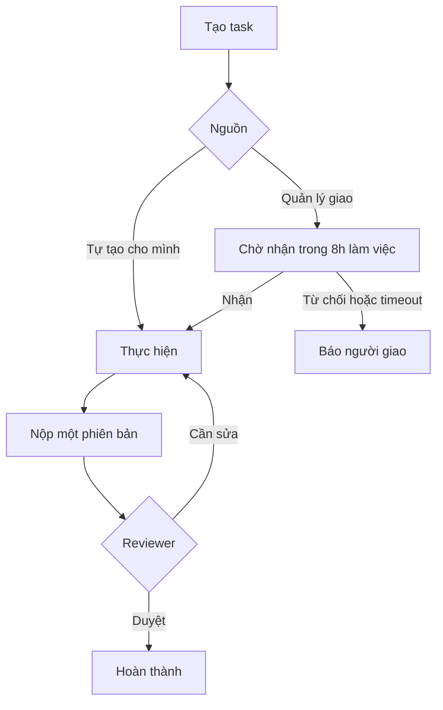
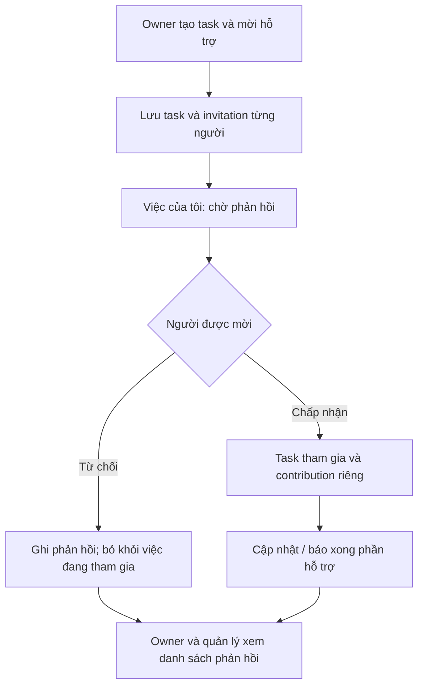

# 03 — Luồng task, checkpoint và task nhiều người
## 1. Tạo nhanh
| Trường | Lúc giao/tạo việc phát sinh | Tự điền / quy tắc |
|---|---|---|
| Tên nhiệm vụ | Bắt buộc | Text 1–255 ký tự sau trim (P kỹ thuật) |
| Người phụ trách chính | Bắt buộc | Tự điền chính nhân viên; quản lý chọn trong scope |
| Deadline | Bắt buộc | Ngày giờ VN; server lưu UTC; không dùng thời lượng dự kiến thay deadline |
| Mô tả | Tùy chọn | Yêu cầu/kết quả mong muốn/lưu ý; Enter xuống dòng |
| Tài liệu/link | Tùy chọn | Nhiều file/link, upload xong mới gắn |
| Người hỗ trợ | Tùy chọn, thu gọn | Chọn nhiều người và role hỗ trợ; không được trùng owner hoặc trùng user trong task |
| Role chính | Tự điền nếu một role | Nếu nhiều role: chọn chip, không đoán từ title |
| Loại task | OTHER mặc định | Chọn mẫu khi cần, không bắt điền kênh/series/pillar |
| Ưu tiên | NORMAL mặc định (P) | URGENT khi người tạo chọn; không phải trạng thái |
| Reviewer | Tự giải theo cấu hình | Không tự chọn người không có quyền; thiếu người duyệt hiển thị cần cấu hình |
| Campaign/content/giờ dự kiến | Nâng cao | Không bắt buộc, không gây thêm page form |

Nháp cho phép thiếu người/hạn; hành động “Giao việc” mới validate các trường bắt buộc. Task tự tạo đề xuất bắt đầu IN_PROGRESS, không phải tự gửi lời mời nhận chính mình. Role cung cấp danh mục công việc; chỉ rule/plan đã bật mới sinh việc định kỳ. Không tự tạo 20 task mỗi ngày chỉ vì có role Content.

## 2. Tách 5 loại trạng thái
1. **Task:** DRAFT → ASSIGNED → ACCEPTED → IN_PROGRESS → SUBMITTED → CHANGES_REQUESTED → IN_PROGRESS → DONE. CANCELLED là kết thúc hủy có lý do. Task bị từ chối giao hiển thị DECLINED ở UI; assignment attempt lưu lý do từ chối/timeout.
2. **Assignment attempt:** PENDING / ACCEPTED / DECLINED / TIMED_OUT / SUPERSEDED. Hết 8h là TIMED_OUT, không phải nhân viên nộp trễ.
3. **Support invitation:** PENDING / ACCEPTED / DECLINED / REVOKED. Từ chối người này không ảnh hưởng người khác.
4. **Contribution:** NOT_STARTED / IN_PROGRESS / REPORTED_DONE; “đã báo xong” là người hỗ trợ tự cập nhật, không phải task chung đã được duyệt.
5. **Suy ra:** overdue/blocked/urgent. Không cho user tự đánh dấu “đúng hạn”; không lấy URGENT làm status.

## 3. Đếm 8 giờ làm việc
- Thời điểm bắt đầu `assigned_at` do server ghi khi giao thành công trong transaction, không dựa đồng hồ client hoặc mở thông báo.
- Dùng calendar timezone Asia/Ho_Chi_Minh, T2–T7 [09:00,12:00), [13:00,18:00); cộng 480 phút trong các khoảng làm việc.
- Nếu bắt đầu ngoài giờ, chuyển tới khoảng làm việc kế tiếp. Chỉ tính giao lồng trong các khoảng; không cộng giờ nghỉ, Chủ nhật.
- Ghi `response_due_at` và `calendar_version_id` vào attempt để kiểm toán. Việc ngày lễ thay đổi sau giao có tính lại không là Q01, không âm thầm đổi.
- Nếu nhận/từ chối và worker timeout cùng lúc: lock attempt PENDING, lấy server time sau lock; yêu cầu trả lời với `now < response_due_at` mới nhận, đúng hạn tại mốc bằng hạn được coi đã hết theo P kỹ thuật Q02. Một transition cuối cùng, một notification. Worker chậm không kéo dài quyền phản hồi.
- Khi timeout: task không tự sang DONE, không ghi kết quả nộp, không tự giao lại. Người giao quyết định giao lại/hủy; tạo attempt mới, giữ attempt cũ.

| Giao thành công | Hạn phản hồi không có ngày lễ |
|---|---|
| T2 09:00 | T2 18:00 |
| T2 11:00 | T3 11:00 |
| T2 12:30 | T3 12:00 |
| T7 17:00 | T2 17:00 |
| CN 10:00 | T2 18:00 |
| T2 18:00 | T3 18:00 |

## 4. Task nhóm
Một row task, một owner. `task_support_invitations` có unique task/user cho vòng mời hiện hành; `task_support_responses`/events giữ lịch sử vòng mời. Không tạo 3 task giống nhau cho 3 supporter.

Luồng cụ thể:
1. Người tạo chọn hỗ trợ ở form thu gọn. Server kiểm tra người/role hiệu lực và scope có thể mời; lưu danh tính người mời/người nhận/role/brief chia sẻ/thời điểm.
2. Sau commit tạo notification in-app từng người. Task xuất hiện ngay ở Việc của tôi, gắn “Hỗ trợ · Chờ phản hồi”. Không phải đã đồng ý thực hiện.
3. Pending chỉ có Chấp nhận/Từ chối + ghi chú tùy chọn (P08). Double click không tạo hai phản hồi.
4. Chấp nhận: tạo membership hoạt động + contribution NOT_STARTED; người đó xem task chung và sửa contribution riêng. Không sửa owner/deadline/chung checklist nếu không được giao quyền rõ.
5. Từ chối: giữ lý do/thời điểm, thông báo người mời/owner; không làm task DECLINED, không từ chối lời mời người khác. Owner vẫn thực hiện và có thể mời người khác theo policy Q12.
6. Contribution có summary, next_step, blocker, file/link, báo xong và timestamp; có lịch sử riêng. Không auto-complete task chính khi tất cả báo xong.
7. Owner nộp kết quả chung; reviewer quyết định task. Mặc định kỹ thuật không chặn nộp chỉ vì có supporter pending/declined, trừ template có checkpoint cứng được cấu hình (Q13).
8. Role hết hạn/nghỉ việc: không còn quyền task qua supporter; giữ contribution lịch sử cho owner/manager. Không tự xóa nội dung người đó đã làm.

Không tự áp timeout 8h, bắt buộc lý do từ chối, tự mời lại hoặc quyền rút lui sau nhận cho supporter khi chưa chốt Q10–Q13. Demo hiện chỉ nhận/từ chối ban đầu, không có mời lại hay rút lui.

## 5. Checkpoint
- Checklist nhỏ không có owner/deadline độc lập thì thuộc task, không tăng task count.
- Checkpoint có tên, thứ tự, owner (nếu cần), due, evidence, reviewer, trạng thái, required flag. Chỉ required ở phase tương ứng.
- Với task SCRIPT: nhận brief → nghiên cứu → viết bản nháp → nộp → review/sửa → duyệt.
- Với SHOOT_PREP: lịch/địa điểm → người quay/diễn nếu cần → đạo cụ/shotlist → kiểm tra sẵn sàng.
- Với EDIT: nhận footage → rough cut → âm thanh/phụ đề → bản xem trước → sửa → bản duyệt.
- Nếu có trọng số, progress=sum(weight checkpoint đã đạt)/sum(weight mốc áp dụng). Không tự chia % dựa trạng thái. Không có trọng số: hiện số mốc x/y + trạng thái, % tự khai chỉ khi policy bật.
- Child task chỉ khi khác đầu ra/người chịu trách nhiệm/hạn cần quản riêng. Parent is_rollup không cộng cùng leaf vào KPI. Task hỗ trợ không tự biến thành child task.

## 6. Nộp, duyệt, sửa, đổi hạn
`task_submissions`: revision_no, submitted_by/at, payload snapshot, result text, artifact refs, requirement_version, due_at_at_submit. Immutable sau nộp. Review trỏ submission_id + expected task version.

- Nộp: ít nhất kết quả văn bản hoặc file/link hợp lệ; template chuyên môn có thể yêu cầu thêm. Upload chưa hoàn tất không tính.
- Quản lý yêu cầu sửa: feedback rõ, giữ revision cũ, có thể đưa hạn đề nghị mới; chỉ khi người có quyền đổi hạn quyết định mới cập nhật current_due_at.
- Hạn gốc không đổi; `task_deadline_changes` lưu trước/sau, lý do, người đề nghị/duyệt và hiệu lực.
- Duyệt DONE: khóa submission được duyệt + deadline cuối áp dụng tại quyết định; `timing = accepted_submission.submitted_at <= final_due_at` (bằng hạn là đúng hạn). Giờ duyệt muộn không làm nhân viên bị trễ nộp.
- SUBMITTED chờ duyệt: hiện “Nộp đúng hạn/chờ duyệt” hoặc “Nộp trễ/chờ duyệt”, chưa cộng “đã hoàn thành được duyệt”.
- DONE không sửa trực tiếp. Mở lại cần quyền/lý do (P, Q14), giữ vòng trước; báo cáo đã nộp không tự thay.
- Không tự đặt số điểm/trừ điểm cho vòng sửa. Đánh giá thái độ chỉ nhận xét có dẫn chứng, chưa cấu hình thang điểm thì ghi chưa cấu hình.

## 7. Những lỗi phải tránh
Không đóng modal khi Enter trong textarea; Enter không kích hoạt nút nộp toàn form ngoài ý muốn. Đóng khi đang lưu lỗi có cảnh báo giữ nháp. Thay template không xóa field cũ. API không chấp nhận sửa status/owner/due bằng PATCH payload chung; đi qua action có quyền. Không tạo thông báo cho mỗi autosave.
