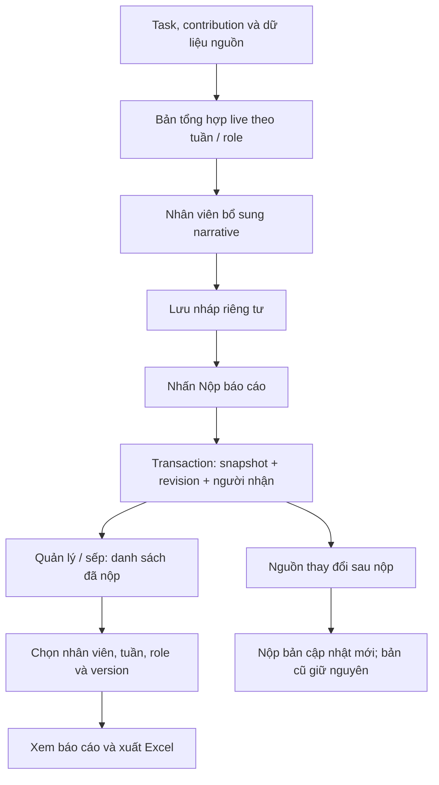

# 04 — Báo cáo tuần, dashboard, nhập dữ liệu và Excel
## 1. Báo cáo tự tổng hợp
Nhân viên không tự nhập tổng số task, số đúng/trễ hoặc chép lại danh sách. Hệ thống lấy dữ liệu chuẩn, nhân viên chỉ rà soát và bổ sung narrative. Role nào có dữ liệu riêng thì render panel riêng, không dùng một mẫu GMV cho Content/HR/Designer.

Đơn vị báo cáo cá nhân đề xuất: một employee + một khoảng tuần + một revision; bên trong có nhiều role sections. Không tạo hai bản task vì một người có nhiều role.

## 2. Tập task và phép đếm
Quy tắc chính người dùng: task phát sinh trong tuần. Demo dùng created_at thuộc tuần. Thiết kế ứng viên P05: [T2 00:00, T2 kế tiếp 00:00) theo VN; xác nhận Q05 trước khi đóng chính sách production.

| Chỉ số | Định nghĩa có thể triển khai | Chú ý |
|---|---|---|
| Phát sinh | DISTINCT task.id, created_at trong tuần, principal scope được phép, không is_rollup | Task giao lại/có owner đổi cần Q07; không đổi created_at |
| Đã làm | Trong tập phát sinh, có started_at hoặc hành động thực hiện/nộp hợp lệ trước cutoff | Không dùng số lần đăng nhập; demo dùng status, production dùng events |
| Hoàn thành | DONE tại cutoff và có approved_submission | Đã nộp nhưng chờ duyệt tách riêng |
| Hoàn thành đúng hạn | DONE và accepted_submission.submitted_at <= final_due_at | Không lấy approved_at |
| Hoàn thành trễ hạn | DONE và accepted_submission.submitted_at > final_due_at | final_due_at lưu cố định tại vòng hoàn tất |
| Chưa xong | Task trong tập còn mở tại cutoff: assigned/accepted/in_progress/submitted/changes_requested | Từ chối/hủy tách riêng, không gọi hoàn thành |
| Chưa phản hồi | Attempt PENDING chưa hết hạn | Không gộp với mọi trạng thái task chưa xong |
| Đã từ chối / timeout | Theo attempt, hiển thị nguyên nhân và task liên quan | Đếm distinct task ở summary; số attempt riêng khi drilldown |
| Hủy | CANCELLED có lý do | Không xóa khỏi lịch sử/baseline |
| Hỗ trợ đã nhận | Invitation ACCEPTED, role còn hiệu lực với người đang xem, task thuộc cohort | Tách khỏi số task phụ trách chính |
| Phần hỗ trợ đã báo xong | Contribution REPORTED_DONE | Không gọi là task đã được quản lý duyệt |
| Việc chuyển tiếp | Task tạo trước tuần nhưng còn mở/được làm trong tuần | Panel riêng, không cộng vào phát sinh tuần |

Đối chiếu: tổng task cohort = done + open + declined/cancelled + draft nếu draft có tính (Q08). Đúng hạn + trễ hạn + hoàn thành thiếu dữ liệu = done. Draft cá nhân đề xuất không tính đã giao. Không ngầm loại task khó khỏi mẫu số.

Báo cáo role dùng principal_role_id; task liên quan nhiều role vẫn chỉ một task tổng. Hỗ trợ báo theo role invitation, không theo role chính của owner. Quy tắc cohort hỗ trợ hiện theo ngày tạo task như demo; nếu muốn theo ngày nhận hỗ trợ cần Q07.

## 3. Luồng nhân viên và sếp

Bổ sung gồm: kết quả khác chưa có trong task; khó khăn/nguyên nhân chưa xong; đề nghị hỗ trợ; kế hoạch tuần tới. Không bắt buộc nhập chữ nếu đã đủ dữ liệu. Production đề xuất narrative theo role + phần chung có scope, tránh rò dữ liệu role đã hết.

Submit phải:
1. Kiểm tra user/role/scope, employee chính là người gửi; không nhận employee_id giả từ client.
2. Tính lại authoritative data ở server bằng snapshot transaction nhất quán; ghi cutoff_at, timezone, policy/schema version.
3. Ghi report_revision, sections, task snapshots, support snapshots, metric/source manifest và narrative, recipient list xác định từ manager relation/Boss scope.
4. Commit rồi phát notification. Gửi trùng cùng idempotency-key trả cùng revision. Nội dung giống hệt có thể trả lại version cũ như demo (P); không sinh revision vô ích.
5. Nếu mất mạng/DB lỗi: chưa nộp; giữ draft, cho thử lại; không hiện thông báo thành công giả.

Quản lý/sếp chỉ thấy bản đã nộp. Danh sách theo tuần hiển thị nhân viên thuộc scope, trạng thái chưa nộp/đã nộp, version, giờ nộp, Xem/Xuất. Không bấm vào “Chưa nộp” rồi đọc live draft của nhân viên. Không mặc định cần sếp duyệt báo cáo mới coi là đã nộp; phản hồi/duyệt báo cáo là extension Q09.

## 4. Snapshot và số liệu quá khứ
Báo cáo live có thể thay; bản đã nộp không thay khi task được duyệt sau đó hoặc import sửa số. Giữ toàn bộ source IDs/revisions và giá trị tại cutoff. Xuất version 1 sau version 2 phải đúng số/nhận xét của version 1, không join ngược task current để thay nội dung. Tên nhân viên/role snapshot giữ lịch sử, quyền xem kiểm tra hiện tại.

Thay role/hết role không xóa snapshot. Server lọc snapshot trả nhân viên theo quyền còn hiệu lực; manager vẫn phải còn scope quản lý lịch sử (Q20 nếu chuyển nhóm). Không gửi cả snapshot nhạy cảm để frontend che.

## 5. Các khối dữ liệu theo chuyên môn
| Role | Hệ thống tự tổng hợp từ task | Dữ liệu nghiệp vụ riêng |
|---|---|---|
| Content | Nghiên cứu, kịch bản, chuẩn bị/quay/dựng/đăng; bản được duyệt; chưa xong và blocker | Content/video/publication/live, views/likes/comments/shares/clicks/GMV khi nguồn có |
| Designer | Brief, thiết kế đã nộp/duyệt/cần sửa | Số deliverable và revision, file/link theo brief; không dùng task count thay số ảnh |
| Vận hành | Listing/kiểm tra/promo/KOC/case | GMV, tổng doanh thu, đơn/khách, hoàn/hủy, bồi hoàn, KOC đã đăng |
| ADS | Công việc ads và kết quả được giao | Chi tiêu, impression/click/conversion/attributed GMV, video/ad/campaign ID, cửa sổ quy gán |
| HR | Tuyển dụng/lịch PV/hồ sơ | Hồ sơ nhận, PV, bắt đầu thử việc, thông báo tuyển/sinh nhật; không lộ lương vào report chung |
| Kho | Task xuất/trả mẫu/kiểm tra | Xuất theo BigSeller: đơn/kiện/sản phẩm tách đơn vị; thiết bị mượn/trả |
| Kế toán | Task đối chiếu/chứng từ/yêu cầu được giao | Phiếu xử lý, thiếu chứng từ, đề nghị thanh toán/hoàn chi; chưa làm sổ kế toán đầy đủ |
| TTS | Task chuyên môn được mentor giao, review | Phần đã học, sản phẩm thực hành, góp ý; không mặc định KPI của nhân viên chính thức |

## 6. TikTok: mapping dựa screenshot người dùng
**Nguồn nhận biết:** screenshot bảng “Kết quả kinh doanh”, không phải parser đã chạy file mới. Có phần tổng quan (hàng 3–5) và dữ liệu ngày (tiêu đề hàng 9, dữ liệu hàng 10–15 trong ảnh). Production phải dò marker/header, không hardcode mọi file luôn bắt đầu dòng 9.

| Header nhìn thấy | Key dự kiến | Kiểu | Cách tổng hợp |
|---|---|---|---|
| Ngày | business_date | date | Khóa ngày + shop + source profile |
| GMV | gmv | decimal tiền | SUM theo ngày cùng phạm vi |
| Đơn hàng | orders | integer | SUM theo ngày; không đồng nghĩa SKU orders |
| Khách hàng | customers | integer | Tổng kỳ dùng số nguồn; sum ngày có thể lặp khách |
| Số món bán ra | items_sold | integer | SUM khi định nghĩa nguồn phù hợp |
| Hoàn tiền | refunds_amount | decimal tiền | Giữ riêng; không tự suy là số đơn hoàn |
| Đơn hàng SKU | sku_orders | integer | Riêng orders, không gộp |
| Tổng doanh thu | total_revenue | decimal tiền | Riêng GMV; không tự suy là ngân hàng thực nhận |
| Lượt xem trang | page_views | integer | SUM theo ngày |
| Khách truy cập | visitors | integer | Unique kỳ không tự sum các ngày |
| Tỷ lệ chuyển đổi | conversion_rate | decimal ratio | Giữ định nghĩa nguồn; không tự trung bình cộng |
| Lượt hiển thị sản phẩm | product_impressions | integer | Theo nguồn |
| Lượt hiển thị sản phẩm độc nhất | unique_product_impressions | integer | Non-additive qua ngày; dùng tổng kỳ nguồn |
| Lượt nhấp vào sản phẩm | product_clicks | integer | Theo nguồn |
| Cột bên phải bị cắt | UNMAPPED | Chưa rõ | Không đoán tên/ý nghĩa |

Ví dụ đối chiếu **từ ảnh** kỳ 26–31/10/2026: GMV 47.137.964; đơn 628; khách 607; món bán 651; hoàn tiền 5.786.767; SKU orders 635; tổng doanh thu 49.653.977; page views 10.204; visitors 6.682; product impressions 463.397; unique product impressions 255.534; clicks 10.148. Không tự đưa các số này thành dữ liệu production. Đơn vị tiền/currency và định nghĩa gross/net cần Q16 xác minh file thật.

Ảnh có kỳ so sánh 20–25/10/2026 và phần trăm thay đổi. Không lấy dòng “Tổng giá trị” cộng vào dòng ngày lần nữa. Dòng “Phần trăm thay đổi” là ratio/delta, không phải dữ liệu ngày. CR trong ảnh là số thập phân ~0,09084; hiển thị khoảng 9,08% nếu profile xác nhận lưu dạng 0–1, không hiển thị 0,09% hoặc nhân 100 hai lần.

File quảng cáo TikTok/Shopee: chưa đủ header và dòng để chốt mapping. Phải có mẫu đầy đủ, tài khoản/shop, timezone/currency và định nghĩa attribution. Không suy CTR/ROAS chỉ từ tên file.

## 7. Luồng import thống nhất
Upload → lưu file gốc private/checksum → nhận diện profile/platform/report_type/version → preview sheet/header/period → map columns → normalize ngày/số → validate từng dòng → đối chiếu tổng → xác nhận import → commit nguyên tử → tạo batch/rows/source records/revisions → tổng hợp dashboard.

- Upload mới không tự ghi dữ liệu KPI trước preview/validation.
- Business key có shop/account + platform + report_type + grain + date/window + subject IDs + metric + attribution + currency khi liên quan. Không dùng filename làm khóa.
- Checksum bắt import cùng file; row natural key bắt file khác tên cùng dữ liệu. Giao kỳ chồng lấn không append cộng lần hai; xác định revision/replace scope có xác nhận.
- Không sửa định nghĩa metric giữa hai batch mà vẫn dùng cùng definition version.
- Dòng lỗi có sheet, row_no, field, raw_value, code, message; null khác 0. Nguồn string “—”/trống không đổi thành 0 mặc định.
- Ghi định dạng số theo profile, ví dụ 1.234,56 khác 1,234.56. Không parse theo locale máy chủ ngẫu nhiên.
- Unique số kỳ và số ngày là hai grain; không cộng chéo. Unique theo tháng/tuần phải dùng report scope đúng.
- Khi revise nguồn đã nằm trong report nộp: gắn “nguồn có bản mới”, không sửa snapshot.
- Manual input dùng cùng metric definitions, validation và provenance; xung đột với import cần chọn nguồn ưu tiên theo policy Q17, không cộng cả hai.

## 8. GMV/ads/video/KOC và tránh cộng trùng
- File video hoàn thiện ≠ bài đã đăng. Cùng content đăng 2 kênh tạo 2 publications, metrics riêng.
- Video thường ≠ livestream session; chưa rõ “live” trong lời người dùng thì phải chọn loại metric, không tự hiểu là likes.
- Organic/ads/affiliate GMV có thể cùng quy gán một đơn; không cộng thành shop GMV. Tổng shop dùng nguồn tổng shop.
- Snapshot lũy kế D3=1.000, D7=3.000: tổng D7 là 3.000, tăng là 2.000; không cộng 4.000.
- ROAS chỉ dùng attributed revenue/GMV phù hợp nguồn / ad spend cùng kỳ/currency/cửa sổ quy gán; mẫu số 0 → N/A.
- Tỷ lệ tổng dùng numerator/denominator đúng định nghĩa, không trung bình tỷ lệ ngày. Chưa biết mẫu số → giữ tỷ lệ nguồn/Chưa rõ định nghĩa.
- Claim một đơn nhiều SKU: tiền bồi hoàn cấp đơn không lặp lại trên từng SKU. Có allocation được khai thì tổng allocations không vượt tiền claim.
- Người nhập chịu trách nhiệm dữ liệu; chưa gọi “đã nhận tiền” nếu mới nhập “được duyệt bồi hoàn”. Tách claimed/approved/received nếu chưa chốt Q15; UI không bịa trạng thái.

## 9. Biểu đồ và so sánh
1. Cards task cohort + nguồn/cutoff. Click card mở đúng filter.
2. Cột chồng done/open/declined/cancelled theo người, chỉ manager/Boss có scope.
3. Cột tuần này/tuần trước về task hoặc KPI cùng đơn vị; line ngày cho GMV/ad spend đặt chart riêng hoặc trục có nhãn rõ.
4. Bảng video: tuổi bài, D7/D14, nguồn, spend, views/likes/clicks/orders/GMV khả dụng.
5. Bảng support: người, accepted/declined/pending, contribution; không xếp hạng thái độ bằng số từ chối.

Đề xuất P06: kỳ kết thúc so kỳ trước đầy đủ; kỳ đang chạy so số ngày hoàn tất tương đương, ghi dải ngày. Ngày chưa đủ dữ liệu gắn Tạm tính. previous>0: delta%=(current-previous)/previous; previous=0: hiện delta tuyệt đối và “Kỳ trước bằng 0”; missing: Chưa đủ dữ liệu. Tỷ lệ thay đổi thể hiện điểm phần trăm khi so tỷ lệ; tăng chi phí không mặc định xanh.

## 10. Xuất XLSX thật
Server giải scope giống màn hình, dùng report_revision_id + filters, không nhận mảng dữ liệu do browser tự khai. Đề xuất sheet: Thong_tin, Tong_hop, Theo_role, Task_chinh, Ho_tro, Bo_sung, Nguon_du_lieu. Có tuần, employee, role, revision, cutoff, xuất lúc, người xuất, metric definition version và bộ lọc. Task filtered detail không làm summary cohort đổi mà không nói rõ.

Số tiền/numeric là ô số, date là ô ngày, mã đơn/SKU là chuỗi giữ số 0 đầu. Không chứa secrets/CCCD/lương ngoài scope. Text bắt đầu =,+,-,@ phải ghi kiểu text an toàn, tránh Excel formula injection. Nhiều dữ liệu tạo export job, trả trạng thái/URL tải được kiểm quyền; file hết hạn theo policy lưu trữ Q24. Không xuất HTML đổi đuôi .xlsx.
