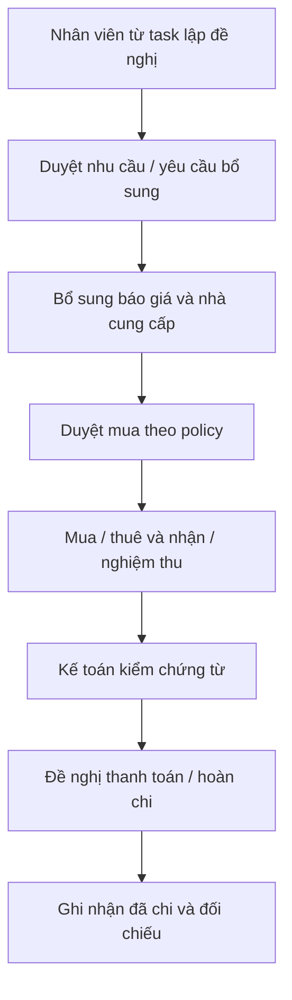

# 05 — Danh mục công việc theo role và các module bổ sung
**Toàn bộ danh mục dưới đây là thư viện mẫu đề xuất**, không phải định mức mỗi nhân viên phải làm hết. Admin/manager bật mẫu và rule cho từng role/người. Required theo phase trong config, không dồn vào Tạo task. Người dùng đã yêu cầu phân tích/đề xuất các nhóm việc; chưa xác nhận tần suất/KPI/định mức.

## 1. Content Marketing và sản xuất
| Mẫu / code | Đầu vào khi thực hiện | Checkpoint / đầu ra khi nộp | Liên kết dữ liệu |
|---|---|---|---|
| PRODUCT_RESEARCH | SKU, tài liệu, thị trường | Công dụng có nguồn, khách hàng, USP, giới hạn thông tin, ý tưởng áp dụng | products, research payload, refs |
| AUDIENCE_RESEARCH | Bình luận/phản hồi hợp lệ | Nhu cầu, pain points, câu hỏi, bằng chứng, giả thuyết | research payload; không gom dữ liệu cá nhân thừa |
| COMPETITOR_RESEARCH | Đối thủ/tiêu chí, link | Giá/nội dung/ưu đãi, ngày quan sát, so sánh, đề xuất | nhiều dòng đối thủ |
| TREND_RESEARCH | Kênh/ngành hàng | Xu hướng, ví dụ, lý do phù hợp, đề xuất thử | refs + summary |
| CONTENT_PLAN | Mục tiêu, campaign, nguồn lực | Tuần/tháng, ý tưởng, kênh, lịch, phân công | week_plan, content_items |
| IDEA | Brief/nghiên cứu | Thông điệp, angle, cách thể hiện, CTA | content_item |
| SCRIPT | Brief/ý tưởng | Hook, scenes hình/lời thoại/thời lượng, CTA; file/text/link | template payload + submission revision |
| COPY | Kênh, sản phẩm, brief | Bài/caption/FAQ/tiêu đề/CTA được duyệt | content variation |
| DESIGN_BRIEF | Nội dung chữ, nhận diện | Kích thước, layout, refs, assets bàn giao Designer | task links; có thể mời Designer hỗ trợ |
| SHOOT_PREP | Kịch bản duyệt | Ngày/giờ/địa điểm, người quay, người diễn khi cần, shot list, đạo cụ sẵn sàng | shoot_session, participants, props |
| PROP_PREP | Danh sách sản phẩm/dụng cụ | Số lượng/tình trạng/người giữ, cái thiếu, request mua/mượn | request/asset loan |
| SHOOT | Kịch bản, lịch, shotlist | Footage/file location, cảnh đủ/thiếu, ghi chú | shoot assets và task submission |
| EDIT | Footage, kịch bản, brief dựng | Rough cut → sửa → bản video hoàn thiện/phụ đề/ảnh bìa theo brief | deliverable revisions |
| PUBLISH | Bản duyệt, caption, kênh | URL hoặc platform ID + published_at + sản phẩm gắn | publications |
| COMMUNITY | Bài đăng, hướng dẫn trả lời | Tương tác đã xử lý, FAQ, case cần chuyển | summary/case; không tự đọc inbox |
| MEASURE | Publication/live + kỳ/nguồn | Chỉ số nguồn có, thiếu có lý do, phân tích và hành động | metric observations |
| PERFORMANCE_AUDIT | Nội dung và số liệu lịch sử | Nội dung hiệu quả/chưa hiệu quả, nhận định có căn cứ | report/analysis |
| OPTIMIZE | Baseline/giả thuyết | Điều chỉnh, phạm vi test, kết quả, bài học | experiment payload |
| LOCALIZE | Ngôn ngữ/brief | Bản dịch/phụ đề Việt/Hoa và người kiểm tra | content variation + revision |
| BRAND_GUIDE | Thương hiệu/phiên bản cũ | Voice/tone, nhận diện, mẫu chuẩn có version | knowledge/assets |
| ASSET_ORGANIZE | Footage/ảnh/video | Nhãn/tên/phiên bản/vị trí/quyền dùng | assets, usage_rights |
| CONTENT_INCIDENT | Bài sai/link hỏng/gắn sai SKU | Mức độ, quyết định sửa/gỡ, bằng chứng xử lý | issue + task |
| LIVE_PREP | Lịch live/sản phẩm/ưu đãi đã duyệt | Rundown/FAQ/người dẫn/đạo cụ | live_session plan |
| LIVE_SESSION | Kế hoạch phiên | Thực tế giờ/người, link/ID live, kết quả nguồn | live session riêng video |
| KOC_BRIEF | Sản phẩm/hợp tác | Brief, feedback, nội dung KOC được kiểm | KOC collaboration |
| OTHER | Mô tả tự do | Văn bản hoặc file/link | Không ép schema Content |

Không bắt diễn viên nếu video chỉ quay sản phẩm. Một buổi quay có nhiều nội dung; một nghiên cứu dùng nhiều video; một bản dựng có thể đăng nhiều kênh. Không dùng content_item = task = publication.

## 2. Designer
Mẫu: ảnh sản phẩm, banner chiến dịch, cover/thumbnail, key visual, template, chỉnh theo review, bàn giao file nguồn. Brief có mục tiêu/kích thước/nội dung chữ/brand assets; output file preview, bản final và file nguồn khi brief yêu cầu. Revisions có link/file, feedback và trạng thái duyệt. Designer nhận lời mời từ Content qua cùng cơ chế task nhóm; công việc có deadline/đầu ra độc lập có thể là task riêng với relation, không copy task hỗ trợ thành hai task không liên kết.

## 3. Vận hành sàn TikTok/Shopee
| Mẫu | Dữ liệu đầu vào | Đầu ra / dữ liệu báo cáo |
|---|---|---|
| LISTING_CREATE / UPDATE | SKU/ảnh/mô tả/biến thể | Checklist listing, external product ID/link, phần đã sửa |
| LISTING_AUDIT | Sản phẩm/chiến dịch | Sai/thiếu ảnh/giá/biến thể/mô tả, evidence và follow-up |
| PRODUCT_SEO | Keyword/source | Tiêu đề/mô tả trước sau, ngày thay đổi, hiệu quả nếu có |
| PROMOTION_PREP | Chương trình được duyệt | Sản phẩm/giá/khung giờ, file/link kiểm tra |
| SHOP_DAILY_REVIEW | File ngày | Số nguồn, bất thường, task xử lý |
| SHOP_WEEKLY_REPORT | Kỳ/shop/import batch | Hệ thống tổng hợp; nhân viên bổ sung nguyên nhân/kế hoạch |
| ORDER_CASE | ID đơn, SKU, issue | Trạng thái case, evidence, hạn xử lý theo nguồn |
| RETURN_CANCEL_REVIEW | File hoàn/hủy | Số đơn/tiền theo đúng ngày trạng thái và definition |
| COMPENSATION_ENTRY | ID đơn, SKU, amount | Người nhập/giờ nhập, trạng thái bồi hoàn đã được chốt |
| KOC_BOOKING / FOLLOWUP | Tiêu chí, brief, hợp tác | KOC được liên hệ/nhận/đăng, lịch, link, kết quả |
| SAMPLE_SHIP_FOLLOWUP | KOC/mẫu/vận đơn | Đã gửi/nhận, evidence, liên kết yêu cầu xuất mẫu |

KOC có nhiều bài đăng và nhiều lần hợp tác. Cần tách contact, collaboration, deliverable và publication; không ghi một cột video_url duy nhất cho cả KOC. Phí KOC/mẫu/ads không tự trở thành chi phí kế toán đã ghi nhận.

## 4. ADS
Mẫu: kế hoạch chiến dịch, thiết lập ads (chỉ ghi nhận task nếu chưa có API), kiểm tra creative, theo dõi ngân sách/hiệu quả, điều chỉnh, import báo cáo, phân tích video/campaign, tổng kết tuần. Fields theo account/campaign/ad/creative/video, ngày hoặc window, spend/currency, impressions/clicks/orders/attributed GMV có nguồn và attribution window. Không mặc định vận hành và ADS cùng nhập lại một khoản chi; ownership nguồn cần Q17.

## 5. HR
- Tiếp nhận CV/portfolio, ghi người tuyển/giới thiệu, vị trí, nguồn, ngày nhận.
- Application riêng theo vị trí; một ứng viên có thể ứng tuyển nhiều lần; dedupe người theo thông tin được phép, không suy tên giống là một người.
- Lịch phỏng vấn: ngày giờ, interviewer, trạng thái; không gửi email/SMS thật nếu chưa cấu hình và được giao tác vụ gửi.
- Kết quả tuyển và quyết định nhận việc do người có thẩm quyền ghi; không cho hệ thống tự quyết định phù hợp dựa dữ liệu nhạy cảm.
- Tạo employee từ candidate khi nhận việc; record ngày thử việc/chính thức, hợp đồng, bằng cấp và dữ liệu nhạy cảm theo quyền.
- Bắt đầu thử việc → một notification HR về thưởng người tuyển; correction không gửi thưởng trùng. Không tự tính tiền vào payroll.
- Sinh nhật: đang làm/đang thử việc, báo HR trước 5 ngày làm việc; ngày lễ/29-02/nghỉ việc cần Q01/Q19.
- Bàn giao/nghỉ việc: trạng thái account và role thu hồi, transfer task theo người có quyền, giữ lịch sử. Không xóa task/CV/hợp đồng khi disable.

## 6. Kho / thiết bị
BigSeller là nguồn tồn. Web lưu external reference, import snapshot và báo cáo xuất, các yêu cầu xuất/trả mẫu, mượn/trả thiết bị. Không cho nhập số tồn tùy ý rồi overwrite tồn chuẩn. Phân biệt số đơn/kiện/món và đơn vị quy đổi có nguồn.
Thiết bị mượn có unit/serial hoặc asset tag, người giữ, lịch mượn/due back, tình trạng giao/nhận, evidence; cảnh báo trùng lịch là P cần Q21 mức chặn/cho override. Mẫu tặng KOC khác mẫu mượn quay phải trả. Không tự tăng/giảm tồn BigSeller nếu chưa có tích hợp được xác minh.

## 7. Kế toán, mua hàng, hóa đơn
Yêu cầu người dùng: có đề nghị mua dụng cụ và mục hóa đơn để quản lý/sếp phê duyệt. Phạm vi dưới đây là thiết kế mở rộng P; hạn mức/người duyệt/pháp nhân/các bước cần Q22–Q23.

Các loại request: PURCHASE, RENTAL, EQUIPMENT_LOAN, SAMPLE_ISSUE, ADVANCE, REIMBURSEMENT, SALES_INVOICE_REQUEST, DOCUMENT_COLLECTION.
- Fields lúc đề nghị: loại, mục đích, task/campaign liên quan tùy chọn, ngày cần, item/qty/unit, số tiền dự kiến/currency khi đã có, tài liệu/quote nếu có.
- Chưa có giá: duyệt nhu cầu/lấy báo giá, không được coi là duyệt mua ngân sách không giới hạn.
- Approval policy lưu version/steps/approvers snapshot. Thiếu policy không auto-approve; hiển thị Chưa cấu hình người duyệt.
- Đổi số tiền/NCC/pháp nhân/phạm vi sau duyệt phải vào reapproval theo policy, không lén sửa bản đã duyệt.
- Nhận hàng/dịch vụ một phần, chứng từ một phần, thanh toán một phần là trạng thái khác nhau. Task “mua mic” hoàn thành không tự biến invoice thành đầy đủ hoặc payment thành đã chi.
- Nhân viên đã chi: reimbursement cho nhân viên; không tự tạo thêm thanh toán NCC cùng khoản.
- Thu thập hóa đơn mua vào ≠ yêu cầu xuất hóa đơn bán ra. Web chưa tự phát hành hóa đơn điện tử; kế toán ghi external_invoice_id/status/file sau xử lý ở hệ thống được phép.
- Tạm ứng ghi được duyệt/đã giải ngân/chưa quyết toán/quyết toán; không đồng nghĩa chi phí mới.
- Dashboard chi phí không cộng PR + PO + invoice + payment bốn lần. Cost actual/commitment/cash là ba góc nhìn, ghi nguồn tính rõ.
- Kho/phần tài chính không được tự gắn kết chéo hai công ty chỉ vì cùng nhân viên; company_id phải nhất quán hoặc workflow liên công ty được duyệt riêng.

Không đưa các luật thuế, BHXH, hạch toán hay ký hóa đơn chưa được xác nhận vào logic tự động. Thiết kế này là quản lý hồ sơ/luồng, không tư vấn pháp lý hay phần mềm kế toán thay thế.

## 8. TTS, mentor và Tester
TTS: role chuyên môn + level INTERN + supervisor/mentor assignment có hiệu lực. Task học/thực hành có brief, đầu ra, review của mentor. Không tự xuất bản/quản ngân sách/phê duyệt nghiệp vụ nhạy cảm.
Tester là module đề xuất: issue title, module/page, build/environment, steps, expected/actual, severity, evidence, assigned dev, fixed_build, retest result. Nếu chưa bật role Tester thì không hiện menu.

## 9. Những bổ sung nên cân nhắc, chưa mặc định bật
Trung tâm tài nguyên/brand guide; quyền sử dụng ảnh/nhạc/KOC có ngày hết hạn; quản lý lịch thiết bị; checklist onboarding/offboarding; báo cáo chất lượng dữ liệu; audit truy cập bí mật; hỗ trợ tìm kiếm task/tài liệu theo scope; phản hồi của nhân viên với nhận xét quản lý; cảnh báo backlog. Không triển khai như yêu cầu đã chốt nếu chưa ưu tiên.

## 10. Kho tài khoản nền tảng và phần mềm
Danh mục người dùng đã nêu: TikTok, Shopee, Facebook, Zalo, email, Google, ChatGPT, NAS và tài khoản nội bộ khác. Mỗi account có nhãn/login, pháp nhân hoặc phạm vi sở hữu, grant cho người/role/hạn, người duyệt. Người được quyền xem hiện tại được cập nhật bản lưu theo yêu cầu. Nhân viên đổi thật trên nền tảng trước rồi xác nhận cập nhật web; web không tự đồng bộ. Admin mới xem lịch sử giá trị trước/sau qua encrypted versions. Các subscription/ghế phần mềm/gia hạn/phí là module đề xuất P, chưa có chu kỳ/phí/auto-renew được chốt; không tự mua/gia hạn hay tính vào chi phí chiến dịch.
