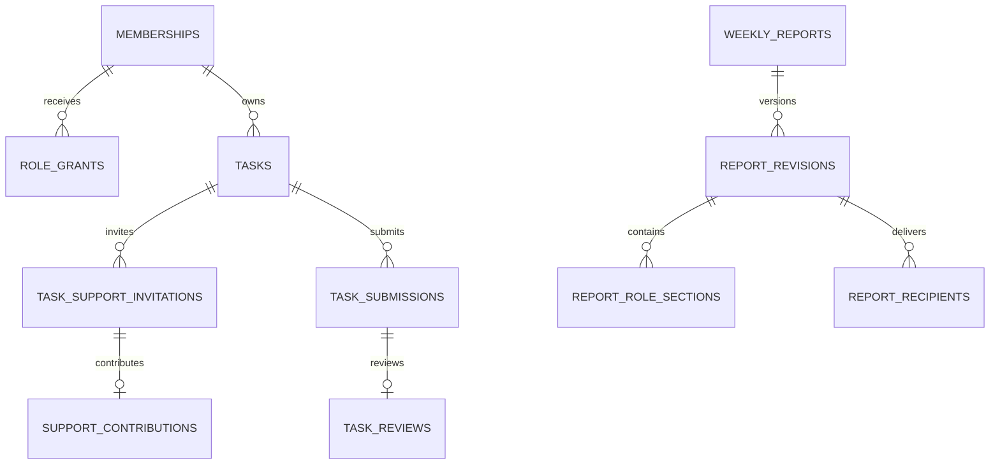

# 07 — Database, lưu trữ, tính toàn vẹn và tối ưu
## 1. Phạm vi của thiết kế
`database/schema.sql` là **DDL ứng viên PostgreSQL**, không phải migration production đã chạy. `catalog.json` và `DICTIONARY.md` cùng sinh từ một catalog nên tên/cột/kiểu/FK nhất quán. Catalog có 110 bảng scoped và 2 bảng root cho toàn bản thiết kế nhiều module; **không yêu cầu dựng cả 112 bảng trong MVP**. Các module mua hàng/tài chính/kho thiết bị/tri thức là extension, không bật nghiệp vụ chưa được chốt chỉ vì có bảng.

Bản DDL bảo đảm PK, unique, CHECK cơ bản, FK cùng workspace và bất biến một số lịch sử. Nó **chưa** có auth, RLS hoàn chỉnh, trigger tất cả invariants, mọi quan hệ N:N tài chính nâng cao, migrations thực tế, seed production hoặc worker. Codex phải chia migration theo phase, kiểm thử và bổ sung các invariant dưới đây; không chạy nguyên file vào dữ liệu đang dùng.

## 2. Nguyên tắc nền
- Workspace là ranh giới tổ chức; legal_entity/company là pháp nhân. Một web có thể nhiều pháp nhân nhưng không tự gộp số. Phạm vi cụ thể chờ Q22.
- Users toàn cục chỉ danh tính/auth_subject/status; memberships thuộc workspace. Không tạo một bảng mỗi người/role/tháng.
- Tasks dùng chung; principal role, type/template version, source độc lập. Supporters là quan hệ, không bảng ContentTasks/AccountantTasks riêng.
- UUID; FK dạng `(workspace_id, target_id)` tới `(workspace_id,id)` ngăn link chéo tenant. users là FK global duy nhất có chủ đích. API resolve ID phải luôn kèm workspace.
- UTC timestamptz lưu sự kiện, Asia/Ho_Chi_Minh hiển thị; business_date là date theo nguồn. Numeric tiền + currency, không float. Tỷ lệ cần precision cao hơn tiền; metric observations numeric(28,10), không ép 2 chữ số.
- File video/ảnh/hợp đồng nằm private object storage hoặc NAS có lớp quyền thực; DB chỉ metadata/private key. Không nhét video base64 vào JSON/DB.
- JSONB dùng cho brief mềm/form schema/narrative/snapshot immutable; fields filter/sort/FK/số tiền/số lượng giao dịch nằm cột/bảng chuẩn.
- Audit/event append-only. Không hard delete lịch sử task/report/chứng từ/secret version. Retention xử lý riêng theo policy, không tự purge dữ liệu thật.

## 3. Nhóm bảng và phase
| Nhóm | Bảng chính | Phase |
|---|---|---|
| Identity/permissions | users, workspaces, memberships, teams, job_roles, access_roles, permissions, role_grants, manager_relations | A nền bắt buộc |
| Calendar/task | calendar_versions, task_types/templates/rules, tasks, assignment_attempts, owner_history, payloads, updates, checkpoints, blockers, submissions/reviews/events/deadline_changes | A lõi; recurring sau core |
| Collaboration | task_support_invitations/responses, support_contributions/events | A trước nghiệm thu task nhóm |
| File/audit/jobs | assets/asset_permissions/task_assets, notifications, outbox_events, audit_events, idempotency_records | A |
| Plans/reports | week_plans/items, report_periods, weekly_reports/drafts/revisions/sections/recipients, export_jobs | A/B báo cáo thật |
| Content | products, campaigns, content_items, task_content_links, deliverables/versions, shoot_sessions/participants/props, channels/publications/live | B |
| Metrics/import/KOC | definitions/subjects/observations, import_profiles/batches/rows, koc_*, order_claims/claim_sku_lines | B/C sau mẫu nguồn |
| HR/secrets | candidates/applications/interviews/employee_profiles/terms/events; platform_accounts/grants/credential_versions | C, quyền nhạy cảm riêng |
| Requests/approval | requests/lines, approval_policy_versions/instances/steps | C lõi; policy Q trước bật |
| Procure/finance | partners, purchase_orders/lines, receipts/lines, bills/matches, advances/expense/payment/invoice_request | D extension, chưa sổ kế toán |
| Equipment/inventory/knowledge | equipment_units/loans, sample_fulfillments, inventory_source_records, knowledge/rights | D; BigSeller chuẩn tồn |

Không tạo trước kho dữ liệu tài chính giả để đủ bảng. Khi triển khai MVP chỉ lấy closure FK cần thiết; ví dụ products/campaigns nếu tasks có FK thì tạo bảng context tối thiểu hoặc tạm bỏ FK nullable trong migration đầu có kế hoạch bổ sung. Không sửa tên cột ad hoc lệch catalog mà không cập nhật docs/tests.

## 4. Quan hệ cốt lõi

Snapshot report không chỉ giữ FK; giữ cả dữ liệu lúc nộp. Snapshot reference phục vụ drilldown/source lineage, không lấy live record ghi đè quá khứ.

## 5. Invariants cần service/constraint trigger — DDL chưa đủ
| Invariant | Kiểm tra ở đâu / khi nào |
|---|---|
| Role còn hiệu lực, account active, scope đúng | Server mỗi read/write/export/download; không chỉ khi login |
| Grant không vượt quyền cấp và phạm vi người cấp | Grant service transaction, audit |
| Khoảng manager/role trùng không tạo quyền bất ngờ | Service lock member; exclusion constraint theo business key nếu policy cần |
| Supporter khác owner, không duplicate active vòng mời | Unique partial index + kiểm owner/role trong invite service; transfer owner phải xử lý supporter cũ |
| Contribution chỉ invitation ACCEPTED và chính invitee | Service/trigger; task closed thì chặn sửa trừ luồng mở lại |
| Một pending assignment hiện hành, timeout/accept nguyên tử | Partial unique + SELECT FOR UPDATE + server time check |
| Owner task/current assignment/history nhất quán | Transfer service một transaction; close old interval, new attempt/history |
| Submission actor là owner; không reviewer tự duyệt | Submit/review service; Admin override riêng có policy/audit |
| DONE có approved submission cùng task | Review service/deferrable constraint trigger; không PATCH status trực tiếp |
| Review đúng revision và expected_version | Transaction + task row lock; 409 nếu stale |
| current due và original due/history nhất quán | Deadline service; original immutable sau giao; không sửa DONE |
| Checklist/checkpoint/file cùng task và scope | Composite FK cùng workspace chưa đủ; service/trigger check task_id matching |
| Không cycle task parent/dependency | Recursive validation ở transaction; lock vùng graph cần thiết |
| Publication dùng bản duyệt của content tương ứng | Service check submission/review/content link, không chỉ version FK |
| Không cộng metric grain/ngồn/currency khác nhau | Aggregation service theo definition/profile version |
| Metric business key chuẩn hóa và revision nối đúng | Server sinh key, không tin key client; concurrent revision lock |
| Report snapshot/sections/recipient cùng transaction | Report submit service, immutable trigger sau ghi |
| COMMON narrative lộ role đã hết | Serialize/filter server theo scope IDs, không CSS hide |
| Claim allocations <= amount, không lặp tiền theo SKU | Claim transaction + sum lock |
| PO/receipt/bill/payment cùng company/currency | Service/trigger; FK workspace không tự chặn cross-company |
| Receipt accepted total không vượt qty trừ policy | Lock PO line trước ghi nhiều receipt |
| Payment allocations tổng <= payment amount và target outstanding | Lock payment/targets; không chỉ check từng dòng |
| Không hoàn nhân viên và trả NCC trùng chi phí | Nguồn expense/bill identity + allocations transaction |
| Xóa/retention file không làm mất evidence lịch sử | Referenced asset retention/legal policy; soft archive |
| Mật khẩu platform là ciphertext, key nằm ngoài DB | Vault service/KMS; logs chỉ version refs |

Schema tài chính trong catalog là **skeleton quản lý hồ sơ**, chưa đủ cho matching nhiều-nhiều PO ↔ nhiều request lines ↔ invoice lines ↔ receipts/service acceptances. Nếu mở phase D, phải bổ sung các bảng `purchase_request_allocations`, `vendor_bill_lines`, `bill_line_matches` cấp invoice line, `advance_settlements`, `payment_request_allocations`, `service_acceptances`, `cost_allocations` và constraint sum/company/currency; không gọi skeleton là sổ tài chính hoàn chỉnh. Kho MVP không có stock posting ledger để cạnh tranh BigSeller.

## 6. Hình dạng snapshot bắt buộc
`principal_task_snapshot[]`: task_id/code/title, owner_id/name snapshot, principal_role_id/name, type/template_version, source, created_at, status_at_cutoff, started_at, original_due_at, final_due_at, accepted_submission_id/submitted_at, approved_at, timing_result, next_step/result/blockers, artifact metadata đã lọc quyền, assignment history refs.
`support_task_snapshot[]`: task_id/title/owner snapshot, invitee_id, support_role_id, invitation_round/status/responded_at, contribution_state/summary/next_step/blocker/reported_done_at, evidence refs.
`carryover_snapshot[]`: task cũ, các field tương tự, exclusion_reason=CREATED_BEFORE_PERIOD.
`summary_snapshot`: cohort policy/version/ranges; principal counts; support counts; cancelled/declined/unknown; no point score unless configured.
`data_snapshot` role: KPIs [{code,definition_version,value,unit,aggregation,missing_reason,source_refs}], chart datasets, coverage và cutoff.
`narrative_snapshot`: results,difficulties,support,next_week; scope_key/role_scope_ids.
`source_manifest`: definition versions, source batch/row/observation IDs+revision/hash, calendar version, permission context metadata không có secrets.

## 7. File và secrets
Upload: initiate API → private object → finalize checksum/mime/size → asset READY → link vào task/record. Upload dở không dùng làm evidence. Giới hạn loại/size/retention cần Q24, cấu hình môi trường, không hardcode 10MB cho video. Quét an toàn file và URL allowlist là thiết kế bảo vệ P.

Platform secrets: AES-GCM hoặc vault authenticated encryption tương đương do triển khai chọn; key version/KMS ở ngoài DB; credential_versions có ciphertext/nonce/key_version/actor/time. Current = version hợp lệ mới nhất, update append version không overwrite cũ. Admin có thể reveal version trước/sau theo R33; audit reveal không chứa plaintext. Website password hash không decrypt, không log old/new. Backup secrets cần key lifecycle/restore tách quyền; không backup key cạnh ciphertext trong cùng ZIP public.

## 8. Hiệu năng và vận hành
- Index theo workspace/owner/status/due, invitations invitee/status, reviewer/status, report employee/period, metric subject/date, import business_key, notification unread, pending jobs. Phân trang cursor; tìm kiếm title/code với index phù hợp stack.
- Dashboard aggregate theo scope rồi cache với key chứa permission_version + filter + cutoff; role revoke không trả cache dữ liệu cũ. Không cache secret plaintext.
- Không partition/microservices/EAV ngay từ đầu. Đo query/EXPLAIN trên volume đại diện trước tối ưu sâu.
- updated_at và row_version do server cập nhật ở mọi mutation; SQL ứng viên chưa tự touch mọi bảng. History immutable được INSERT mới, không update timestamp.
- Backup tự động + restore rehearsal, mã hóa, quyền truy cập; RPO/RTO/lưu trữ phải chốt Q25. Không hứa thời gian khôi phục chưa test.
- Migrations expand→backfill→validate→switch→contract; không drop legacy dữ liệu trước đối chiếu/backup. Source demo không phải data migration nguồn thật.

## 9. Yêu cầu môi trường production
Dedicated runtime DB role ít quyền, không owner/BYPASSRLS. Application authorization là bắt buộc; bổ sung RLS tenant và file scope như defense in depth theo auth context tin cậy. Không cho frontend trực tiếp DB/vault. Không dùng bảng permission grant client tự thay. Data encryption/session/CSRF/CORS/rate limit theo runtime được chọn và test; không nhúng secrets vào bundle.

## 10. Bổ sung đối tượng HR/kho và import chung
`employee_documents` lưu bằng cấp/giấy tờ qua asset ID + sensitivity, không chỉ hai link CV/portfolio. `warehouse_outbound_records` giữ dòng xuất BigSeller theo external transaction/line ID, order/package/qty/unit để tính riêng số đơn/kiện/sản phẩm, không lấy snapshot tồn suy ra xuất. `import_batches` có company_id/source_system và channel_id nullable; nguồn TikTok/Shopee bắt buộc channel ở service, nguồn kho BigSeller gắn company và không bắt tạo shop giả.
