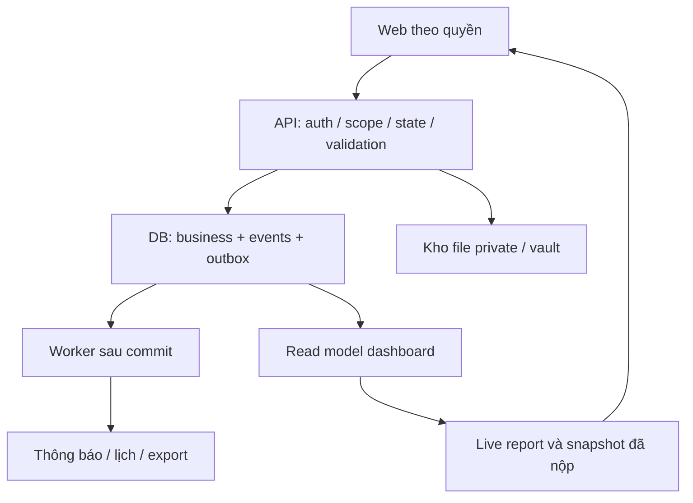

# 08 — Hợp đồng API và luồng xử lý server
## 1. Quy ước
Đề xuất REST JSON, có thể server actions tương đương nhưng giữ semantics. Prefix `/api/v1`; identity/workspace từ session server, không tin role/client employee_id. Time ISO UTC, local date rõ timezone. List cursor pagination `{items,next_cursor,total_if_available,capabilities}`; detail `{data,row_version,capabilities}`.
Mutation có `Idempotency-Key` với create/action/import commit/report submit và `expected_version` với sửa; cùng key + body khác trả 409. Response errors `{code,message,field_errors,request_id,retryable}`; không stacktrace/secret. Timestamps/actor/state terminal do server ghi.

## 2. Endpoint contract
| Route | Payload chính | Quyền / kết quả |
|---|---|---|
| GET /me | — | identity, active roles/scopes, menu/actions, permission_version |
| GET /directory/invitees | query, task context | Chỉ ID/tên/role mời được; không lộ hồ sơ/công việc |
| GET /task-types | role/phase | Chỉ template enabled trong quyền |
| POST /tasks | title,owner_id,due_at,role_id,type_id?,description?,assets?,supporters[] | Tạo task và invitations cùng transaction; không yêu cầu field chuyên môn chưa tới phase |
| GET /tasks | mode=mine/team,role,status,owner,giver,from,to,participation,cursor | Scope server; mode mine gồm chính/hỗ trợ hợp lệ |
| GET /tasks/:id | — | Payload theo role/participation, pending invite chỉ brief an toàn |
| PATCH /tasks/:id | title/description/payload allowed,expected_version | Không cho status/owner/due bypass action |
| PATCH /tasks/:id/payload | values,expected_version | Validate draft schema; không bắt field SUBMIT |
| POST /tasks/:id/assignment-response | decision ACCEPT/DECLINE,note?,expected_version | Chỉ người nhận; check 8h theo server; một kết quả terminal |
| POST /tasks/:id/start | expected_version | Owner đã nhận |
| POST /tasks/:id/updates | summary,next_step,progress? | Owner; % chỉ khi policy |
| POST /tasks/:id/blockers | reason,help_owner_id?,expected_resolve_at? | Owner hoặc contribution-specific route |
| POST /tasks/:id/submissions | result_text,payload,artifact_refs,expected_version | Owner, phase validate, creates immutable revision |
| POST /submissions/:id/review | decision,feedback?,deadline_request?,expected_task_version | Reviewer; đúng revision, không tự duyệt |
| POST /tasks/:id/deadline-requests | new_due_at,reason | Không tự đổi final due nếu chưa có quyền quyết định |
| POST /deadline-requests/:id/decision | APPROVE/REJECT,expected_version | Scope manager/reviewer theo policy |
| POST /tasks/:id/transfer | new_owner,role,reason,expected_version | Manager, tạo attempt/history mới |
| POST /tasks/:id/cancel | reason,expected_version | Người có quyền; history giữ |
| POST /tasks/:id/reopen | reason,expected_version | Extension Q14 trước bật |
| POST /tasks/:id/support-invitations | invitees[{user_id,role_id}],expected_version | Mời thêm sau tạo là extension Q12; create ban đầu đã có |
| POST /support-invitations/:id/response | ACCEPT/DECLINE,note? | Chính invitee, role còn hạn; không đổi task.status |
| PATCH /support-invitations/:id/contribution | summary,next_step,blocker,artifact_refs,reported_done,expected_version | Chính invitee ACCEPTED, task chưa đóng |
| GET /reports/live | employee=self,period,role | Tự tổng hợp chính/hỗ trợ/chuyển tiếp; manager không đọc narrative draft người khác |
| PUT /reports/draft | period,scope_key,narrative,expected_version | Employee self; autosave riêng tư |
| POST /reports/submit | period,expected_draft_versions,expected_source_etag? | Server recompute, snapshot/version/recipients/outbox atomic |
| GET /reports/submitted | period,employee?,role? | Manager/Boss scope, latest status list |
| GET /reports/:id/revisions/:n | role? | Snapshot đã nộp, filter ACL hiện tại |
| POST /report-revisions/:id/exports | filters,format=XLSX | Theo revision, scope, file job |
| POST /imports | asset_id,profile_id?,channel_id | Batch chưa commit |
| POST /imports/:id/preview | sheet/header/mapping/profile version | Rows/errors/period/totals/duplicate decisions |
| POST /imports/:id/commit | preview_hash,conflict_resolution | Authorized source writer; atomically commit validated rows |
| POST /metrics | subject,definition,window,as_of,value/missing_reason,source | Manual đúng schema, provenance; không fake 0 |
| POST /claims | order,sku_lines,amount,currency,stage?,note | entered_by/at server; total đúng cấp đơn |
| POST /assets/initiate; POST /assets/:id/finalize | filename,size,mime,sha256/context | Upload private/verify trước link |
| GET /assets/:id/download | — | ACL hiện tại, audit khi nhạy cảm |
| GET /notifications; POST /notifications/:id/read | cursor/id | Recipient self |
| POST /role-grants; POST /role-grants/:id/revoke | role,scope,from/to,reason | Admin/delegated scope; invalidate cache |
| GET /platform-accounts | — | Chỉ granted account role active; masked mặc định |
| POST /platform-accounts/:id/reveal | reason? | Current reveal có audit |
| POST /platform-accounts/:id/versions | secret,external_changed_confirmed,note | Encrypted append; không log request body |
| GET /platform-accounts/:id/history; POST /credential-versions/:id/reveal | — | Admin only; trả metadata trước, reveal riêng |
| POST /employees/:id/probation-start | actual_start_date | HR; event notification dedupe |
| POST /requests; POST /requests/:id/submit | typed request + version | Policy required; không auto approve nếu thiếu |
| POST /approval-steps/:id/decision | decision,note,expected_version | Actor step hiện hành, không stale revision |

Request đầy đủ/response JSON minh họa trong `config/api_examples.json`; UUID giả chỉ fixture, không dùng làm user thật.

## 3. Transaction điển hình
### Giao task có hỗ trợ
Validate auth/scope/template/calendar/roles → reserve idempotency key → INSERT task + assignment attempt + invitations + shared file links + task event + outbox events → commit → trả task ID/capabilities → worker gửi in-app. Nếu invitation một người invalid: đề xuất không commit một phần âm thầm; trả field error để sửa danh sách (P).

### Phản hồi hỗ trợ
Load invitation FOR UPDATE → validate actor/role active/status PENDING → update status/responded_at → INSERT response event → ACCEPT tạo contribution nếu chưa có → outbox notify owner → commit. Retry cùng key trả kết quả cũ. DECLINE không sửa task/status/owner; không tạo bản task khác.

### Nộp task và duyệt
Lock task → check owner/version/state/schema/file READY → INSERT submission immutable → update task SUBMITTED,row_version → event/outbox → commit. Review lock task + submission → validate reviewer/correct revision → INSERT review → DONE và khóa timing hoặc CHANGES_REQUESTED → event/outbox → commit. Review v1 sau khi đã có v2 phải 409, không duyệt nhầm v2.

### Nộp báo cáo
Lock report container employee/period → đọc nhất quán nguồn tại cutoff trong transaction → đọc authorized draft → validate role sections → tăng revision_no theo unique/lock → INSERT revision/sections/recipients + outbox → commit. Lưu bản snapshot mà sếp sẽ xem; nguồn thay sau đó không đổi report. Nếu không giải được manager/Boss recipient: lưu draft + lỗi cấu hình cụ thể, không báo đã gửi cho người giả. Recipient nhận và quyền đọc là hai lớp; thêm người nhận không được vượt quyền (Q09/Q20).

## 4. Worker/jobs
| Job | Trigger / tần suất đề xuất | Dedup / điều kiện |
|---|---|---|
| Assignment timeout | Queue đúng response_due_at, sweeper fallback ~1 phút P | attempt_id + timeout; check PENDING và now >= due |
| Notification dispatch | Sau outbox commit | event/recipient/type; retry backoff; không secret payload |
| Role expiry maintenance | Tại thời điểm hết hạn và sweeper | Không dựa job để chặn quyền; API luôn check time |
| Recurring task generation | Chỉ rules enabled theo local calendar | rule_id+assignee+occurrence_key unique |
| Birthday reminders | Hằng ngày theo cấu hình | employee/year/notification type; active employment |
| Recruitment notice | Employment event PROBATION_STARTED | employee/term event; correction không gửi thưởng lặp |
| Export generator | Sau POST export | export job ID, permission check lúc tạo/tải |
| Import processing | Sau upload/commit | batch/business key/revision; fail hiển thị trạng thái |
| Source reaggregation | Batch committed / metric correction | revision-aware, không rewrite submitted reports |

Tần suất job/retention/backoff là cấu hình kỹ thuật P, không phải SLA người dùng đã chốt. Job lỗi có attempts/last_error/dead letter, admin thấy để xử lý. Không report thành công khi job chưa làm xong.

## 5. Đồng thời, lỗi mạng và bảo mật
Optimistic concurrency row_version, update chỉ khi expected match; trả 409 giữ nháp. Pending/approve/submit dùng pessimistic lock khi quyết định terminal. Idempotency store cùng transaction, key payload hash chống replay khác nội dung. Connection mất sau commit: retry cùng key lấy kết quả, không nộp thêm revision.

Sessions secure/httpOnly theo stack; CSRF cho cookie mutations; scope mỗi route; rate-limit login/reveal; logs redact secrets, identity docs, request bodies nhạy cảm. Không fetch server URL người dùng tùy ý để tạo thumbnail (SSRF); phase đầu chỉ lưu URL hợp lệ, preview theo allowlist nếu bổ sung.

## 6. Luồng hệ thống

